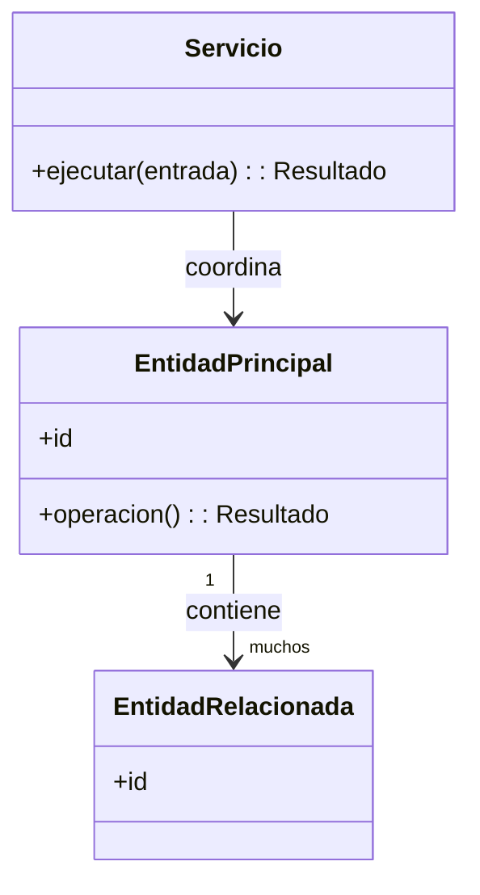
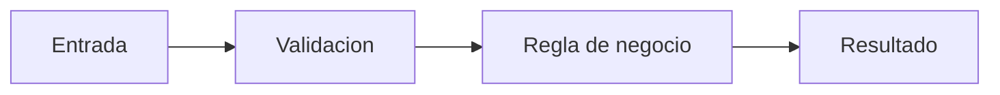

# PRD: [Nombre de la funcionalidad]

**Ticket**: [Historia de usuario o referencia del ticket]
**Autor**: [Equipo o persona]
**Fecha**: [Fecha]
**Estado**: Borrador | En revision | Aprobado

---

## 1. Contexto y Objetivo

[2 o 3 frases: que problema resuelve y que quiere lograr el usuario]

> **Alcance estricto**: [Que SI entra y que NO entra en este PRD]

**Sketch heredado**: `docs/design/<slug>-sketch.md` | No aplica | `sketch: skipped`
**UI lock**: locked | not-applicable | missing
**Visible UI**: Si | No

_PRD compacto: una seccion que no aplica se reduce a una linea `No aplica: razon`; no se rellenan placeholders._

_Si el PRD pertenece a una epica, insertar aqui las secciones "Contexto de Epica Padre" y "Contrato entre Fases" desde `template-sections/epic-context.md`. Si no, omitirlas._

### Estado Actual

| Capa                  | Componente    | Archivo           |
| --------------------- | ------------- | ----------------- |
| [Modulo/Servicio/...] | [Nombre real] | [ruta/al/archivo] |

---

## 2. Requerimientos Funcionales

### 2.1 [Grupo de requerimientos 1]

[Tabla de entradas, salidas o parametros nuevos; los campos persistidos van en 3.1]:

| Elemento | Tipo | Obligatorio | Descripcion |
| -------- | ---- | ----------- | ----------- |
| ...      | ...  | ...         | ...         |

### 2.2 Regla de Negocio: [Nombre]

> **Decision confirmada**: [Regla de negocio exacta, en un parrafo claro]

**Condicion de aplicacion**: [Cuando se dispara la regla]
**Alcance de la regla**: [A que elementos aplica y como se identifican]
**Datos afectados**: [Lista exhaustiva]
**Datos NO afectados**: [Lista exhaustiva con razon]
**Resultado**: [Que se devuelve, muestra o guarda]

### 2.3 Criterios de Aceptacion

| ID | Dado | Cuando | Entonces | Evidencia esperada |
| --- | --- | --- | --- | --- |
| AC-1 | [Precondicion] | [Accion o evento] | [Resultado observable] | [Test, contrato o smoke que lo prueba] |

### 2.4 Casos de Uso

| ID | Actor | Precondiciones | Flujo principal | Resultado observable (falsable) | AC vinculado |
| --- | --- | --- | --- | --- | --- |
| UC-1 | [Actor] | [Precondicion] | [Pasos del flujo principal] | [Resultado observable y falsable] | AC-1 |

### 2.5 Estrategia de Tests

| Nivel | Objetivo | Caso de uso vinculado | Cobertura esperada | Comando o mecanismo de validacion |
| --- | --- | --- | --- | --- |
| Unidad/Integracion/Contrato/Smoke/E2E | [Que prueba] | UC-1 | [Cobertura esperada] | `[comando exacto]` |

### 2.6 Matriz de Edge Cases

| Categoria | Descripcion | Caso de uso vinculado | Capa duena | Validacion | Estado |
| --- | --- | --- | --- | --- | --- |
| Datos vacios | [Escenario] | UC-1 | [Query/servicio] | [Test, contrato, smoke o evidencia manual] | Pendiente |
| Limites | [Escenario] | UC-1 | [Query/servicio] | [Test, contrato, smoke o evidencia manual] | Pendiente |
| Errores | [Escenario] | UC-1 | [Servicio/punto de entrada] | [Test, contrato, smoke o evidencia manual] | Pendiente |
| Permisos/tenancy | [Escenario] | UC-1 | [Punto de entrada] | [Test, contrato, smoke o evidencia manual] | Pendiente |
| Concurrencia/orden | [Escenario] | UC-1 | [Servicio/job] | [Test, contrato, smoke o evidencia manual] | Pendiente |
| Rollout/rollback | [Escenario] | UC-1 | [Despliegue/datos] | [Test, contrato, smoke o evidencia manual] | Pendiente |

Una categoria sin caso aplicable se marca `No aplica` con una justificacion de una linea basada en el alcance real; nunca se omite en silencio. `Capa duena` es la capa mas baja que contiene la regla (query, servicio, modelo, job, punto de entrada, componente): el caso se prueba ahi y solo ahi, salvo permisos/tenancy, que siempre se prueban tambien en el punto de entrada.

### 2.7 Contrato Visual (UI lock)

**UI lock**: locked | not-applicable

Si hay UI visible, reemplazar este bloque por la seccion completa de `template-sections/visual-contract.md` y dejar `UI lock: locked`; si hay prototipo (HTML o imagen), completar su `Lock visual` (si no, `Lock visual: N/A`). Si no hay pantalla de usuario, dejar `UI lock: not-applicable` y una razon de una linea.

---

### 2.8 Supuestos e integraciones

Toda dependencia externa o poco conocida (API de terceros, forma y volumen de datos reales, limites, calidad de datos legados). Si no hay ninguna, escribir `Ninguno` con una razon de una linea.

| Supuesto | Fuente | Estado | Evidencia | Que pasa si es falso |
| --- | --- | --- | --- | --- |
| [Comportamiento que se da por cierto] | [Codigo / contrato / documentacion / usuario / prueba exploratoria] | verificado \| asumido \| bloqueante | [Ruta, enlace o resultado de la prueba] | [Criterios o slices afectados y plan] |

Un supuesto `asumido` que afecta un criterio de aceptacion necesita verificacion antes de cerrar el PRD o un primer slice que lo verifique, con condicion de parada si resulta falso.

### 2.9 Que queda obsoleto

Lo que este desarrollo deja obsoleto forma parte del alcance. Si no hay nada, escribir `Ninguno` con una razon de una linea. Solo cuenta lo que **este** cambio vuelve obsoleto; el codigo muerto no relacionado se anota como sugerencia, fuera del alcance. Incluye los tests que dejan de tener sentido (prueban comportamiento retirado, duplican una regla que pasa a otra capa, o prueban una migracion o herramienta de corte que se va); el slice dueno los borra.

| Elemento | Tipo | Ubicacion | Reemplazado por | Accion | Consumidores | Slice | Busqueda de verificacion |
| --- | --- | --- | --- | --- | --- | --- | --- |
| [Constante, parametro, endpoint, test, doc...] | codigo \| constante o parametro \| configuracion \| flag \| endpoint o campo \| test \| fixture o seed \| traduccion \| documentacion \| datos | [Ruta] | [Nuevo elemento] | eliminar \| adaptar \| deprecar en etapas | [En el repo / externos: cuales] | [P1-S2] | `[comando de busqueda que debe dar cero usos]` |

---

## 3. Diseno Tecnico

### 3.1 Datos y Persistencia

**Persistencia**: aplica | no aplica

Si el PRD crea o cambia datos persistidos, reemplazar este bloque por la seccion completa de `template-sections/data-model.md`. Si no, dejar `Persistencia: no aplica` y una razon de una linea.

### 3.2 Diagrama de Clases

Documentar las clases, entidades, value objects, servicios o interfaces introducidos o modificados y sus relaciones confirmadas. Usar nombres reales del diseno; indicar cardinalidades cuando apliquen. En un PRD que solo agrega o cambia funciones (sin clases, entidades ni servicios nuevos o modificados), reemplazar el diagrama por una lista de firmas: nombre, entradas, salida y modulo de cada funcion. Si el PRD crea o mueve entidades de dominio sin persistencia, anotar aqui su contexto dueno y la direccion de sus dependencias.

### 3.3 Diagrama de Flujo

---

## 4. Plan de Implementacion por Fases

### Fase 1 - [Nombre]

**Objetivo**: [Meta en una frase]

**Slices ejecutables**:

| ID | Resultado | Depende de | Alcance / archivos probables | Criterios de aceptacion | Casos de uso | Tests | Edge cases | Validacion | Evidencia |
| --- | --- | --- | --- | --- | --- | --- | --- | --- | --- |
| P1-S1 | [Un resultado pequeno] | ninguno | [Una responsabilidad] | AC-1 | UC-1 | [Test enfocado] | [Fila de edge case, si hay] | `[comando exacto]` | [Salida en verde, diff o chequeo] |
| P1-S2 | [Siguiente resultado pequeno] | P1-S1 | [Una responsabilidad] | AC-2 | UC-1 | [Test enfocado] | [Fila de edge case, si hay] | `[comando exacto]` | [Salida en verde, diff o chequeo] |

En un PRD compacto de una sola fase con hasta tres slices, reemplazar la tabla por una linea por slice: `P1-S1: resultado · depende de · archivos · AC · casos de uso · tests · edge cases · validacion · evidencia`.

Los cuatro campos siguientes valen para toda la fase; anotarlos en un slice solo cuando difiere.

**Fuera de alcance**: [Trabajo adyacente que esta fase no absorbe]
**Chequeos de calidad**: [Contrato, tenancy/auth, i18n, rendimiento u otros que apliquen, o `No aplica`]
**Activacion**: [Paso para datos existentes, comando de despliegue, smoke y nota de rollback, o `No aplica`]

**Condiciones de parada**:

- [Condicion que obliga a aclarar o replanificar]

**Definition of Done**:

- Cada slice esta `VERIFIED`, no solo implementado
- Los criterios de aceptacion de esta fase tienen evidencia
- Los tests enfocados y las validaciones pasan
- Los chequeos de calidad que aplican (contrato, tenancy/auth, i18n, rendimiento, rollback) se cumplen o se declaran `No aplica`
- No queda limpieza pendiente ni un fallo sin explicar escondido en la fase siguiente

### Fase 2 - [Nombre]

Repetir la estructura completa de la fase anterior. No reemplazar los slices ejecutables por una lista amplia de entregables.

### Fase Futura - [Nombre] _(fuera de alcance de este PRD)_

> Sera abordada en PRD separado.

- [Descripcion breve de lo que vendra despues]

---

## 5. Decisiones Tomadas

| #   | Pregunta            | Respuesta              | Impacto en diseno     |
| --- | ------------------- | ---------------------- | --------------------- |
| 1   | [Pregunta resuelta] | [Respuesta confirmada] | [Efecto en el diseno] |

---

## 6. Preguntas Abiertas

| #   | Pregunta           | Bloquea | Area   |
| --- | ------------------ | ------- | ------ |
| 1   | [Pregunta pendiente] | Si/No   | fase X |

_(Vacio = PRD listo para implementar)_

---

## 7. Riesgos y Mitigaciones

| Riesgo            | Probabilidad      | Impacto         | Mitigacion               |
| ----------------- | ----------------- | --------------- | ------------------------ |
| [Riesgo concreto] | Baja/Media/Alta   | Bajo/Medio/Alto | [Mitigacion verificable] |

---

## 8. Definition of Done Global

_PRD compacto: dejar solo los items que aplican._

- [ ] Todas las fases completadas
- [ ] `[comando de tests del proyecto, segun .agents/project/context.md o el legacy .agents/project-context.md]` en verde
- [ ] `[comando de lint del proyecto]` sin hallazgos
- [ ] Retrocompatibilidad: [que sigue funcionando igual] verificado, o `No aplica` con razon
- [ ] Identificadores segun el `identifier_language` del Pattern Lock
- [ ] Errores manejados segun la convencion del proyecto
- [ ] Todo AC tiene al menos un caso de uso vinculado y todo caso de uso tiene al menos un AC vinculado
- [ ] Todo caso de uso tiene al menos un test en la Estrategia de Tests
- [ ] La Matriz de Edge Cases cubre las seis categorias obligatorias (o declara `No aplica` con justificacion)
- [ ] Si hay UI visible, el Contrato Visual esta `locked` y `implement-change` no tiene que inventar la pantalla
- [ ] Si no hay UI visible, `UI lock: not-applicable` tiene una razon de una linea
- [ ] Si hay prototipo, cada choque con los patterns tiene decision en el `Lock visual` y cada elemento tiene componente

---

## 9. Matriz de Trazabilidad

_PRD compacto: omitir esta seccion; cada linea de slice ya nombra sus AC, casos de uso y tests._

| Criterio de aceptacion | Caso de uso | Fase / slice | Evidencia de test | Edge case(s) | Evidencia de validacion | Estado |
| --- | --- | --- | --- | --- | --- | --- |
| AC-1 | UC-1 | P1-S1 | [ruta o nombre del test] | [fila de edge case] | [comando o chequeo] | Pendiente |

---

## 10. Evidencia de Implementacion

Esta seccion es el registro durable de cierre: un resumen, no una bitacora. `implement-change` la completa antes de eliminar los artefactos temporales de `.ai-work/<prd-slug>/`; no registrar prompts, trackers, handoffs ni estado interno de agentes. Tamano orientativo: unas 60 lineas en N3 y 15 en N1/N2; cada "Iteracion N" posterior, unas 15. Los hallazgos `critical` y `high` se listan uno por uno; el resto se resume en conteos por estado.

**Estado**: No iniciada | En progreso | Cerrada | Bloqueada

| Campo | Evidencia durable |
| --- | --- |
| Cambios entregados | [Resumen concreto y rutas relevantes] |
| Criterios de aceptacion | [AC-N: COMPLETE/BLOCKED y evidencia] |
| Validaciones ejecutadas | [`comando` - PASS/FAIL y resultado relevante] |
| Calidad y QA | [Quality gate y `ready_to_close` con evidencia] |
| Referencia de cambio | [Commit, PR o diff identificable] |
| Riesgos o waivers | [Ninguno o riesgo, aprobador y motivo] |
| Checks reutilizados | [Ninguno, o `comando`: reutilizado de <etapa>, huella <x>] |
| Iteraciones y causa | [Ninguna, o por cada reentrada, ronda de reparacion o iteracion: `hueco del PRD` \| `error de implementacion` \| `entorno` \| `cambio de requisito`] |
| Modo de ejecucion | [supervisado \| autonomo] |
| Fecha de cierre | [YYYY-MM-DD] |
