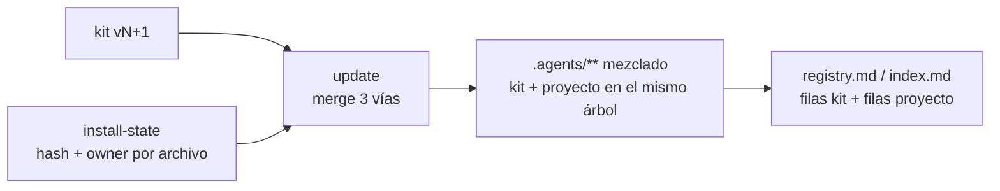
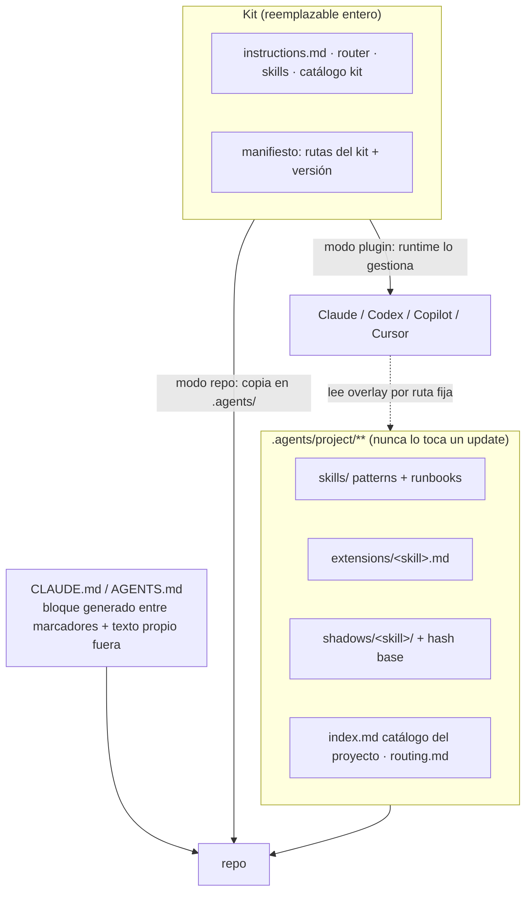
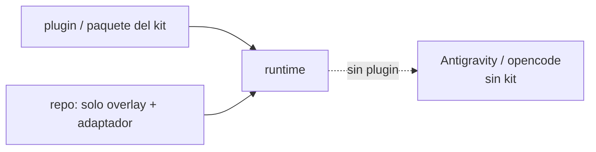

# Solution Sketch: Kit sellado + overlay del proyecto (con modo plugin y runbooks)

**Slug**: `kit-project-overlay`
**Fecha**: 2026-11-21
**Estado**: Locked (2026-11-21: el usuario eligió "Fijar B + escribir épica")
**Siguiente flujo**: create-epic → `docs/epics/kit-project-overlay/kit-project-overlay.md`

Es una pizarra, no un PRD. No incluye criterios de aceptación, matrices de casos borde ni slices.

Cubre tres mejoras: #1 separar los archivos del kit de los del proyecto (prio 0, es la base), #2 distribuir el kit como plugin o MCP sin perder el modo de archivos en el repo (prio 1) y #3 runbooks de procesos del proyecto (prio 0).

---

## 1. Problem in 3 lines

1. Los equipos que instalan el kit necesitan extenderlo con sus patterns, sus procesos y sus reglas. Hoy lo hacen editando archivos del kit en el mismo lugar: `registry.md`, `skills/index.md`, el `SKILL.md` del router y `instructions.md`.
2. El ownership de los archivos está escrito a mano en tres listas de `src/planner.mjs`, y `install-state.json` solo guarda un hash por archivo. Pasa lo siguiente:
   - Un archivo del kit editado queda congelado para siempre (`skip_modified`).
   - `CLAUDE.md` y `AGENTS.md` se protegen completos: si se editan, el kit no los vuelve a actualizar.
   - Los catálogos mezclan filas del kit con filas del proyecto.
   - Los archivos que el kit deja de distribuir nunca se borran.
   - Con todo eso no se puede armar un plugin, y los procesos (staging, release, hotfix, rollback) no tienen dónde vivir.
3. Un buen diseño hace que el kit se pueda reemplazar entero, sea por copia o por plugin, sin tocar nada del proyecto. También da al proyecto puntos de extensión explícitos y un lugar propio para los runbooks.

---

## 2. Options

### Option A — Dueño por archivo, mismo árbol

Se mantiene el layout actual. `install-state.json` pasa a registrar `owner: kit | project` por ruta y el update hace merge a 3 vías de los archivos del kit editados.

Trade-off:
- Gana: no hay que migrar rutas y es el cambio más chico en el CLI.
- Cuesta:
  - La extensión sigue siendo editar archivos del kit en el lugar.
  - El merge de markdown del router produce conflictos semánticos silenciosos.
  - Los catálogos siguen mezclados, así que no se puede empaquetar un plugin limpio. #2 queda bloqueada.

### Option B — Kit sellado por manifiesto + overlay único en `.agents/project/`

El kit es dueño de una lista cerrada de rutas, declarada en un manifiesto que viaja con el kit. Esas rutas no cambian, así que el descubrimiento nativo de `.agents/skills/**` sigue funcionando en Codex y Copilot. Todo lo del proyecto vive bajo `.agents/project/**`. El proyecto extiende el kit en tres niveles, por nombre y nunca editando el kit:

- **add**: patterns y runbooks nuevos.
- **extend**: puntos de extensión que declara una skill del kit.
- **shadow**: reemplazo completo de una skill hoja, guardando el hash base.

El mismo árbol del kit se distribuye de dos formas: copiado al repo (modo actual) o como plugin.

Trade-off:
- Gana:
  - El update es "reemplaza la lista del kit y borra lo que salió". No hay merge.
  - El plugin sale del mismo árbol.
  - Los runbooks tienen un hogar que el kit nunca pisa.
- Cuesta:
  - Una migración única de los proyectos ya instalados.
  - Hay que cambiar el router y `add-project-pattern` para que lean dos catálogos.
  - Se necesita una regla de rutas: kit→kit con rutas relativas, kit→proyecto con ruta fija `.agents/project/...`, proyecto→kit por nombre de skill.

### Option C — Kit fuera del repo (solo plugin o paquete)

El repo guarda solo el overlay y un adaptador mínimo. El kit siempre llega como plugin, paquete npm o ruta global.

Trade-off:
- Gana: es lo más limpio y el repo queda con la menor cantidad de archivos.
- Cuesta:
  - Elimina el modo de archivos en el repo, que algunos equipos usan para obligar a todos a usar el kit. El usuario lo pidió explícitamente.
  - Deja sin kit a los runtimes que no tienen plugins.
  - En Claude Code, cada persona del equipo igual tiene que instalar el plugin una vez.

---

## 3. Winner + discarded + why

**Winner**: Option B — kit sellado por manifiesto + overlay `.agents/project/`, con dos modos de distribución del mismo árbol.

**Discarded**:
- Option A: cada archivo del kit que un proyecto edita deja de recibir fixes sin aviso. Los catálogos mezclados además impiden el plugin, así que #2 quedaría bloqueada.
- Option C: rompe un requisito explícito, porque el modo repo tiene que seguir existiendo.

**Why**: lo que causa el drift es que la extensión edite el kit en el lugar. Mientras eso siga pasando:
- no se puede reemplazar el kit entero;
- no se puede empaquetar como plugin;
- no hay un lugar seguro para los runbooks.

B elimina esa causa. La migración que exige se puede automatizar con lo que ya existe: los hashes de `install-state.json`, el dry-run, los backups y el rollback.

**Critical-stance challenge**: "A evita migrar los proyectos instalados (no mueve ningún archivo) y no obliga a cambiar el router ni `add-project-pattern`. ¿Por qué B?"

B sobrevive al desafío por tres razones:
- El costo de A es permanente. Un archivo del kit editado queda en `skip_modified` para siempre, y un merge a 3 vías sobre reglas del router puede mezclar dos políticas sin que nadie lo note.
- El costo de B se paga una sola vez y se puede ver antes en el dry-run.

Segundo desafío, sobre el riesgo propio de B: el nivel *shadow* reintroduce forks del kit. Se mitiga así:
- Cada shadow guarda el hash base de la skill del kit que reemplaza.
- `doctor` avisa cuando esa skill cambia en una versión nueva del kit.
- El router e `instructions.md` no admiten shadow, solo *extend*, mediante `.agents/project/routing.md` y los puntos de extensión.

**Decisiones derivadas dentro de B**:
- **Distribución (#2)**:
  - Un solo árbol fuente del kit. Un build genera:
    - un paquete Agent Plugins 1.0: `plugin.json` en la raíz, `skills/` y `mcp.json`;
    - `.claude-plugin/plugin.json` y `marketplace.json` en el mismo repo.
  - Según la investigación del 2026-11-21, Copilot y Codex también leen el formato Claude.
  - MCP queda descartado como canal principal: los prompts de MCP no son skills, no tienen carga progresiva ni subagentes, y el usuario tiene que invocarlos a mano. Podría volver más adelante como componente dentro del plugin.
  - Nunca se usan los dos modos a la vez en un repo, porque las skills aparecerían duplicadas. `doctor` lo verifica.
- **Adaptadores**:
  - `CLAUDE.md` y `AGENTS.md` pasan a tener un bloque generado entre marcadores y texto propio del proyecto fuera de ellos. Esto reemplaza la protección actual del archivo completo.
  - Los plugins no cargan `CLAUDE.md` ni `AGENTS.md`, así que en modo plugin el adaptador mínimo se queda en el repo.
- **Runbooks (#3)**:
  - Es una clase nueva del registry, `Runbook`, en `.agents/project/skills/runbooks/<nombre>/SKILL.md`. Cumple el formato Agent Skills.
  - Secciones: frases que lo disparan, precondiciones, pasos, comandos, verificación, rollback, pasos irreversibles marcados `confirm: required`, dueño y fecha de la última verificación.
  - Se crea con `add-project-pattern` (variante runbook).
  - El router lleva las frases operativas al runbook que corresponde. Un runbook no puede quitar la confirmación explícita de una acción irreversible.
  - Ciclo de captura: cuando el usuario enseña o corrige un procedimiento, el agente propone guardarlo como runbook (o un diff del runbook que ya existe). Nunca escribe sin un sí.
- **Migración de proyectos instalados**: `update` detecta el layout viejo (schema de `install-state` menor a 2) y la incluye en el dry-run.
  - Los archivos del kit sin cambios quedan como kit.
  - Los archivos del kit editados se ofrecen como shadow o extend, con su diff, o se descartan.
  - Las skills que agregó el proyecto se mueven a `.agents/project/skills/`.
  - Las filas del proyecto en los catálogos pasan a `.agents/project/index.md`.
  - El texto propio de los adaptadores queda fuera de los marcadores.
  - Hay backup y journal de rollback como hoy, y la migración es idempotente.

---

## 4. Names that exist

| Name | Kind | Owner | Relates to |
| --- | --- | --- | --- |
| `.agents/workflow-kit/manifest.json` | artefacto (hoy solo documenta: ningún código lee `portable_core` ni `repo_overlay`) | kit | pasa a ser el manifiesto obligatorio de rutas del kit |
| `.agents/workflow-kit/install-state.json` | artefacto (`files: {ruta: sha256}`) | CLI | gana `schemaVersion` 2, `mode: repo \| plugin` y la versión fijada |
| `.agents/project/` | directorio (ya contiene `quality-gate.md`, `backend.md`, `frontend.md`, `paths.json`, `stack.md`) | proyecto | se vuelve la raíz única del overlay |
| `skillCatalogPreservePaths`, `skillCatalogMergePaths`, protected set | conjuntos en `src/planner.mjs:18-47` | CLI | se reemplazan por el manifiesto |
| `buildUpdatePlan` | función en `src/planner.mjs:249` | CLI | reemplaza el kit entero y migra el layout viejo |
| `validateOverlayDrift` | función en `src/workflow-contract/drift.mjs:20` | CLI | hoy obliga a que el template sea igual al `.agents/` de este repo |
| `add-project-pattern` | skill en `.agents/skills/06-patterns/authoring/` | kit | gana la variante runbook y escribe en el catálogo del proyecto |
| `workflow-router` | skill | kit | lee el catálogo del kit, el del proyecto y `routing.md`, y rutea a runbooks |
| `scripts/sync-claude-skills.mjs` | script con lista fija `claudeSkillKeys` | kit | entrada del build del plugin |
| `delegate-agent-catalog.json` + `src/model-profiles.mjs` | agentes generados por perfil de modelo al instalar | CLI | choca con el plugin, que es estático (ver sección 6) |
| Agent Plugins 1.0 (`plugin.json`), `.claude-plugin/` | formatos externos | runtimes | destino del build del modo plugin |

---

## 5. What is not created now

- Ningún código, skill ni template: la implementación va en sesiones separadas después de la épica.
- MCP como canal de distribución.
- Extensión de Gemini CLI o Antigravity: siguen en modo repo.
- Merge a 3 vías de markdown.
- Shadow del router o de `instructions.md`.
- Runbooks de ejemplo con contenido de dominio: el kit es neutral y solo distribuye la plantilla.
- Telemetría o auto-update forzado del plugin.

---

## 6. Questions that still block the PRD

1. **Descubrimiento nativo de skills del proyecto.** No está claro si Codex y Copilot descubren skills en `.agents/project/skills/**` o solo en `.agents/skills/**`. Si no las descubren, los runbooks solo se alcanzan por el router. Hay que decidir si eso alcanza.
2. **Agentes delegados en modo plugin.** Hoy se renderizan por perfil de modelo al instalar, y el plugin es estático. Opciones:
   - que el repo los siga generando también en modo plugin;
   - un plugin por perfil;
   - un plugin con el perfil por defecto y override local.
3. **Ubicación de `.agents/project-context.md`.** Se puede mover a `.agents/project/`, lo que cambia la ruta, o dejarlo como excepción con nombre.
4. **Borrar archivos que el kit dejó de distribuir.** Hoy nunca se borran. B los borraría si no tienen cambios. Es un cambio de comportamiento que hay que confirmar.
5. **Este repo se distribuye a sí mismo.** `validateOverlayDrift` hace que los archivos de proyecto de este repo sean el contenido que se distribuye. Hay que separar el overlay propio de este repo del árbol del kit.
6. **Obligatoriedad del modo plugin.** En Claude Code, `enabledPlugins` en `.claude/settings.json` solo recomienda el plugin: cada persona lo instala una vez, y solo los managed settings lo hacen obligatorio. Hay que decidir si eso es aceptable o si los equipos que quieren obligar deben quedarse en modo repo.
7. **Datos de runtimes sin verificar.** Esto sale de investigación con fecha 2026-11-21 y hay que confirmarlo en la fase de research de la épica:
   - el estado formal de Agent Plugins 1.0;
   - la precedencia entre skills de plugin y skills locales en Copilot y Cursor;
   - si el agente cloud de Copilot carga plugins.
8. **Nombre del plugin.** En modo plugin, Claude expone las skills como `/<plugin>:<skill>`. Hay que elegir el nombre, que va a quedar en el uso diario.
