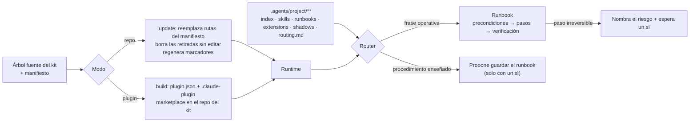

# Epic: Kit sellado + overlay del proyecto, modo plugin y runbooks de proyecto

**Estado**: Borrador
**Apetito**: Multi-cycle (supuesto: ver P9)
**Limite de inversion**: Cuatro PRDs, uno por fase. Cada uno debe caber en un ciclo de `create-prd` → `implement-change` → `document-development`. Si una fase no cabe, se recorta su alcance y la fecha no se mueve.
**Autor**: Agente (sesión de arquitectura del kit)
**Fecha**: 2026-11-21
**Sketch**: [../../design/kit-project-overlay-sketch.md](../../design/kit-project-overlay-sketch.md) (Locked, opción B)
**Evidence pack**: [kit-project-overlay-evidence.md](kit-project-overlay-evidence.md)
**Ledger**: [kit-project-overlay-ledger.md](kit-project-overlay-ledger.md)
**Mejoras que cubre**: #1 separar kit y proyecto (prio 0), #2 plugin o MCP instalable (prio 1), #3 aprendizaje de procesos del proyecto (prio 0)

> **Gate de inicio:** no empieza ninguna implementación de esta épica hasta que estén integradas en `main` estas tres mejoras: #6 reglas de tests (PR en curso, 0.19.0), #4 lock visual y #5 textos del TUI.
> - F1 choca con #6 y #4: comparten `.agents/**`, `templates/**`, `create-prd`, slicing, QA y el implementador frontend.
> - F2 choca con #5: comparten `src/**`.
>
> El gate es el invariante `INV-SEQ-01`.

## 1. Contexto y Problema que Resuelve

El kit se instala copiando unos 289 archivos al repo del proyecto (instalación de Claude en modo repo). Esos archivos son `.agents/**`, los adaptadores y `.claude/**`. Después, el proyecto necesita adaptarlo con sus patterns, sus reglas de ruteo y sus convenciones. La guía actual (`docs/extending-the-workflow.md`) dice que se haga editando en el lugar archivos que también son del kit: `registry.md`, `skills/index.md`, el `SKILL.md` del router e `instructions.md`.

El actualizador no sabe de quién es cada archivo. `install-state.json` solo guarda un hash, y el ownership vive en tres conjuntos escritos a mano en `src/planner.mjs`. Eso tiene cuatro consecuencias:
- Cada archivo del kit que el proyecto edita queda en `skip_modified` para siempre y deja de recibir correcciones sin avisar.
- `CLAUDE.md` y `AGENTS.md` se protegen completos: una línea propia bloquea las actualizaciones del prefiltro de nivel.
- Los catálogos mezclan filas del kit y del proyecto.
- Los archivos que el kit deja de distribuir nunca se borran.

Esa mezcla bloquea las otras dos mejoras:
- **#2 (plugin):** necesita poder entregar "el kit" como una unidad que el runtime administra, y hoy el kit no se puede separar del proyecto.
- **#3 (runbooks):** los procedimientos del proyecto (pase a staging o preprod, release, hotfix, rollback) necesitan un lugar que una actualización nunca pise. Hoy ese lugar no existe, y los patterns solo cubren estándares de código.

Importa ahora por dos razones. El estándar Agent Plugins 1.0 (agosto de 2026) y su adopción por Claude Code, Codex, Copilot y Cursor hacen viable un modo plugin con un solo build. Y cada proyecto que se instala con el layout actual suma deuda de migración.

## 2. Objetivo, Resultado Esperado y Metricas

**Objetivo principal**: que el kit sea una unidad reemplazable, copiada al repo o entregada como plugin, y que el proyecto lo extienda solo desde su propio overlay, que ninguna actualización toca.

**Resultado esperado dentro del apetito**:
- El contrato del límite queda escrito y se hace cumplir (F1).
- El actualizador reemplaza el kit por manifiesto y migra los proyectos ya instalados (F2).
- Los runbooks de proyecto existen y tienen ciclo de captura (F3).
- Hay un modo plugin piloto para Claude Code y Copilot (F4).

**Metricas de exito**:

| Metrica | Baseline | Objetivo | Como se mide |
| ------- | -------- | -------- | ------------ |
| Archivos del proyecto escritos, movidos o borrados por `update` | Sin medir. Los catálogos y los adaptadores mezclan contenido. | 0 | Test e2e de upgrade con un overlay editado (`test/upgrade-e2e.test.mjs`) |
| Archivos del kit editados que quedan en `skip_modified` después de migrar | Cada archivo editado queda congelado | 0. Cada uno pasa a ser shadow o extend, o se descarta. | Dry-run de la migración sobre un fixture con ediciones |
| Archivos que el kit escribe en el repo en modo plugin (Claude) | ~289 en modo repo | ≤ 5: el adaptador, `.claude/settings.json`, `install-state.json` y el overlay inicial | Conteo del plan de `init --mode plugin` |
| Procedimientos operativos guardados como runbook | 0. La clase no existe. | Al menos 1 runbook capturado con confirmación en un repo piloto | Revisión del overlay del piloto |
| Acciones irreversibles ejecutadas sin confirmación por medio de un runbook | No aplica | 0 | Evals del router (`router-evals.md`) |

## 3. Alcance

**Incluido en esta epica:**

- Contrato del límite:
  - manifiesto obligatorio con las rutas del kit;
  - overlay único `.agents/project/**`;
  - tres niveles de extensión (add, extend, shadow);
  - reglas de referencia entre rutas;
  - adaptadores con bloque generado entre marcadores.
- Actualizador por manifiesto:
  - reemplaza el kit entero y borra los archivos del kit que salieron y no fueron editados;
  - `install-state` v2;
  - migración del layout viejo con dry-run, backup y rollback.
- Clase `Runbook`:
  - plantilla y variante runbook en `add-project-pattern`;
  - ruteo de frases operativas;
  - confirmación obligatoria de los pasos irreversibles;
  - ciclo de captura con confirmación.
- Modo plugin:
  - build único que genera Agent Plugins 1.0 y `.claude-plugin`;
  - `init` y `update` con `--mode plugin`;
  - `doctor` con verificación de los dos modos;
  - piloto en Claude Code y Copilot.

**No incluido:**

- MCP como canal de distribución.
- Merge a 3 vías de markdown.
- Shadow del router o de `instructions.md`.
- Runbooks de ejemplo con contenido de dominio: el kit es neutral.
- Telemetría y auto-update forzado.
- Hacer obligatorio el plugin con managed settings: eso lo decide cada organización.

**Futuro:**

- Plugin para Codex y Cursor (F5).
- Extensión de Gemini o Antigravity.
- MCP como componente del plugin, por ejemplo para consultar el registry o capturar runbooks.
- Runbooks compartidos entre repos.

## 4. Flujo de Usuario

1. Una persona instala el kit en modo repo (como hoy) o en modo plugin. El dry-run muestra qué es del kit y qué es del proyecto.
2. El equipo agrega un pattern o un runbook. Va a `.agents/project/skills/**` y se registra en `.agents/project/index.md`. Nunca toca un archivo del kit.
3. El equipo necesita ajustar una skill del kit:
   - Si la skill declara un punto de extensión, escribe `.agents/project/extensions/<skill>.md` (**extend**).
   - Si no, crea un **shadow** en `.agents/project/shadows/<skill>/`, que guarda el hash base de la skill original.
4. Durante una sesión, el usuario explica cómo se hace el pase a staging o corrige un paso. Al cerrar, el agente propone: "¿Lo guardo como runbook `deploy-staging`?". Solo escribe si el usuario dice sí. Si ya existe un runbook, propone un diff.
5. Más adelante el usuario escribe "pasa esto a staging". El router carga el runbook, verifica las precondiciones y ejecuta los pasos. En cada paso marcado `confirm: required` nombra el riesgo y espera un sí explícito.
6. El equipo corre `workflow-kit update`. El kit se reemplaza entero y el overlay queda intacto. Si la skill del kit que el proyecto reemplazó con un shadow cambió, `doctor` avisa: "upstream cambió, revisa tu shadow".
7. Un proyecto instalado con la versión 0.18 corre `update`. El dry-run muestra la migración:
   - los archivos sin cambios quedan como kit;
   - cada archivo editado se ofrece como shadow, extend o descarte, con su diff;
   - las skills propias se mueven al overlay;
   - el texto propio de los adaptadores queda fuera de los marcadores.

   Recién al aplicar se escriben los archivos, con backup y journal de rollback.

Estados relevantes:
- **Overlay ausente:** el kit lo trata como vacío (exists-or-skip).
- **Shadow con upstream cambiado:** `doctor` muestra un warning, no un error.
- **Modo repo y modo plugin a la vez:** `doctor` muestra un error.
- **Runbook con precondición fallida:** se detiene y lo informa. No sigue.
- **Migración interrumpida:** se usa el rollback del journal.

## 5. Reglas de Negocio

**Regla 1: el kit es una lista cerrada.** Una ruta es del kit solo si figura en el manifiesto que trae la versión instalada. Todo lo que está bajo `.agents/project/**` es del proyecto. Una ruta que no es de ninguno de los dos la reporta `doctor` y no la toca nadie. *Riesgo de interpretación:* los artefactos derivados, como `.claude/agents/*` renderizados por perfil, son del kit aunque se generen al instalar. El manifiesto los declara como `derived`.

**Regla 2: tres niveles de extensión, en orden de preferencia.**
1. **add**: un archivo nuevo en el overlay.
2. **extend**: un punto de extensión declarado por la skill del kit.
3. **shadow**: reemplazo completo de una skill hoja.

El router y `instructions.md` solo admiten extend, mediante `.agents/project/routing.md` y los puntos que declaren. *Por qué:* un shadow del router congela la política de ruteo y reproduce el problema que esta épica viene a resolver.

**Regla 3: referencias entre rutas.**
- Del kit al kit, con rutas relativas al árbol del kit. Así funcionan igual copiadas al repo o dentro del plugin.
- Del kit al proyecto, con la ruta fija `.agents/project/...` y exists-or-skip.
- Del proyecto al kit, por nombre de skill y nunca por ruta.

**Regla 4: los adaptadores tienen dos dueños.** `CLAUDE.md`, `AGENTS.md`, `ANTIGRAVITY.md` y las instrucciones de Copilot tienen un bloque generado entre marcadores `workflow-kit:managed`, que es del kit. Todo lo que está fuera de los marcadores es del proyecto. Esto reemplaza la protección actual del archivo completo.

**Regla 5: un solo modo por repo.** Un repo usa el modo repo o el modo plugin, nunca los dos. Con los dos, las skills aparecerían duplicadas: `/skill` y `/kit:skill`.

**Regla 6: los runbooks son del proyecto y piden confirmación.**
- Un runbook vive solo en el overlay.
- El agente propone capturarlo y nunca lo escribe sin un sí explícito.
- Un runbook no puede eliminar ni debilitar la confirmación de una acción irreversible (push, deploy, delete, migración de datos).
- No se guardan secretos ni credenciales en un runbook. Aplica `.agents/memory/README.md`: sensibilidad `public-in-repo`.

**Regla 7: la migración se ve antes de escribir y se puede deshacer.**
- Primero el dry-run.
- Backup antes de mover o reescribir.
- Un journal para el rollback.
- Es idempotente: un segundo `update` no escribe nada.
- Ningún contenido editado se pierde sin que el usuario lo elija.

### Invariantes No Negociables

| ID | Invariante | Owner | Rationale | Child PRD mapping required |
| -- | ---------- | ----- | --------- | ------------------------- |
| INV-OWN-01 | `update` nunca escribe, mueve ni borra nada bajo `.agents/project/**`, ni el texto de un adaptador que está fuera de sus marcadores. | Mantenedor del kit | Es la promesa central de la mejora #1. | Yes |
| INV-OWN-02 | El ownership del kit sale solo del manifiesto que viaja con la versión. El CLI no tiene conjuntos de rutas escritos a mano. | Mantenedor del kit | Los conjuntos escritos a mano (`planner.mjs:17-47`) son la causa del drift actual. | Yes |
| INV-EXT-01 | El proyecto extiende el kit solo con add, extend o shadow desde el overlay. El router y `instructions.md` admiten solo extend. | Mantenedor del kit | Un shadow del router congela la política. | Yes |
| INV-EXT-02 | Cada shadow guarda el hash base, y `doctor` avisa cuando la skill del kit cambia. | Mantenedor del kit | Sin eso, un shadow es un fork silencioso. | Yes |
| INV-PATH-01 | Del kit al kit con rutas relativas; del kit al proyecto con `.agents/project/...` y exists-or-skip; del proyecto al kit por nombre. | Mantenedor del kit | Es lo que permite el mismo árbol en modo repo y en modo plugin. | Yes |
| INV-DIST-01 | El modo repo sigue siendo de primera clase. El modo plugin es opcional. Nunca los dos en un repo. | Usuario o producto | Los equipos usan el modo repo para obligar a todos a usar el kit. Requisito explícito. | Yes |
| INV-DIST-02 | Hay un solo árbol fuente del kit. El plugin se genera desde ese árbol, sin una segunda copia mantenida a mano. Los `SKILL.md` cumplen Agent Skills. | Mantenedor del kit | Dos copias divergen. | Yes |
| INV-RUN-01 | El agente nunca guarda un runbook, ni un cambio a un runbook, sin un sí explícito del usuario. | Usuario o producto | Lo pidió explícitamente el usuario. | Yes |
| INV-RUN-02 | Un runbook no puede eliminar la confirmación explícita de una acción irreversible. Esos pasos van marcados `confirm: required`. | Mantenedor del kit | Es seguridad operativa y está alineado con `.agents/instructions.md`. | Yes |
| INV-NEUT-01 | El kit distribuye plantillas y reglas neutrales, sin runbooks ni patterns de dominio. | Mantenedor del kit | Lo exige el `validate-stack-neutrality` que ya existe. | Yes |
| INV-MIG-01 | La migración del layout viejo cumple la Regla 7. | Mantenedor del kit | Hay proyectos ya instalados en producción. | Yes |
| INV-SEQ-01 | Ninguna implementación empieza antes de que #6, #4 y #5 estén integradas en `main`. | Orquestador o usuario | F1 choca con #6 y #4, y F2 choca con #5. | Yes |
| INV-CUT-01 | Path vivo, secuencia elegida y secuencia descartada (ver Sección 9). | Usuario | Evita que un PRD hijo invierta el orden. | Yes |

Cada PRD hijo mapea cada invariante que hereda a un criterio de aceptación. Una contradicción requiere un change request aprobado por el usuario.

## 6. Casos de Uso

### Equipo que adapta el kit y quiere seguir recibiendo mejoras

Un equipo ajustó el paso de QA del kit para su CI y agregó tres patterns de backend. Hoy, cuando sale una versión nueva, el archivo de QA queda congelado y el equipo no se entera de los arreglos. Con esta épica, el ajuste vive en un extend o en un shadow. `update` trae la versión nueva y `doctor` avisa que hay que revisar el shadow.

### Tech lead que quiere que todo el equipo use el mismo flujo

El tech lead prefiere el kit commiteado en el repo para que nadie trabaje sin él. Se queda en modo repo, con las mismas garantías del overlay. Otro equipo, en cambio, prefiere un repo limpio: usa el modo plugin y solo tiene el adaptador y el overlay.

### Ingeniero de guardia que hace un hotfix

El ingeniero escribe "hagamos hotfix de esto". El router carga el runbook `hotfix` del proyecto. El agente verifica las precondiciones (rama, CI en verde), ejecuta los pasos y se detiene antes del deploy a producción para pedir confirmación. Al final, el ingeniero corrige un paso que cambió, y el agente propone actualizar el runbook con ese diff.

## 7. Evidencia de Investigacion

### Codigo y Documentacion Interna

| Area | Hallazgo | Evidencia |
| ---- | -------- | --------- |
| Actualizador | No hay ownership por archivo: solo un hash. Hay tres conjuntos escritos a mano y los archivos que el kit dejó de distribuir nunca se borran. | `src/planner.mjs:17-47`, `:249-486`, `:611-654` |
| Catálogos | Se mezclan filas: el kit solo agrega filas nuevas. `registry.json` registra lo que encuentra bajo `.agents/skills`. | `src/planner.mjs:674-786`, `:858-905` |
| Adaptadores | Se protegen completos. Solo `docs/README.md` tiene merge por marcadores. | `src/planner.mjs:40-47`, `:956-980` |
| Manifiesto | Hoy solo documenta: nadie lo lee. | `.agents/workflow-kit/manifest.json` |
| Drift check | Este repo distribuye su propio `.agents/` | `src/workflow-contract/drift.mjs:20-57` |
| Cómo se extiende | Editando en el lugar | `docs/extending-the-workflow.md`, `add-project-pattern/SKILL.md:24-58` |
| Contrato existente | Ya define portable core y repo overlay, pero nada lo hace cumplir. | `.agents/capabilities/README.md`, `docs/project-boundaries.md` |

Detalle completo en el [evidence pack](kit-project-overlay-evidence.md).

### Investigacion Web

**Aplica**: Si
**Motivo**: el modo plugin depende de los sistemas de plugins de Claude Code, Codex, Copilot y Cursor, y del estándar Agent Plugins 1.0.

| Tema | Hallazgo | Fuente |
| ---- | -------- | ------ |
| Estándar | Agent Plugins 1.0 estandariza `plugin.json`, `skills/` y `mcp.json`. Copilot lo marca como GA. | https://github.blog/changelog/2026-08-12-agent-plugins-1-0-in-vs-code-copilot-cli-and-the-copilot-app |
| Claude Code | Plugins sin `CLAUDE.md`, con nombres `/plugin:skill`. `enabledPlugins` en el proyecto solo recomienda el plugin. | https://code.claude.com/docs/en/plugins-reference |
| Interoperabilidad | Copilot y Codex leen el formato `.claude-plugin`. | https://code.visualstudio.com/docs/copilot/customization/agent-plugins · https://developers.openai.com/codex/plugins/build.md |
| MCP | Los prompts no son skills. Sirve como componente, no como canal. | https://code.claude.com/docs/en/mcp |

Hay filas marcadas como *sin verificar* en el evidence pack. Se confirman al iniciar el PRD de F4 (ver P7).

### Evidence Pack

Reutilizar [kit-project-overlay-evidence.md](kit-project-overlay-evidence.md). Antes de citar una línea, verificarla contra el commit vigente: #6, #4 y #5 van a mover líneas de `src/planner.mjs` y `.agents/**`.

### Supuestos

| Supuesto | Impacto si es falso | Como validarlo |
| -------- | ------------------- | -------------- |
| Las rutas del kit pueden quedarse donde están (`.agents/skills/**`) y el descubrimiento nativo de Codex y Copilot sigue funcionando. | Si hubiera que mover el kit, la migración cuesta más y se rompen los links de los proyectos. | Se confirma en F1. Es parte de P1. |
| El formato `.claude-plugin` sirve para Claude y Copilot con un solo build. | Habría que generar dos paquetes. | Smoke test del piloto F4. |
| La clasificación por hash de `install-state` alcanza para decidir qué archivos son del kit sin editar. | Habría que migrar a mano. | Fixture e2e de F2 con estados mixtos. |
| Apetito multi-ciclo, con cuatro PRDs. | Si el apetito fuera menor, F4 se difiere. | P9 |

## 8. Impacto Tecnico

### Como funciona end-to-end

Hoy:
1. `init` copia toda la plantilla del overlay y los adaptadores.
2. `update` compara hashes y omite, sobrescribe o mezcla archivo por archivo según tres listas.

Con esta épica:
1. El kit trae un manifiesto con sus rutas, cada una de clase `kit` o `derived`, y la versión.
2. `update` en modo repo reemplaza exactamente esas rutas, borra las que salieron si no fueron editadas, regenera los bloques de los adaptadores y nunca toca `.agents/project/**`.
3. En modo plugin, el runtime entrega el árbol del kit. El repo solo guarda el adaptador, la declaración del plugin y el overlay.
4. En los dos modos, el router lee el catálogo del kit y después el del proyecto (`.agents/project/index.md`), aplica `routing.md`, los extends y los shadows, y rutea las frases operativas a los runbooks.

### Diagrama de flujo



### Backend / Dominio

Es el CLI en Node:
- `src/planner.mjs` y `src/apply.mjs`: manifiesto, plan de reemplazo, borrado de lo retirado y migración.
- `src/rollback.mjs`: rollback de la migración.
- `src/doctor.mjs`: modos, shadows y rutas sin dueño.
- `src/workflow-contract/*`: drift y skills.
- `src/runtime-matrix.mjs` y `src/model-profiles.mjs`: modo plugin.
- `install-state` v2, con `schemaVersion`, `mode`, la versión fijada y las clases por ruta.

### Frontend / UX

Es el TUI y la salida del CLI:
- el dry-run muestra la migración agrupada (kit sin cambios, editados con opciones, propios que se mueven);
- la selección del modo al instalar;
- los avisos de `doctor`.

Los textos del TUI dependen de #5.

### API / Contratos

- Schema del manifiesto del kit.
- `install-state` v2.
- `registry.schema.json`, con la clase `Runbook` y los campos `shadows` y `extension_points`.
- Formato de los marcadores de los adaptadores.
- Layout de `.agents/project/**`.
- Manifiestos del plugin.

Todos son contratos públicos del kit y requieren tests de contrato en `test/workflow-contract.test.mjs` y en los tests de plantillas.

### Datos, Seguridad y Operacion

- La migración mueve archivos de los repos de los usuarios. Por eso aplica la Regla 7.
- Los runbooks pueden tener comandos peligrosos, así que les aplica `INV-RUN-02`, y no se guardan secretos (`.agents/memory/README.md`).
- El modo plugin descarga contenido de un marketplace. Sigue la política de fuentes oficiales y confirmación de `.agents/integrations/README.md`.

### Limites operativos

- **En Claude Code el plugin no es obligatorio desde el repo.** `enabledPlugins` solo lo recomienda, y cada persona igual instala una vez. Si un equipo necesita que el uso sea obligatorio, el modo plugin no le sirve, salvo con managed settings. Por eso el modo repo sigue siendo de primera clase.
- **Antigravity y opencode no tienen plugins compatibles.** Quedan en modo repo.

### Robustez ante fallas

| Situación | Comportamiento |
| --- | --- |
| Falta el overlay | El kit lo trata como vacío y no falla. |
| Shadow de una skill que el kit eliminó | `doctor` avisa; no lo borra. |
| Migración con un archivo editado y sin decisión | Queda pendiente y no se aplica. Nunca se elige un default destructivo. |
| El plugin no está instalado aunque el repo lo declara | `doctor` lo informa y sugiere el comando de instalación. Nunca lo instala sin confirmación. |
| Precondición fallida en un runbook | Se detiene y lo informa. |

## 9. Plan de Entrega por Fases

### Path vivo y corte de fases

**Aplica**: Si
**Path vivo durante el apetito**: Debe seguir. Los proyectos instalados en modo repo con 0.18.x tienen que poder actualizarse y funcionar después de cada fase.
**Cabe en un ciclo**: No
**Secuencia elegida**: F1 contrato → (F2 actualizador y migración ∥ F3 runbooks) → F4 modo plugin
**Secuencia descartada**: F4 plugin primero, como piloto, → F1 → F2 → F3. La alternativa F3 primero, en `06-patterns/` con el layout viejo, también queda descartada.
**Por que gana la elegida**: sin el límite (F1) y el actualizador por manifiesto (F2), el plugin empaquetaría catálogos con filas del proyecto, y los runbooks escritos en `06-patterns/` habría que migrarlos dos veces.
**Invariante**: `INV-CUT-01`

Cómo cada fase deja el path vivo usable:
- **F1:** cambia el contrato, pero el router lee el overlay con exists-or-skip. Un proyecto con el layout viejo sigue funcionando.
- **F2:** migra con dry-run y rollback.
- **F3:** escribe solo en el overlay.
- **F4:** agrega un modo nuevo sin tocar el modo repo.

### Fases comprometidas dentro del apetito

| Fase | Apetito relativo | Resultado | Dependencias | Riesgo principal | Definition of Done |
| ---- | ---------------- | --------- | ------------ | ---------------- | ------------------ |
| F1 Contrato kit/overlay | Medium | El límite queda escrito y se valida: manifiesto con clases, layout de `.agents/project/**`, niveles add/extend/shadow, reglas de rutas, marcadores en los adaptadores y lectura de dos catálogos por el router. | `INV-SEQ-01` (#6 y #4 integradas). P1, P3 y P5 resueltas. | Romper el descubrimiento nativo o los links de los proyectos | `check:workflow` incluye un validador del manifiesto y de las referencias de ruta (INV-PATH-01). Las evals del router cubren el catálogo del proyecto. Las docs de límites y extensión están actualizadas. El layout viejo sigue funcionando. |
| F2 Actualizador por manifiesto + migración | Large | `update` reemplaza el kit por manifiesto, borra lo retirado sin editar, regenera los marcadores, usa `install-state` v2 y migra el layout 0.18 con dry-run, backup y rollback. | F1. `INV-SEQ-01` (#5 integrada). P4 resuelta. | Perder contenido editado durante la migración | Hay e2e desde 0.18 para Claude, Codex, Copilot y Antigravity: contenido propio conservado, segundo update sin escrituras y rollback restaura. Ningún conjunto de rutas escrito a mano en `src/`. |
| F3 Runbooks de proyecto | Medium | Clase `Runbook`, plantilla, variante en `add-project-pattern`, ruteo de frases operativas, `confirm: required` y ciclo de captura con confirmación. | F1. Puede ir en paralelo con F2. P1 resuelta. | Un runbook que se salta la confirmación | Las evals del router cubren el ruteo operativo, la confirmación irreversible y "capturar sin escribir sin un sí". El validador de neutralidad pasa. |
| F4 Modo plugin (piloto Claude + Copilot) | Medium | El build genera `plugin.json` y `.claude-plugin` desde el árbol del kit. `init` y `update` funcionan con `--mode plugin`. `doctor` verifica los modos. Hay docs. | F2. P2, P6, P7 y P8 resueltas. | Precedencia o nombres distintos entre runtimes | Smoke test en Claude Code y en VS Code Copilot: las skills cargan, el overlay se lee y no hay duplicados. El repo en modo plugin tiene ≤ 5 archivos del kit. |

### Bets o fases futuras fuera del apetito actual

| Fase futura | Por que se difiere | Senal para retomarla |
| ------------ | ------------------ | -------------------- |
| F5 Plugin para Codex y Cursor | Faltan datos verificados de precedencia, y el piloto valida primero el formato | El piloto F4 está estable y un equipo usa Codex o Cursor |
| Extensión de Gemini o Antigravity | Ecosistema en transición (Gemini CLI → Antigravity CLI) | Hay un formato estable de Antigravity |
| MCP como componente | No es necesario para distribuir el kit | Aparece una herramienta concreta que valga la pena, como consultar el registry o capturar runbooks |
| Runbooks compartidos entre repos | Requiere una política de memoria `project-shared` entre repos | Dos o más repos de un mismo equipo duplican runbooks |

## 10. Cola de PRDs y Flujo de Ejecucion

Cada fila se ejecuta como su propio ciclo: `create-prd` → `implement-change` → `document-development`.

| Orden | PRD | Objetivo | Alcance estricto | Depende de | Implementacion esperada | Documento posterior |
| ----- | --- | -------- | ---------------- | ---------- | ----------------------- | ------------------- |
| 1 | PRD: Contrato kit/overlay | Fijar y validar el límite | Manifiesto con clases, layout `.agents/project/**`, add/extend/shadow, `routing.md`, reglas de rutas, marcadores de adaptadores, router con dos catálogos. Sin cambios en el actualizador. | `INV-SEQ-01` | Use `$implement-change` after PRD approval | Use `$document-development` after implementation |
| 2 | PRD: Actualizador por manifiesto y migración | Que `update` respete el límite y migre los proyectos instalados | `install-state` v2, plan de reemplazo, borrado de lo retirado, regeneración de marcadores, migración 0.18 y rollback, `doctor` del límite | PRD 1 | Use `$implement-change` after PRD approval | Use `$document-development` after implementation |
| 3 | PRD: Runbooks de proyecto | Capturar y ejecutar procesos del proyecto de forma segura | Clase `Runbook`, plantilla, variante en `add-project-pattern`, ruteo operativo, `confirm: required`, ciclo de captura | PRD 1 (en paralelo con el 2) | Use `$implement-change` after PRD approval | Use `$document-development` after implementation |
| 4 | PRD: Modo plugin piloto | Distribuir el kit como plugin en Claude Code y Copilot | Script de build, manifiestos, `--mode plugin`, `doctor` de modos, docs. Sin Codex ni Cursor. | PRD 2 | Use `$implement-change` after PRD approval | Use `$document-development` after implementation |

### Archivos existentes que toca cada fase (para evitar choques entre sesiones)

Estas listas son la estimación del diseño. Cada PRD hijo la confirma en su discovery.

| Fase | Archivos existentes | Archivos nuevos | Choca con |
| --- | --- | --- | --- |
| F1 | `.agents/instructions.md` · `.agents/skills/00-router/workflow-router/SKILL.md` · `…/reference/route-gates.md` · `…/reference/router-evals.md` · `.agents/skills/index.md` · `.agents/skills/registry.md` · `registry.json` · `registry.cache.json` · `registry.schema.json` · `.agents/skills/06-patterns/README.md` · `.agents/capabilities/README.md` · `.agents/workflow-kit/manifest.json` · `docs/project-boundaries.md` · `docs/extending-the-workflow.md` · `templates/repo-overlay-fhh-ia-ecosystem-full/**` (espejo) · `templates/runtime-adapters/{claude,agents-md,antigravity,copilot}/**` (marcadores) · `templates/template-manifest.json` · `scripts/sync-skill-registry.mjs` · `scripts/sync-level-prefilter.mjs` · `scripts/validate-template-packs.mjs` · `scripts/validate-neutral-paths.mjs` · `test/workflow-contract.test.mjs` · `test/skill-registry-sync.test.mjs` · `test/level-prefilter-router.test.mjs` · `test/template-packs.test.mjs` · `package.json` (`check:workflow`, versión) · `CHANGELOG.md` | validador del manifiesto y de las referencias de ruta (`scripts/validate-kit-boundary.mjs`), schema del manifiesto | #6 (reglas de tests: `.agents/**`, `templates/**`), #4 (lock visual: `create-prd`, slicing, QA, implementador frontend) |
| F2 | `src/planner.mjs` · `src/apply.mjs` · `src/rollback.mjs` · `src/doctor.mjs` · `src/workflow-contract/drift.mjs` · `src/workflow-contract/skills.mjs` · `src/workflow-contract/adapters.mjs` · `src/cli/commands.mjs` · `src/cli/summaries.mjs` · `src/plan-insight.mjs` · `src/tui/view.mjs` (grupos de la migración) · `test/planner.test.mjs` · `test/upgrade-e2e.test.mjs` · `test/doctor.test.mjs` · `test/cli-summaries.test.mjs` · `docs/migration.md` · `docs/troubleshooting.md` · `package.json` · `CHANGELOG.md` | fixtures e2e del layout 0.18 | #5 (textos del TUI en `src/**`) |
| F3 | `.agents/skills/06-patterns/authoring/add-project-pattern/SKILL.md` · `.agents/skills/06-patterns/authoring/pattern-skill-template.md` · `.agents/skills/06-patterns/README.md` · router `SKILL.md` · `route-gates.md` · `router-evals.md` · `.agents/instructions.md` (regla de captura) · `registry.schema.json` · `scripts/sync-skill-registry.mjs` · espejo en `templates/**` · `test/turn-routing-contract.test.mjs` · `docs/extending-the-workflow.md` · `package.json` · `CHANGELOG.md` | plantilla de runbook (`.agents/skills/06-patterns/authoring/runbook-template.md`) | F1 (comparte router e `instructions.md`: secuencial después de F1). F2 no comparte archivos. |
| F4 | `src/runtime-matrix.mjs` · `src/model-profiles.mjs` · `src/planner.mjs` · `src/doctor.mjs` · `src/cli/args.mjs` · `src/cli/commands.mjs` · `scripts/sync-claude-skills.mjs` · `scripts/sync-delegate-runtime-adapters.mjs` · `package.json` (`files`, scripts) · `docs/README.md` · `docs/quickstart.md` · `docs/github-install.md` · `docs/workflow/cross-runtime-capability-matrix.md` · `CHANGELOG.md` | `scripts/build-plugin.mjs`, `plugin.json`, `.claude-plugin/plugin.json`, `.claude-plugin/marketplace.json`, `test/plugin-build.test.mjs` | F2 (comparte `planner.mjs` y `doctor.mjs`: secuencial después de F2) |

## 11. Riesgos y Mitigaciones

| Riesgo | Probabilidad | Impacto | Mitigacion |
| ------ | ------------ | ------- | ---------- |
| La migración pierde contenido editado | Media | Alto | Regla 7 e `INV-MIG-01`. Ningún default destructivo. E2E desde 0.18 por runtime. |
| Los shadows se vuelven forks olvidados | Alta | Medio | `INV-EXT-02`: hash base y aviso de `doctor`. Preferir extend. |
| Codex o Copilot no descubren skills en `.agents/project/skills/**` | Media | Medio | Los runbooks se alcanzan por el router. Se confirma en F1 (P1). |
| Los runtimes cambian el formato del plugin | Media | Medio | Un solo build; el estándar común primero y las carpetas de vendor aparte. Se verifica al iniciar F4. |
| Choques de archivos con #6, #4 y #5 | Alta si se ignora el gate | Alto | `INV-SEQ-01`. Las evidencias se vuelven a verificar contra `main` al iniciar cada PRD. |
| Un runbook ejecuta un paso irreversible sin confirmación | Baja | Alto | `INV-RUN-02` y evals del router |
| Este repo se distribuye a sí mismo y mezcla su overlay propio con el kit | Alta | Medio | P5 se resuelve en F1 y se hace cumplir en F2 (drift check). |

## 12. Preguntas Abiertas

| # | Pregunta | Bloquea | Decision requerida |
| - | -------- | ------- | ------------------ |
| P1 | ¿Codex y Copilot descubren de forma nativa skills en `.agents/project/skills/**`, o solo en `.agents/skills/**`? Si no, ¿alcanza con que los runbooks se ruteen por el router? | Si, F1 y F3 | Ubicación física de las skills del proyecto y si se necesitan stubs de descubrimiento |
| P2 | En modo plugin, ¿cómo se resuelven los agentes delegados que hoy se renderizan por perfil de modelo al instalar? (a) el repo los sigue generando, (b) un plugin por perfil, (c) plugin con el perfil por defecto y override local. | Si, F4 | Estrategia de agentes en modo plugin |
| P3 | ¿`.agents/project-context.md` se mueve a `.agents/project/` (cambia la ruta) o queda como excepción con nombre? | Si, F1 | Ubicación del archivo y alcance de la migración |
| P4 | ¿`update` debe borrar los archivos que el kit dejó de distribuir si no fueron editados? Hoy nunca los borra. | Si, F2 | Confirmar el cambio de comportamiento |
| P5 | Este repo se distribuye a sí mismo: `validateOverlayDrift` hace que el `.agents/` de este repo sea lo que se distribuye. ¿Cómo se separa el overlay propio de este repo del árbol del kit? | Si, F1 (decidir) y F2 (hacer cumplir) | Layout del repo del kit y del drift check |
| P6 | En Claude Code, `enabledPlugins` solo recomienda el plugin. ¿Alcanza para el modo plugin, o el uso obligatorio queda solo para el modo repo y los managed settings? | Si, F4 | Postura de obligatoriedad documentada |
| P7 | Hay datos externos sin verificar: el estado formal de Agent Plugins 1.0, la precedencia entre skills de plugin y locales en Copilot y Cursor, y si el agente cloud de Copilot carga plugins. | Si, F4 | Verificarlos al iniciar el PRD 4 |
| P8 | ¿Cómo se llama el plugin? En Claude define `/<plugin>:<skill>` en el uso diario. | Si, F4 | Nombre del plugin |
| P9 | ¿El apetito es multi-ciclo con cuatro PRDs? Si fuera menor, F4 se difiere como bet futura. | No (supuesto vigente) | Confirmar el apetito |

## 13. Guia de Uso de la Epica

1. Esperar el gate `INV-SEQ-01`: #6, #4 y #5 integradas en `main`.
2. Resolver P1, P3 y P5 y empezar solo el PRD 1.
3. Cuando el PRD esté aprobado, correr `$implement-change` sobre ese archivo.
4. Después de implementar y validar, correr `$document-development` para esa fase. Eso actualiza el ledger (Sección 14).
5. Volver a esta épica, actualizar el estado de la fase y seguir. Los PRDs 2 y 3 pueden ir en sesiones paralelas porque no comparten archivos. El PRD 4 va después del 2.

## 14. Ledger de Cierre de Fases (obligatorio)

Archivo complementario: [kit-project-overlay-ledger.md](kit-project-overlay-ledger.md), creado junto con esta épica. Tiene una fila por invariante y una por PRD, todas en `Pendiente`. `document-development` actualiza las filas que corresponden al cerrar cada PRD hijo. La épica no se marca `Completado` hasta que cada invariante diga `Cumplido` o `Cumplido con excepcion aprobada`.

## 15. Handoff a Create PRD

**Primer PRD recomendado**: PRD 1 — Contrato kit/overlay (solo después del gate `INV-SEQ-01`)

**Prompt sugerido**:

```
Use $create-prd to create the PRD for "Contrato kit/overlay" using `docs/epics/kit-project-overlay/kit-project-overlay.md` as parent context (read the companion ledger at `docs/epics/kit-project-overlay/kit-project-overlay-ledger.md`, the evidence pack `kit-project-overlay-evidence.md`, and the locked sketch `docs/design/kit-project-overlay-sketch.md`). First resolve open questions P1, P3 and P5 with the user. Focus only on the kit manifest with path classes, the `.agents/project/**` layout, add/extend/shadow levels, `routing.md`, path-reference rules (INV-PATH-01), adapter marker blocks, and the router reading the kit and project catalogs with exists-or-skip. Keep the updater/migration (PRD 2), runbooks (PRD 3) and plugin mode (PRD 4) out of scope. Re-verify every cited line against current `main`, since #6, #4 and #5 will have landed.

After that PRD is approved, use $implement-change on the PRD file. After implementation and validation, use $document-development to document the delivered phase and update the ledger.
```

## Anexo: Fuentes de investigacion

| Tema | Fuente |
| ---- | ------ |
| Agent Plugins 1.0 | https://github.com/agentplugins/agent-plugins-spec/blob/main/spec/1.0.0.md |
| Copilot y Agent Plugins | https://github.blog/changelog/2026-08-12-agent-plugins-1-0-in-vs-code-copilot-cli-and-the-copilot-app · https://code.visualstudio.com/docs/copilot/customization/agent-plugins |
| Plugins de Claude Code | https://code.claude.com/docs/en/plugins-reference · https://code.claude.com/docs/en/plugin-marketplaces |
| Plugins de Codex | https://developers.openai.com/codex/plugins/build.md |
| Plugins de Cursor | https://cursor.com/docs/plugins |
| Extensiones de Gemini | https://geminicli.com/docs/extensions/reference/ |
| Agent Skills | https://agentskills.io/specification |

Investigación hecha el 2026-11-21.

## Anexo: Archivos tecnicos de referencia

| Proposito | Archivo |
| --------- | ------- |
| Sketch fijado | `docs/design/kit-project-overlay-sketch.md` |
| Plan de install y update | `src/planner.mjs` |
| Apply, backups y rollback | `src/apply.mjs`, `src/rollback.mjs` |
| Drift check | `src/workflow-contract/drift.mjs` |
| Matriz de runtimes | `src/runtime-matrix.mjs` |
| Agentes por perfil | `src/model-profiles.mjs`, `scripts/delegate-agent-catalog.json` |
| Manifiesto actual (solo documenta) | `.agents/workflow-kit/manifest.json` |
| Contrato portable core y overlay | `.agents/capabilities/README.md`, `docs/project-boundaries.md` |
| Cómo se extiende hoy | `docs/extending-the-workflow.md`, `.agents/skills/06-patterns/authoring/add-project-pattern/SKILL.md` |
| Política de memoria | `.agents/memory/README.md` |
