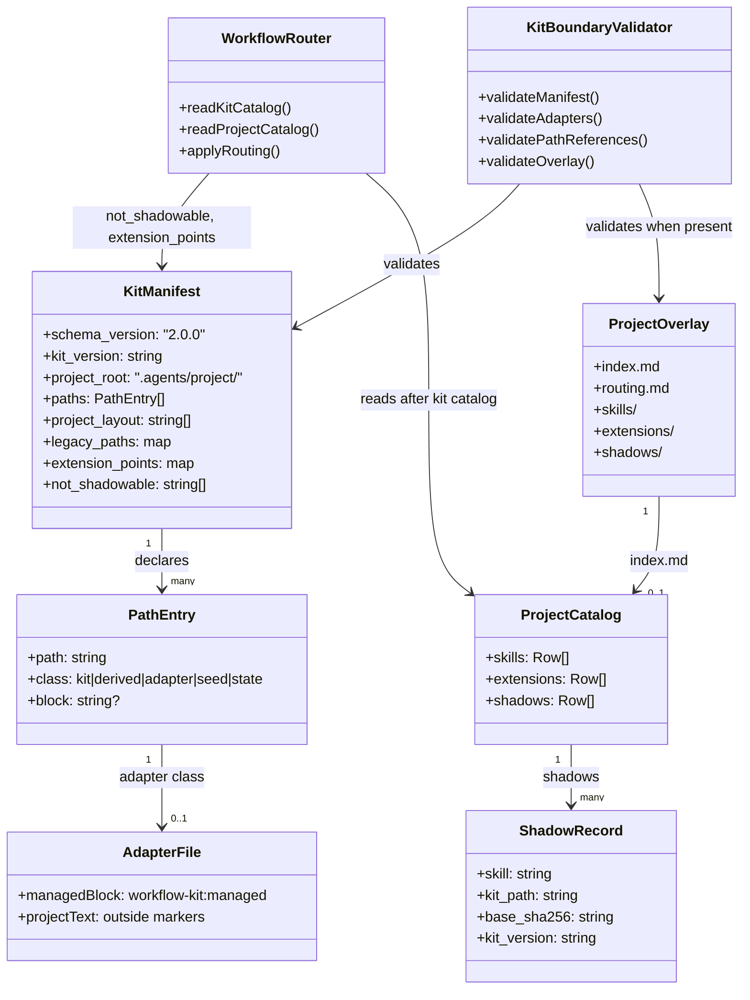
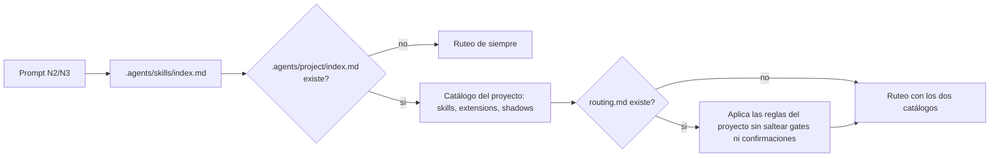

# PRD: Contrato kit/overlay (PRD 1 de la épica kit-project-overlay)

**Ticket**: Épica `kit-project-overlay`, fase F1, fila 1 de la cola de PRDs
**Autor**: Agente (sesión F1)
**Fecha**: 2026-11-21
**Estado**: Cerrada (PR #80, `0.20.0-kit-overlay-contract`, squash `7a1f91c`, integrada en `main` el 2026-11-21)

---

## 1. Contexto y Objetivo

Hoy un proyecto extiende el kit editando archivos del kit en el lugar, y nada escribe qué ruta es del kit y cuál del proyecto. Este PRD fija ese límite por escrito y lo hace cumplir con un validador en `check:workflow`. El actualizador no cambia: el límite queda listo para que F2 lo use.

> **Alcance estricto**: manifiesto v2 con clases por ruta, layout de `.agents/project/**`, niveles add/extend/shadow, `.agents/project/routing.md`, reglas de referencia entre rutas (`INV-PATH-01`), bloque `workflow-kit:managed` en los adaptadores, router que lee el catálogo del kit y el del proyecto, y las decisiones P1, P3, P5 y P10. **No incluye** cambios en `src/**` ni `bin/**` (actualizador, migración, drift check, `doctor`: F2), runbooks (F3) ni modo plugin (F4).

**Sketch heredado**: `docs/design/kit-project-overlay-sketch.md` (Locked, opción B)
**UI lock**: not-applicable
**Visible UI**: No. Cambia el contrato de archivos del kit; el CLI y el TUI no cambian.

### Contexto de Epica Padre

**parent_epic**: `docs/epics/kit-project-overlay/kit-project-overlay.md`

| Invariante heredada | AC hijo | Estado | Change request aprobado |
| --- | --- | --- | --- |
| INV-OWN-01 | AC-1, AC-6 (contrato: el kit no reclama rutas bajo `.agents/project/**` y no siembra archivos nuevos ahí). El cumplimiento en `update` es de F2. | Mapeada | No aplica |
| INV-OWN-02 | AC-1 (el manifiesto es la única fuente del ownership). Borrar los conjuntos de `src/planner.mjs` es de F2. | Mapeada | No aplica |
| INV-EXT-01 | AC-2, AC-5, AC-9 | Mapeada | No aplica |
| INV-EXT-02 | AC-2 (el shadow guarda el hash base). El aviso de `doctor` es de F2. | Mapeada | No aplica |
| INV-PATH-01 | AC-4 | Mapeada | No aplica |
| INV-DIST-01 | AC-6 (el modo repo no cambia) | Mapeada | No aplica |
| INV-DIST-02 | AC-1 (un solo árbol fuente, `.agents/`) | Mapeada | No aplica |
| INV-RUN-01, INV-RUN-02 | AC-5 (`routing.md` no puede quitar la confirmación de una acción irreversible). El resto es de F3. | Mapeada parcial | No aplica |
| INV-NEUT-01 | AC-10 | Mapeada | No aplica |
| INV-MIG-01 | No aplica: F1 no migra nada | No aplica | No aplica |
| INV-SEQ-01 | Verificada: #6 (0.19.0), #5 (0.19.1) y #4 (0.19.2) están en `main` (67c2ec5) | Cumplida | No aplica |
| INV-CUT-01 | AC-6 | Mapeada | No aplica |

**Path vivo heredado**: Debe seguir.
**Secuencia de corte heredada**: F1 → (F2 ∥ F3) → F4
**Este PRD respeta el corte**: Si

### Contrato entre Fases

**Ledger leido**: `docs/epics/kit-project-overlay/kit-project-overlay-ledger.md`
**PRD anterior en la cola**: No aplica (primer PRD)

**Precondiciones**:

| ID | Precondicion | Origen | Verificado en discovery |
| --- | --- | --- | --- |
| PRE-1 | #6, #4 y #5 integradas en `main` | Épica, `INV-SEQ-01` | Si (`git log`: 9901069, 737bd36, 3e233f4) |
| PRE-2 | `.agents/` y la plantilla son iguales salvo `install-state.json` | Evidence pack | Si (`diff -rq`) |

**Postcondiciones**:

| ID | Postcondicion | Como se prueba |
| --- | --- | --- |
| POST-1 | `.agents/workflow-kit/manifest.json` v2 cubre con una sola clase cada archivo instalable. F2 lo lee en vez de los conjuntos de `src/planner.mjs`. | `validate-kit-boundary` en `check:workflow` |
| POST-2 | Los 5 adaptadores protegidos tienen exactamente un bloque `workflow-kit:managed`. F2 regenera solo ese bloque. | Validador + test |
| POST-3 | El layout de `.agents/project/**` y los formatos de `index.md`, `routing.md`, `extensions/` y `shadows/<skill>/shadow.json` están escritos en `.agents/kit-boundary.md`. F2 y F3 escriben solo ahí. | Revisión del contrato + test sobre fixture |
| POST-4 | Las referencias del kit a `.agents/project/context.md` caen a `.agents/project-context.md` si falta (P3). F2 mueve el archivo. | Validador (`legacy_paths`) |
| POST-5 | La plantilla solo distribuye, bajo `.agents/project/`, los archivos de clase `seed` (P5). F2 cambia el drift check para comparar solo rutas del manifiesto. | Validador |
| POST-6 | El default del quality gate es del kit (`.agents/delegation/quality-gate.md`) y el archivo del proyecto solo agrega (P10). F2 aplica el mismo patrón a `stack.md`. | Validador + lectores actualizados |

### Estado Actual

| Capa | Componente | Archivo |
| --- | --- | --- |
| Manifiesto | Solo documenta: `portable_core`, `repo_overlay`, `not_an_installer`. Nadie lo lee. | `.agents/workflow-kit/manifest.json` |
| Ownership en el CLI | Tres conjuntos escritos a mano (fuera de alcance) | `src/planner.mjs:17-47` |
| Drift | Exige `.agents/` igual a la plantilla byte a byte (fuera de alcance) | `src/workflow-contract/drift.mjs:20-57` |
| Adaptadores | Solo el bloque del prefiltro tiene marcadores | `CLAUDE.md`, `AGENTS.md`, `ANTIGRAVITY.md`, `.github/copilot-instructions.md`, `.github/instructions/ai-workflow.instructions.md` y sus plantillas |
| Router | Lee solo `.agents/skills/index.md`. El core tiene 196 de 200 líneas. | `.agents/skills/00-router/workflow-router/SKILL.md` |
| Extensión | Se edita el kit en el lugar | `docs/extending-the-workflow.md`, `add-project-pattern/SKILL.md:24-58` |
| Quality gate | El default del kit vive en un archivo del proyecto que se preserva | `.agents/project/quality-gate.md` |

---

## 2. Requerimientos Funcionales

### 2.1 Manifiesto v2

`.agents/workflow-kit/manifest.json` pasa a `schema_version: "2.0.0"`, con su schema en `.agents/workflow-kit/manifest.schema.json`.

| Campo | Tipo | Descripcion |
| --- | --- | --- |
| `kit_version` | string | Igual a `package.json#version` |
| `contract` | string | `.agents/kit-boundary.md` |
| `project_root` | string | `.agents/project/` |
| `classes` | objeto | `kit` (el kit es dueño del archivo entero), `derived` (el kit lo genera), `adapter` (el kit es dueño solo del bloque entre marcadores), `seed` (el kit lo crea una vez si falta y después es del proyecto) y `state` (estado del CLI) |
| `paths[]` | `{path, class, block?}` | Lista cerrada. Una ruta que termina en `/` es un prefijo. Gana la entrada más específica. `block` es el nombre del marcador de un `adapter` (por defecto `workflow-kit:managed`). |
| `project_layout[]` | string[] | Las rutas del overlay que el kit puede nombrar |
| `legacy_paths` | `{vieja: nueva}` | `.agents/project-context.md` → `.agents/project/context.md` |
| `extension_points` | `{skill: archivo}` | `workflow-router` e `instructions` → `.agents/project/routing.md`; `quality-gate` → `.agents/project/quality-gate.md` |
| `not_shadowable` | string[] | `workflow-router`, `instructions` |

### 2.2 Regla de Negocio: niveles de extensión y layout del overlay

> **Decision confirmada**: el proyecto extiende el kit solo desde `.agents/project/**`, en este orden de preferencia: **add** (archivo nuevo), **extend** (archivo de un punto de extensión declarado en el manifiesto) y **shadow** (`shadows/<skill>/SKILL.md` más `shadow.json` con `skill`, `kit_path`, `base_sha256` y `kit_version`). El router y `instructions.md` solo admiten extend. Un extend o un shadow cuenta solo si figura en `.agents/project/index.md`. Las skills del proyecto se alcanzan solo por el router: ningún runtime las descubre en esa ruta (P1).

**Condicion de aplicacion**: cada vez que el router arma el catálogo, y cada vez que un agente agrega o ajusta una skill en un repo destino.
**Layout**: `index.md` (catálogo: tablas Skills, Extensions y Shadows), `routing.md`, `skills/<nombre>/SKILL.md`, `extensions/<skill>.md`, `shadows/<skill>/`, `context.md`, `quality-gate.md`, `backend.md`, `frontend.md`, `stack.md` y `paths.json`.
**Campos NO afectados**: `.agents/skills/**` sigue siendo del kit y no se mueve, así que el descubrimiento nativo de las skills del kit no cambia.
**Almacenamiento**: archivos markdown y JSON en el repo destino. F1 no siembra ninguno nuevo (supuesto A4).

### 2.3 Criterios de Aceptacion

| ID | Given | When | Then | Evidence expected |
| --- | --- | --- | --- | --- |
| AC-1 | La plantilla del overlay y las de los adaptadores | Corre `validate-kit-boundary` | Cada archivo instalable cae en exactamente una entrada del manifiesto. Ninguna entrada `kit`, `derived` ni `adapter` está bajo `.agents/project/`. `kit_version` es igual a la de `package.json`. Si falta cobertura, hay duplicados o una ruta no existe, el validador falla. | Test con fixture mutado y el repo real en verde |
| AC-2 | `.agents/kit-boundary.md` | Un agente lo lee | Tiene el layout, add/extend/shadow con su orden, formatos de `index.md`, `routing.md`, extend y `shadow.json`, la regla de que el router e `instructions.md` no admiten shadow, y las reglas de rutas | Revisión + test de que nombra cada entrada de `project_layout` |
| AC-3 | Los 5 adaptadores protegidos, en la raíz y en la plantilla | Corre el validador | Cada uno tiene exactamente un bloque `workflow-kit:managed`, el prefiltro queda adentro y el bloque de la raíz es igual al de la plantilla. Si falta, está duplicado o difiere, falla. | Test con fixture |
| AC-4 | Archivos `kit` en markdown bajo `.agents/` y los bloques de los adaptadores | Corre el validador | Falla con: una referencia `.agents/...` del kit que no existe, una referencia a `.agents/project/...` fuera de `project_layout`, o un archivo del proyecto que nombra una ruta `.agents/skills/...` | Test con tres fixtures |
| AC-5 | Un repo con `.agents/project/index.md` y `routing.md` | Llega un prompt N2/N3 | El router lee primero el catálogo del kit, después el del proyecto y `routing.md`. Si una skill del proyecto tiene el nombre de una del kit, se ignora y se avisa. Una regla de `routing.md` no puede saltear un hard trigger, el gate de autorización ni la confirmación de una acción irreversible. | Prompts L16–L20 en `router-evals.md` |
| AC-6 | Un repo con el layout 0.19 (sin `index.md` ni `routing.md` del proyecto) | Rutea y corre el validador | El router rutea igual que antes (exists-or-skip). La plantilla no distribuye archivos nuevos bajo `.agents/project/`, solo `seed`. El validador pasa sobre un fixture sin overlay. | L18 + test con fixture sin overlay |
| AC-7 | Un slice que escribe código | El delegado carga el quality gate | Carga `.agents/delegation/quality-gate.md` y después `.agents/project/quality-gate.md` si existe. Los agregados del proyecto endurecen, nunca relajan. La plantilla del proyecto pasa a ser un stub de agregados. | Lectores actualizados + validador: un archivo del proyecto no referencia rutas del kit |
| AC-8 | Una skill del kit que lee el contexto del proyecto | Corre en un repo con el layout viejo | Lee `.agents/project/context.md` y, si falta, `.agents/project-context.md` | `rg` sin referencias a la ruta vieja sin su ruta nueva + entrada en `legacy_paths` |
| AC-9 | Un usuario pide un pattern del proyecto | Corre `add-project-pattern` | La skill se crea en `.agents/project/skills/<nombre>/SKILL.md` y se registra en `.agents/project/index.md`. Nunca escribe en `.agents/skills/**` ni en los registries del kit. | Revisión de `add-project-pattern` + L17 |
| AC-10 | El repo completo | Se cierra el PRD | `check:workflow` incluye el validador y pasa. Pasan `npm test` y `check:release`. El espejo de la plantilla está igual. Se respetan el límite de tamaño y la neutralidad. `docs/project-boundaries.md` y `docs/extending-the-workflow.md` describen el overlay. La versión es `0.20.0-kit-overlay-contract`. `src/**` y `bin/**` no cambian. | Salida de los comandos + `git diff --stat main -- src bin` vacío |

### 2.4 Casos de Uso

| ID | Actor | Precondiciones | Flujo principal | Resultado observable (falsable) | AC vinculado |
| --- | --- | --- | --- | --- | --- |
| UC-1 | Mantenedor del kit | Agrega un archivo a la plantilla | Corre `check:workflow` | Falla si el archivo no tiene clase en el manifiesto | AC-1, AC-10 |
| UC-2 | Equipo del proyecto | Quiere un pattern propio | Pide `add-project-pattern` | El archivo queda en `.agents/project/skills/` y la fila en `.agents/project/index.md`. `git status` no muestra cambios en `.agents/skills/`. | AC-2, AC-9 |
| UC-3 | Equipo del proyecto | Necesita ajustar la regla de ruteo | Escribe `.agents/project/routing.md` | El router aplica la regla y sigue pidiendo confirmación en los pasos irreversibles | AC-2, AC-5 |
| UC-4 | Equipo del proyecto | Necesita reemplazar una skill hoja | Crea `shadows/<skill>/` con `shadow.json` y la fila en `index.md` | El router carga el shadow. Un shadow de `workflow-router` se ignora y se avisa. | AC-2, AC-5 |
| UC-5 | Proyecto instalado con 0.19 | Sin overlay nuevo | Actualiza a 0.20 y trabaja | Rutea igual. Lee el quality gate del kit y su archivo viejo. Lee `project-context.md` por el fallback. | AC-6, AC-7, AC-8 |
| UC-6 | Mantenedor del kit | Edita una skill del kit con una ruta mal escrita | Corre `check:workflow` | Falla y nombra el archivo y la referencia | AC-4 |
| UC-7 | Mantenedor del kit | Edita el adaptador de Claude en la plantilla | Corre `check:workflow` | Falla si la copia de la raíz quedó distinta o se perdió un marcador | AC-3 |

### 2.5 Estrategia de Tests

| Nivel | Objetivo | Caso de uso vinculado | Cobertura esperada | Comando o mecanismo de validacion |
| --- | --- | --- | --- | --- |
| Contrato | El repo real cumple el límite | UC-1, UC-6, UC-7 | Manifiesto, adaptadores y referencias | `node scripts/validate-kit-boundary.mjs` (dentro de `check:workflow`) |
| Unidad | Cada regla del validador falla cuando corresponde (una mutación por regla sobre una copia temporal) | UC-1, UC-4, UC-5, UC-6, UC-7 | Cobertura, clase bajo el overlay, marcadores, referencia colgada, referencia fuera del layout, archivo del proyecto con ruta del kit, colisión o shadow no admitido en `index.md`, fixture sin overlay en verde | `node --test test/kit-boundary.test.mjs` |
| Contrato | Forma de la tabla de evals del router | UC-3, UC-5 | L16–L20 válidas | `node --test test/level-prefilter-router.test.mjs` |
| Smoke manual | Ruteo real con el catálogo del proyecto | UC-2, UC-3, UC-4 | L16–L20 en Claude Code | Se registra en el PR, como pide `router-evals.md` |
| Regresión | Nada del CLI se rompe | UC-5 | Suite completa | `npm test`, `npm run check:release` |

### 2.6 Matriz de Edge Cases

| Categoria | Descripcion | Caso de uso vinculado | Capa duena | Validacion | Estado |
| --- | --- | --- | --- | --- | --- |
| Datos vacios | Repo sin `.agents/project/index.md` ni `routing.md`: el kit lo trata como vacío y no falla | UC-5 | Router (contrato) + validador | L18 + test de fixture sin overlay | Verified (test del fixture; L18 por smoke manual en Claude Code) |
| Limites | El core del router está en 196 de 200 líneas: lo nuevo va a una referencia y el core suma ≤ 4 líneas | UC-3 | Router | `validate-skill-size` | Verified (el core del router tiene 199 líneas hoy) |
| Errores | Una fila de `index.md` apunta a un archivo que no existe, o un shadow sin `shadow.json` | UC-4 | Validador | Test | Verified |
| Permisos/tenancy | `routing.md` intenta quitar la confirmación de una acción irreversible o saltear el gate: se ignora y se avisa | UC-3 | Router | L20 | Verified por smoke manual en Claude Code (sin test automático) |
| Concurrencia/orden | Una skill del proyecto con el mismo nombre que una del kit: gana la del kit y se avisa. Para reemplazarla, se usa shadow. | UC-2, UC-4 | Router + validador | L19 + test de colisión | Verified (test de colisión; L19 por smoke manual en Claude Code) |
| Rollout/rollback | Hasta F2, una instalación 0.19 conserva el default completo en su `.agents/project/quality-gate.md` y además lee `.agents/delegation/quality-gate.md`, así que las reglas quedan duplicadas. Es seguro: duplicar no relaja ninguna regla, y el default nuevo (0.19.0) llega igual. F2 reduce ese archivo a los agregados del proyecto. | UC-5 | Lectores del quality gate | Revisión de los lectores: cargan los dos archivos y ninguno pide ignorar el default | Verified por revisión (QA `qa-relampago`, sección 10) |
| Rollout/rollback | Instalación 0.19 que actualiza: los adaptadores sin editar reciben los marcadores (el hash coincide). Los editados quedan en `skip_modified` como hoy, sin pérdida. Rollback con `workflow-kit rollback` como siempre. | UC-5 | Actualizador existente (sin cambios) | `npm test` (`test/upgrade-e2e.test.mjs` sigue en verde) | Verified |

### 2.7 Contrato Visual (UI lock)

**UI lock**: not-applicable. Ninguna pantalla cambia: son archivos de contrato y un validador.

### 2.8 Supuestos e integraciones

| Supuesto | Fuente | Estado | Evidencia | Que pasa si es falso |
| --- | --- | --- | --- | --- |
| Codex, VS Code Copilot, Copilot CLI y Cursor no descubren `.agents/project/skills/**` | Docs y código fuente de los runtimes (2026-11-21) | verificado | learn.chatgpt.com/docs/build-skills, `codex-rs/ext/skills/src/loader/*`; code.visualstudio.com agent-skills, `promptFilesLocator.ts`; docs.github.com about-agent-skills; cursor.com/docs/skills | Si alguno las descubriera, aparecerían también por la vía nativa. Sin daño: el router sigue siendo la entrada. |
| VS Code Copilot solo mira `<root>/<child>/SKILL.md`, así que no ve las skills anidadas del kit | Código fuente de VS Code | verificado | `findAgentSkillsInFolder` | Hallazgo fuera de alcance, ya existía. Queda como follow-up. |
| A1: las referencias kit→kit son rutas `.agents/...` ancladas a la raíz del kit, o links relativos al archivo. El build de F4 mapea el ancla. | Interpretación de `INV-PATH-01` | asumido | El validador garantiza que resuelven dentro del árbol del kit | F4 reescribe las rutas de forma mecánica: es posible porque todas están validadas |
| A2: los puntos de extensión se declaran en el manifiesto | Decisión de diseño | asumido | — | Se mueven a los metadatos de cada skill sin cambiar el layout |
| A3: un extend o un shadow cuenta solo si figura en `index.md` | Decisión de diseño | asumido | — | El router tendría que buscar archivos por skill en cada carga |
| A4: F1 no siembra archivos nuevos bajo `.agents/project/` | `src/planner.mjs:17-47`: un archivo nuevo ahí quedaría administrado por hash y `--overwrite-modified` lo pisaría | verificado | Lectura de `planner.mjs` | — |
| El actualizador actual sobrescribe un adaptador sin editar cuando el hash coincide | `src/planner.mjs:385-439` | verificado | Evidence pack | Los proyectos no recibirían los marcadores hasta F2. Sin pérdida. |

### 2.9 Que queda obsoleto

| Elemento | Tipo | Ubicacion | Reemplazado por | Accion | Consumidores | Slice | Busqueda de verificacion |
| --- | --- | --- | --- | --- | --- | --- | --- |
| Claves `portable_core`, `repo_overlay`, `runtime_adapters`, `derived_artifacts` y `not_an_installer` | configuracion | `.agents/workflow-kit/manifest.json` | `paths[]` con clases | eliminar | En el repo: docs | P1-S1 | `rg -n "not_an_installer\|portable_core\"" .agents templates docs scripts` → 0 |
| Guía de "editar en el lugar" | documentacion | `docs/extending-the-workflow.md`, `.agents/instructions.md` ("Workflow extension requests") | Extensión por overlay | adaptar | En el repo | P2-S2 | Revisión manual |
| Default completo del quality gate en el archivo del proyecto | documentacion | `.agents/project/quality-gate.md` y su espejo | `.agents/delegation/quality-gate.md` + stub | adaptar | Repos instalados: conservan su copia completa (se preserva) y la leen junto con el default del kit hasta F2. **Handoff a F2:** la migración reduce ese archivo a solo los agregados del proyecto, con backup y sin perder contenido editado. | P1-S3 | `rg -n "Map every acceptance criterion" .agents/project` → 0 |
| `add-project-pattern` escribe en `06-patterns` y en los registries del kit | codigo (skill) | `add-project-pattern/SKILL.md` | `.agents/project/skills/` + `index.md` | adaptar | En el repo | P2-S2 | `rg -n "Register the skill in .\.agents/skills/registry" .agents/skills/06-patterns/authoring/add-project-pattern` → 0 |
| Referencias a `.agents/project-context.md` sin la ruta nueva | documentacion | Skills del kit y `delegate-contract.md` | `.agents/project/context.md` con fallback | adaptar | Repos instalados (fallback) | P1-S3 | El validador falla con una ruta legacy sin su ruta nueva en la misma línea |

---

## 3. Modelo de Datos

### 3.1 Migracion Requerida

Ninguna. No hay persistencia: cambian un JSON del kit y archivos markdown. La migración de los repos instalados es de F2.

### 3.2 Diagrama de Clases

### 3.3 Diagrama de Flujo

---

## 4. Plan de Implementacion por Fases

### Fase 1 - Contrato y validador

**Objetivo**: el límite queda escrito y `check:workflow` lo hace cumplir.

| ID | Outcome | Depends on | Scope / likely files | Acceptance criteria | Use cases | Tests | Edge cases | Validation | Evidence |
| --- | --- | --- | --- | --- | --- | --- | --- | --- | --- |
| P1-S1 | Manifiesto v2, su schema, el contrato `kit-boundary.md` y el validador con cobertura y clases | none | `.agents/workflow-kit/manifest*.json`, `.agents/kit-boundary.md`, `scripts/validate-kit-boundary.mjs`, espejo, `package.json` (`check:workflow`), `templates/template-manifest.json` | AC-1, AC-2 | UC-1 | `test/kit-boundary.test.mjs` (cobertura, clase bajo el overlay, versión) | Datos vacíos | `node scripts/validate-kit-boundary.mjs` | Salida en verde |
| P1-S2 | Bloque `workflow-kit:managed` en los 5 adaptadores protegidos (raíz y plantilla) + regla del validador | P1-S1 | 10 archivos de adaptadores + validador | AC-3 | UC-7 | Test de marcadores | Rollout/rollback | `npm run check:workflow` | Salida en verde |
| P1-S3 | Reglas de rutas (`INV-PATH-01`) + referencias legacy de contexto (P3) + quality gate dividido (P10) | P1-S1 | Validador, `.agents/delegation/quality-gate.md`, `.agents/project/quality-gate.md`, skills lectoras, `delegate-contract.md` y sus adaptadores generados | AC-4, AC-7, AC-8 | UC-5, UC-6 | Tests de referencia colgada, fuera del layout y proyecto→kit | Errores | `npm run check:workflow` | Salida en verde |

**Slice stop conditions**:
- Hace falta tocar `src/**` o `bin/**` para que un test pase: se detiene y se reporta.
- El validador encuentra más de 15 referencias colgadas ya existentes: se detiene y se acota con el usuario.

**Definition of Done**: cada slice `VERIFIED`, el validador en `check:workflow`, el espejo igual.

### Fase 2 - Router, extensión y cierre

**Objetivo**: el router usa los dos catálogos y la guía de extensión apunta al overlay.

| ID | Outcome | Depends on | Scope / likely files | Acceptance criteria | Use cases | Tests | Edge cases | Validation | Evidence |
| --- | --- | --- | --- | --- | --- | --- | --- | --- | --- |
| P2-S1 | Router con dos catálogos + `reference/project-overlay.md` + `instructions.md` + evals L16–L20 + regla de `index.md` en el validador | P1-S3 | Router core y referencias, `.agents/instructions.md`, `router-evals.md`, espejo | AC-5, AC-6 | UC-3, UC-4, UC-5 | Evals + test de la regla de `index.md` | Límites, Permisos, Concurrencia | `node --test test/level-prefilter-router.test.mjs test/kit-boundary.test.mjs` | Salida en verde |
| P2-S2 | `add-project-pattern`, `06-patterns/README.md`, `capabilities/README.md` y las docs de límites y extensión | P2-S1 | Esos archivos + espejo | AC-9 | UC-2 | Revisión | — | `npm run check:workflow` | Salida en verde |
| P2-S3 | Versión `0.20.0-kit-overlay-contract`, `CHANGELOG.md` y digest de `overlay-authorship.json` | P2-S2 | `package.json`, manifiesto, `CHANGELOG.md`, `docs/legal/overlay-authorship.json` | AC-10 | UC-1 | Suite completa | — | `npm test && npm run check:workflow && npm run check:release` | Salida en verde |

**Definition of Done**: suite completa en verde, smoke L16–L20 registrado en el PR, `src/**` y `bin/**` sin cambios.

### Fase Futura _(fuera de alcance de este PRD)_

- F2: reducir `.agents/project/quality-gate.md` de las instalaciones viejas a solo los agregados del proyecto, con backup y sin perder contenido editado (P10). `update` por manifiesto, `install-state` v2, drift check solo de las rutas del manifiesto (P5), movimiento de `project-context.md` (P3), `stack.md` como default del kit + extend (P10), aviso de `doctor` para los shadows y el `quality-gate-missing` de `src/project-instructions.mjs` (con el default del kit, el archivo del proyecto deja de ser obligatorio).
- F3: clase `Runbook` y su ruteo dentro del overlay.
- Follow-up aparte: VS Code Copilot no descubre las skills anidadas del kit.

---

## 5. Decisiones Tomadas

| # | Pregunta | Respuesta | Impacto en diseno |
| --- | --- | --- | --- |
| P1 | ¿Descubrimiento nativo de `.agents/project/skills/**`? | No existe en ningún runtime. Se alcanzan solo por el router. Sin stubs ni symlinks. | `index.md` del proyecto como catálogo; `add-project-pattern` escribe ahí |
| P3 | ¿Mover `project-context.md`? | Sí, en dos pasos: F1 contrato + fallback; F2 mueve el archivo | `legacy_paths` en el manifiesto; la plantilla sigue sembrando la ruta vieja |
| P5 | ¿Overlay propio de este repo? | Decide el manifiesto. `.agents/` es la fuente; bajo `.agents/project/` solo se distribuye `seed`. F2 cambia el drift check. | Regla del validador sobre la plantilla |
| P10 | ¿Default del kit en archivos del proyecto? | Default del kit + extend. Quality gate en F1; `stack.md` en F2. | `.agents/delegation/quality-gate.md` + stub |
| D1 | ¿Dónde vive el contrato? | `.agents/kit-boundary.md`, del kit y nombrado en el manifiesto | Lo leen el router, `add-project-pattern` y los humanos |
| D2 | ¿`add-project-pattern` cambia en F1? | Sí, solo el destino (`.agents/project/skills/` + `index.md`). La variante runbook es de F3. | F3 edita después el mismo archivo, en secuencia |

---

## 6. Preguntas Abiertas

- [x] Sin UI visible: `UI lock: not-applicable` con razón

_(Vacio = PRD listo para implementar)_

---

## 7. Riesgos y Mitigaciones

| Riesgo | Probabilidad | Impacto | Mitigacion |
| --- | --- | --- | --- |
| El validador de rutas destapa muchas referencias colgadas ya existentes | Media | Medio | Condición de parada en P1-S3: más de 15 se acotan con el usuario |
| Los marcadores rompen un adaptador editado en un repo instalado | Baja | Medio | El actualizador no cambia: un adaptador editado queda en `skip_modified` como hoy |
| Un repo viejo lee el quality gate dos veces (su copia completa + el default del kit) | Alta | Bajo | El contenido es compatible. F2 cambia por el stub las copias sin editar. |
| El core del router pasa de 200 líneas | Media | Bajo | Lo nuevo va a una referencia; el core suma ≤ 4 líneas |
| F2 y F3 tocan los mismos archivos que F1 | Alta | Medio | F1 se mergea antes. La lista de archivos va al reporte para el orquestador. |

---

## 8. Definition of Done Global

Marcado el 2026-11-25 contra `main` (`9d3b917`) y contra la evidencia de la sección 10. Cada casilla nombra qué la prueba.

- [x] Todas las fases completadas (sección 10: Fases 1 y 2, cerradas el 2026-11-21)
- [x] `npm test` en verde (349/349 al cerrar; el CI del PR #80 pasó en verde, y la suite de `main` en `9d3b917` pasó en el CI del PR #83)
- [x] `npm run check:workflow` y `npm run check:release` en verde (CI del PR #80; `check:workflow` corre hoy el validador `validate-kit-boundary`)
- [x] `git diff --stat main -- src bin` vacío (`git diff --stat 67c2ec5 7a1f91c -- src bin` no lista nada)
- [x] Espejo `.agents/` = plantilla (`check:workflow` y `check:templates`)
- [x] Todo AC tiene al menos un caso de uso vinculado y todo caso de uso tiene al menos un AC vinculado (secciones 2.3, 2.4 y 9)
- [x] Todo caso de uso tiene al menos un test en la Estrategia de Tests (sección 2.5)
- [x] La Matriz de Edge Cases cubre las seis categorias obligatorias (sección 2.6)

---

## 9. Matriz de Trazabilidad

| Acceptance criterion | Caso de uso | Phase / slice | Test evidence | Edge case(s) | Validation evidence | Status |
| --- | --- | --- | --- | --- | --- | --- |
| AC-1 | UC-1 | P1-S1 | `test/kit-boundary.test.mjs` | Datos vacíos | `validate-kit-boundary` | Verified |
| AC-2 | UC-2, UC-3, UC-4 | P1-S1 | `test/kit-boundary.test.mjs` | — | Revisión | Verified |
| AC-3 | UC-7 | P1-S2 | `test/kit-boundary.test.mjs` | Rollout/rollback | `check:workflow` | Verified |
| AC-4 | UC-6 | P1-S3 | `test/kit-boundary.test.mjs` | Errores | `check:workflow` | Verified |
| AC-5 | UC-3, UC-4 | P2-S1 | L16, L17, L19, L20 | Permisos, Concurrencia | Smoke en el PR | Verified por smoke manual (lectores ciegos en Claude Code; Codex y Copilot no se corrieron) |
| AC-6 | UC-5 | P2-S1 | L18 + fixture sin overlay | Datos vacíos | `npm test` | Verified (test del fixture sin overlay); L18 por smoke manual en Claude Code |
| AC-7 | UC-5 | P1-S3 | Validador | — | `check:workflow` | Verified |
| AC-8 | UC-5 | P1-S3 | Validador | — | `check:workflow` | Verified |
| AC-9 | UC-2 | P2-S2 | L17 | — | Revisión | Verified por revisión y smoke manual en Claude Code (L17) |
| AC-10 | UC-1 | P2-S3 | Suite completa | — | Comandos de cierre | Verified (comandos de cierre de la sección 10; CI del PR #80) |

---

## 10. Evidencia de Implementacion

**Estado**: Cerrada

| Campo | Evidencia durable |
| --- | --- |
| Cambios entregados | Contrato `.agents/kit-boundary.md`; manifiesto v2 `.agents/workflow-kit/manifest.json` + `manifest.schema.json`; validador `scripts/validate-kit-boundary.mjs` en `check:workflow` + `test/kit-boundary.test.mjs`; bloque `workflow-kit:managed` en 5 adaptadores (raíz y plantilla); router con catálogo del proyecto (`SKILL.md` + `reference/project-overlay.md` + evals L16–L20); matcher lee `.agents/project/index.md`; quality gate dividido (`.agents/delegation/quality-gate.md` + agregados del proyecto) y línea en el adaptador de Copilot; referencias de contexto con fallback legacy en skills, delegate contract, adaptadores generados y `docs/workflow`; `add-project-pattern`, `pattern-skill-template.md`, `init-legacy-attachments`, `06-patterns/README.md`, `capabilities/README.md`, `instructions.md`; docs `project-boundaries.md` y `extending-the-workflow.md`; versión 0.20.0-kit-overlay-contract; espejo y digest legal. |
| Criterios de aceptacion | AC-1..AC-4, AC-6..AC-10: COMPLETE (validador + tests). AC-5: COMPLETE. L16–L20 (más L16b) se corrieron en Claude Code con lectores ciegos sobre dos fixtures (overlay y layout 0.19); L16 se corrigió para que traiga un PRD (nivel N3 por la regla de hazards). Codex y Copilot no se corrieron. |
| Validaciones ejecutadas | `npm test` PASS (349/349); `npm run check:workflow` PASS; `npm run check:release` PASS; `npm run check:legal` PASS; `npm run check:docs` PASS; `git diff --stat main -- src bin` vacío. |
| Calidad y QA | Quality gate del kit aplicado. QA independiente (`qa-relampago`): primera pasada `ready_to_close: no` (2 high, 4 medium); re-entrada: 8 de 9 en PASS y 1 medium (shadow de un rol delegado). Ese último se corrigió (`role_skill` en el lock y en `delegate-contract.md`) y se verificó con los checks, sin tercera pasada de QA. |
| Referencia de cambio | Rama `claude/f1-kit-overlay-contract-c2e98f`, PR a `main`. |
| Riesgos o waivers | Instalaciones 0.19 leen el quality gate dos veces hasta F2 (seguro, no relaja). Archivo extra fuera de la lista del PRD: `implementation-skill-matcher/SKILL.md` (necesario para L16), `pattern-skill-template.md` e `init-legacy-attachments` (hallazgo QA). Búsqueda de claves obsoletas: 3 apariciones históricas en `docs/epics` y `docs/prd` (no distribuidas). |
| Checks reutilizados | Ninguno |
| Iteraciones y causa | 1 ronda de reparación por QA: `hueco del PRD` (template y skill legacy de patterns, wrapper de Copilot, reglas de extend/shadow) y `error de implementacion` (huecos del validador). |
| Modo de ejecucion | supervisado |
| Fecha de cierre | 2026-11-21 |
