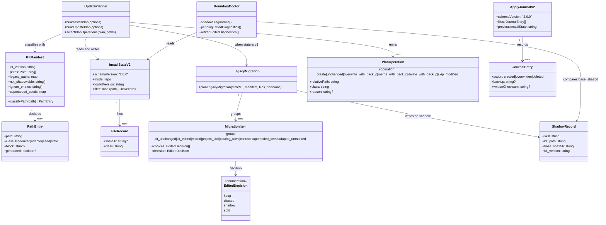
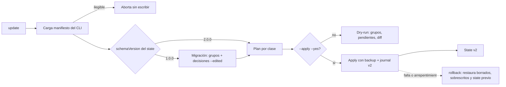

# PRD: Actualizador por manifiesto y migración (PRD 2 de la épica kit-project-overlay)

**Ticket**: Épica `kit-project-overlay`, fase F2, fila 2 de la cola de PRDs
**Autor**: Agente (sesión F2)
**Fecha**: 2026-11-21
**Estado**: Cerrada (PR #82, `0.22.0-manifest-updater`, squash `558e9fb`, integrada en `main` el 2026-11-22). Follow-ups abiertos en la sección 10.

---

## 1. Contexto y Objetivo

F1 dejó el límite escrito: `.agents/workflow-kit/manifest.json` dice de quién es cada ruta, pero el CLI no lo lee. `workflow-kit update` sigue decidiendo con tres conjuntos de rutas escritos a mano, protege los adaptadores completos, mezcla filas del proyecto en los catálogos del kit y nunca borra lo que el kit dejó de distribuir. Este PRD hace que `update` obedezca al manifiesto y migra una sola vez los repos instalados con el layout 0.18/0.19, con dry-run, backup y rollback.

> **Alcance estricto**: lectura del manifiesto en `src/`, plan por clase (`kit`, `derived`, `adapter`, `seed`, `state`), `install-state` v2, borrado de lo retirado sin editar (P4), journal v2 y rollback, migración desde un state v1 (skills propias al overlay, `project-context.md` → `.agents/project/context.md`, recorte del quality gate duplicado, adaptadores sin marcadores, archivos del kit editados con decisión por archivo), `doctor` del límite, drift check por manifiesto (P5), TUI y docs de migración. Incluye una slice chica de manifiesto y plantilla (P1-S1) que se coordina con el orquestador antes de editarla. **No incluye**: `stack.md` como default del kit + extend (P10 de `stack.md`, follow-up), runbooks (F3), modo plugin (F4), merge a 3 vías y cualquier cambio en archivos que son de F3: `scripts/validate-kit-boundary.mjs`, `test/kit-boundary.test.mjs`, `scripts/validate-stack-neutrality.mjs` y su test, `.agents/skills/registry.schema.json`. F2 solo los ejecuta; si necesitara cambiarlos, para y avisa al orquestador.

**Sketch heredado**: `docs/design/kit-project-overlay-sketch.md` (Locked, opción B)
**UI lock**: not-applicable
**Visible UI**: No. Cambia la salida de texto del CLI y las preguntas del TUI; no hay pantalla ni página.

### Contexto de Epica Padre

**parent_epic**: `docs/epics/kit-project-overlay/kit-project-overlay.md`

| Invariante heredada | AC hijo | Estado | Change request aprobado |
| --- | --- | --- | --- |
| INV-OWN-01 | AC-6, AC-8 | Mapeada con excepción | Sí: CR-F2-01 (usuario, 2026-11-21). Solo la migración desde un state v1 escribe en `.agents/project/**`, y solo para crear archivos nuevos, agregar filas a las tablas de `index.md` o reemplazar un seed idéntico byte a byte a un default que el kit distribuyó. Con state v2, `update` no modifica, mueve ni borra nada del overlay; solo crea un `seed` que falta y que nunca se creó (contrato F1). |
| INV-OWN-02 | AC-1, AC-14 | Mapeada | No aplica |
| INV-EXT-01 | AC-9 (`shadow` rechaza `not_shadowable`) | Mapeada | No aplica |
| INV-EXT-02 | AC-9 (hash base), AC-12 (aviso de `doctor`) | Mapeada | No aplica |
| INV-PATH-01 | No aplica: F2 no cambia referencias entre rutas; las valida F1 | No aplica | No aplica |
| INV-DIST-01 | AC-3 (`mode: "repo"`), AC-11 | Mapeada | No aplica |
| INV-DIST-02 | AC-1 (el CLI lee el manifiesto del único árbol del kit) | Mapeada | No aplica |
| INV-RUN-01, INV-RUN-02 | No aplica: runbooks son F3 | No aplica | No aplica |
| INV-NEUT-01 | AC-17 (fixtures sin contenido de dominio; `validate-stack-neutrality` en verde) | Mapeada | No aplica |
| INV-MIG-01 | AC-5, AC-7, AC-8, AC-10, AC-11 | Mapeada | No aplica |
| INV-SEQ-01 | Verificada: #6, #4 y #5 en `main` (9901069, 737bd36, 3e233f4) | Cumplida | No aplica |
| INV-CUT-01 | F2 va después de F1 (PR #80) y en paralelo con F3, sin archivos compartidos salvo P1-S1 (coordinada) | Mapeada | No aplica |

**Path vivo heredado**: Debe seguir.
**Secuencia de corte heredada**: F1 → (F2 ∥ F3) → F4
**Este PRD respeta el corte**: Si

### Contrato entre Fases

**Ledger leido**: `docs/epics/kit-project-overlay/kit-project-overlay-ledger.md`
**PRD anterior en la cola**: `docs/prd/kit-project-overlay/2026-11-21-kit-overlay-contract/kit-overlay-contract.md`

**Precondiciones**:

| ID | Precondicion | Origen | Verificado en discovery |
| --- | --- | --- | --- |
| PRE-1 | Manifiesto v2 con una clase por archivo instalable y la entrada más específica gana | F1 POST-1 | Si (`.agents/workflow-kit/manifest.json`, `validateCoverage`) |
| PRE-2 | Los 5 adaptadores tienen un bloque `workflow-kit:managed`; `docs/README.md` usa `workflow-kit:docs-workflow` | F1 POST-2 | Si (plantillas, línea 1 y fin de cada adaptador) |
| PRE-3 | Layout del overlay y formatos de `index.md` y `shadow.json` escritos en `.agents/kit-boundary.md` | F1 POST-3 | Si |
| PRE-4 | Las referencias del kit leen `.agents/project/context.md` con fallback a `.agents/project-context.md` | F1 POST-4 | Si (`legacy_paths`, adaptadores generados) |
| PRE-5 | La plantilla solo trae archivos `seed` bajo `.agents/project/` | F1 POST-5 | Si (4 archivos) |
| PRE-6 | Default del quality gate en `.agents/delegation/quality-gate.md`; el archivo del proyecto es un stub de agregados | F1 POST-6 | Si |

**Postcondiciones**:

| ID | Postcondicion | Como se prueba |
| --- | --- | --- |
| POST-1 | `update` decide solo con el manifiesto que trae la versión del CLI; `src/` no tiene conjuntos de rutas del kit | AC-14 (test de contrato) |
| POST-2 | `install-state` v2 (`schemaVersion: "2.0.0"`, `mode: "repo"`, `files: {ruta: {sha256, class}}`). F4 agrega `mode: "plugin"` sin cambiar la forma. | AC-3 |
| POST-3 | El repo destino tiene su `manifest.json` instalado; `doctor` y F4 pueden leerlo | AC-1 |
| POST-4 | Journal v2 con acción `deleted`; `rollback` deshace creaciones, sobrescrituras y borrados | AC-5 |
| POST-5 | Los repos migrados usan `.agents/project/context.md`, el catálogo del proyecto y shadows con hash base | AC-8, AC-9 |
| POST-6 | `validateOverlayDrift` compara solo rutas del manifiesto (P5 cumplido) | AC-13 |

### Estado Actual

Verificado contra `main` 7a1f91c (0.20.0).

| Capa | Componente | Archivo |
| --- | --- | --- |
| Ownership | Tres conjuntos escritos a mano: se preservan, se mezclan filas, protegidos | `src/planner.mjs:18-28`, `:32-36`, `:40-47` |
| Plan de update | Por hash, archivo por archivo; `skip_modified` para siempre; sin borrados | `src/planner.mjs:249-486` |
| Plantilla | Recorre todo el overlay y omite `.agents/workflow-kit/**`: el manifiesto nunca se instala | `src/planner.mjs:95-121` (`:110`) |
| State | v1 `files: {ruta: sha256}`; los seeds pierden el hash al primer update (`dropFromState`); los retirados quedan para siempre | `src/planner.mjs:611-654`, `:336-347` |
| Marcadores | Merge por marcadores solo para `docs/README.md` | `src/planner.mjs:956-987` |
| `.gitignore` | Entradas escritas a mano en `src/` | `src/planner.mjs:1071-1126` |
| Journal y rollback | Acciones `created` y `overwritten` | `src/apply.mjs:8-9`, `:104-117`; `src/rollback.mjs:41-71` |
| Drift | Compara `.agents/` entero byte a byte | `src/workflow-contract/drift.mjs:7-57` |
| Doctor | Drift por hash y filas de catálogos locales; nada del límite | `src/doctor.mjs:16-38`, `:70-108` |
| Contexto del proyecto | Ruta legacy fija | `src/workspace-diagnostics.mjs:78` |
| Quality gate de Copilot | El wrapper sale solo del archivo del proyecto; aviso `quality-gate-missing` | `src/project-instructions.mjs:67-82`, `:105-107` |
| TUI | Pregunta única "Keep my edits / Replace" | `src/tui.mjs:866-895` |

---

## 2. Requerimientos Funcionales

### 2.1 Manifiesto en el CLI e `install-state` v2

`src/kit-manifest.mjs` (nuevo) carga `templates/repo-overlay-fhh-ia-ecosystem-full/.agents/workflow-kit/manifest.json` y expone `classifyPath(ruta)` (la entrada más específica gana; un prefijo termina en `/`), `managedBlock(contenido, nombre)` y `replaceManagedBlock(contenido, bloque, nombre)`.

`install-state.json` v2:

| Campo | Tipo | Descripcion |
| --- | --- | --- |
| `schemaVersion` | `"2.0.0"` | Un CLI viejo falla con el mensaje de siempre ("upgrade the CLI") |
| `managedBy`, `toolkitVersion`, `generatedAt`, `runtimes`, `overlay`, `modelProfiles`, `stackPack` | como v1 | Sin cambios |
| `mode` | `"repo"` | F4 agrega `"plugin"` |
| `files` | `{ruta: {sha256?, class}}` | `kit` y `derived`: hash del archivo. `adapter`: hash del bloque. `seed`: sin hash (el kit no vigila contenido del proyecto), solo marca que ya se creó. `state` no se registra. |

Cambios en el manifiesto y la plantilla (slice P1-S1, coordinada con el orquestador):

| Cambio | Motivo |
| --- | --- |
| Seed `.agents/project/context.md` (la plantilla mueve el archivo); `.agents/project-context.md` sale de `paths` y sigue en `legacy_paths` | P3, segundo paso |
| `docs/workflow/migration/legacy-docs-map.md` como `seed` con `generated: true` | Sin esto P4 lo borraría: es evidencia del usuario |
| `ignore_entries: [".ai-work/", "/.agents/workflow-kit/last-apply.json"]` | Saca de `src/` las entradas de `.gitignore` (INV-OWN-02) |
| `superseded_seeds: {".agents/project/quality-gate.md": [sha256 de ded2c15, sha256 de 9901069]}` | Permite reconocer un seed sin editar (CR-F2-01) |
| `manifest.schema.json` acepta las dos claves nuevas; `kit-boundary.md` actualiza la nota del contexto legacy | Contrato |

### 2.2 Regla de Negocio: plan por clase

> **Decision confirmada**: con state v2, `update` trata cada ruta según su clase y nunca según una lista de `src/`.

| Clase | Falta en disco | Igual al hash registrado | Distinto al hash registrado (editado) |
| --- | --- | --- | --- |
| `kit`, `derived` | `create` | reemplaza (`overwrite_with_backup` o `unchanged`) | `skip_modified` con `reason: "edited_kit_file"` (pendiente) |
| `adapter` | `create` | regenera solo el bloque | regenera solo el bloque (el bloque es del kit, F1); el texto de afuera queda byte a byte |
| `seed` | `create` solo si no figura en el state | no se toca | no se toca |
| Retirado (en el state previo, fuera del plan, clase `kit` o `derived`, sin `generated`) | se borra del state | `delete_with_backup` (P4) | se deja, sale del state y `doctor` avisa |

Los catálogos (`.agents/skills/index.md`, `registry.json`, `registry.cache.json`, `06-patterns/index.md`) son `derived`: se reemplazan enteros, sin mezclar filas ni entradas autodetectadas. `delete_with_backup` siempre guarda backup, aunque se pida `--backup-mode none`. Un directorio que queda vacío después de borrar se elimina. Un `*.workflow-kit-backup-*` nunca cuenta como archivo propio ni retirado.

### 2.3 Regla de Negocio: migración desde un state v1

> **Decision confirmada**: la migración corre dentro de `update` cuando el state es v1. El dry-run la muestra agrupada y no escribe nada. Al aplicar, cada movimiento o reescritura guarda backup y queda en el journal.

| Grupo | Detección | Acción |
| --- | --- | --- |
| Kit sin cambios | Ruta `kit`/`derived` con hash v1 igual | Como en 2.2 |
| Kit editado | Hash v1 distinto | Pendiente salvo decisión (2.4) |
| Retirado | En el state v1, fuera del plan | Como en 2.2 |
| Skill propia | Directorio con `SKILL.md` bajo `.agents/skills/**` que no está en la plantilla ni en el state v1 | Se mueve entero a `.agents/project/skills/<nombre>/` y suma una fila en la tabla `Skills` de `.agents/project/index.md`. Si el nombre ya existe en el kit o en el overlay: pendiente, no se mueve. |
| Filas propias de catálogos | Filas de `index.md`/`registry.md` y entradas de `registry.json` cuya ruta no es del kit | Pasan a `.agents/project/index.md` con la ruta nueva; el catálogo se reemplaza (backup + diff en el dry-run) |
| Contexto | Existe `.agents/project-context.md` y no existe `.agents/project/context.md` | Se mueve (mismo contenido). Si existen los dos: no se toca y `doctor` avisa. |
| Seed superseded | `.agents/project/quality-gate.md` con hash en `superseded_seeds` | Se reemplaza por el stub actual (backup) |
| Adaptador sin marcadores | Hash v1 igual: plantilla. Distinto: pendiente con opción `split` | 2.4 |

### 2.4 Regla de Negocio: decisiones sobre archivos editados

| Decisión | Aplica a | Efecto |
| --- | --- | --- |
| `keep` (default) | todos | No se toca; queda pendiente y `doctor` avisa |
| `discard` | todos | Versión del kit, con backup |
| `shadow` | `SKILL.md` de una skill hoja que no está en `not_shadowable` | Copia el archivo editado a `.agents/project/shadows/<skill>/SKILL.md`, escribe `shadow.json` (`skill`, `kit_path`, `base_sha256` = hash v1 registrado, `kit_version` = `toolkitVersion` del state), suma la fila en `Shadows` y reemplaza el archivo del kit |
| `split` | adaptadores sin marcadores | Bloque nuevo arriba; las líneas propias (las que no aparecen en el bloque nuevo, en su orden) debajo del marcador de fin |

CLI: `--edited <ruta>=<decisión>` (repetible) y `--edited all=<decisión>`. Una ruta que no está pendiente, una decisión que no aplica (por ejemplo `shadow` de `workflow-router`) o un valor desconocido termina con código 2 antes de escribir. La opción interna `overwriteModified` del TUI pasa a ser `all=discard`.

TUI: con archivos pendientes pregunta **Keep** (default) / **Replace all** / **Decide file by file** (una pregunta por archivo con sus decisiones válidas y el diff corto). En la selección parcial, la migración es un bloque atómico; los borrados de retirados sí se pueden quitar.

### 2.5 Criterios de Aceptacion

| ID | Given | When | Then | Evidence expected |
| --- | --- | --- | --- | --- |
| AC-1 | La plantilla del CLI | Se arma un plan de `init` o `update` | Cada operación tiene la clase del manifiesto. Una ruta planificada sin clase o un manifiesto ilegible abortan el plan sin escribir y nombran la ruta. `manifest.json` y su schema se instalan como `kit`. | `test/kit-manifest.test.mjs`, `test/planner.test.mjs` |
| AC-2 | Un repo con state v2 | `update` | Se cumple la tabla de 2.2 para `kit`, `derived`, `adapter` y `seed`; los catálogos se reemplazan sin filas ajenas | `test/planner.test.mjs` |
| AC-3 | Cualquier apply | Se escribe el state | Tiene la forma v2 de 2.1, con `mode: "repo"`; el hash de un adaptador es el de su bloque; los seeds sin hash | `test/planner.test.mjs` |
| AC-4 | Un archivo del kit que la versión nueva ya no trae | `update` | Sin editar: `delete_with_backup` (también con `--backup-mode none`) y se eliminan los directorios vacíos. Editado: no se borra. `legacy-docs-map.md` nunca se borra. | `test/planner.test.mjs` |
| AC-5 | Un apply con borrados, movimientos y sobrescrituras | `rollback --apply --yes` | Restaura borrados y sobrescritos, quita los creados y devuelve el state anterior (v1 incluido). Un journal 1.0.0 se sigue deshaciendo. | `test/rollback-journal.test.mjs` (nuevo) |
| AC-6 | Un repo con state v2 y un overlay con archivos editados | `update` | Cero operaciones que modifican, mueven o borran algo bajo `.agents/project/**` | `test/planner.test.mjs` |
| AC-7 | Un repo con state v1 | `update` sin `--apply` | La salida muestra los grupos de 2.3 con conteos y, por cada pendiente, sus decisiones válidas; no se escribe nada | `test/migration.test.mjs` (nuevo) |
| AC-8 | Un repo v1 con skill propia, filas propias, `project-context.md` y quality gate 0.19 sin editar | `update --apply --yes` | La skill y su fila quedan en el overlay; `.agents/project/context.md` tiene el contenido viejo; el quality gate es el stub; todo con backup. Una colisión de nombre queda pendiente. | `test/migration.test.mjs` |
| AC-9 | Archivos pendientes | `--edited` con cada decisión | `shadow` crea `SKILL.md`, `shadow.json` con el hash v1 y la fila; `split` deja el texto propio fuera de los marcadores; `discard` deja la versión del kit con backup; una decisión inválida sale con código 2 sin escribir | `test/migration.test.mjs`, `test/cli-args.test.mjs` |
| AC-10 | Un repo recién migrado | Segundo `update` | Cero escrituras y ninguna migración; los pendientes siguen pendientes sin escribir | `test/migration.test.mjs`, e2e |
| AC-11 | Un repo con el layout 0.18.1 para Claude, Codex, Copilot y Antigravity | `update --apply --yes`, segundo `update` y `rollback` | El contenido propio se conserva; el segundo update no escribe; el rollback deja el árbol igual byte a byte al de antes | `test/upgrade-e2e.test.mjs` |
| AC-12 | Un repo migrado | `doctor` | Avisa (warning): shadow con `base_sha256` distinto del archivo del kit, kit editado pendiente, retirado editado, contexto en las dos rutas. Lee `.agents/project/context.md` con fallback. El wrapper de Copilot del quality gate sale del default del kit más los agregados. Ya no existen `skills/local-catalog-missing-skill` ni `quality-gate-missing`. | `test/doctor.test.mjs`, `test/project-instructions.test.mjs` |
| AC-13 | El repo del kit | `check:workflow` | `validateOverlayDrift` compara solo las rutas `kit`, `derived` y `seed` del manifiesto bajo `.agents/`; un archivo propio no seed bajo `.agents/project/` no cuenta como drift | `test/workflow-contract.test.mjs` |
| AC-14 | `src/` | Corre el test de contrato | No hay literales de rutas del kit (`'.agents/skills/`, `.agents/project-context.md`) ni conjuntos de ownership; `skillCatalogPreservePaths`, `skillCatalogRowPaths` y `protectedCustomizationPaths` no existen | `test/workflow-contract.test.mjs` |
| AC-15 | `update` en el TUI con pendientes | Se elige cada opción | Keep deja pendientes; Replace all los descarta con backup; Decide file by file pregunta por archivo solo con decisiones válidas; la selección parcial no parte la migración | `test/tui.test.mjs` |
| AC-16 | P1-S1 aplicada | `check:workflow` | El manifiesto cubre `.agents/project/context.md` y `legacy-docs-map.md` como seed; el schema acepta `ignore_entries` y `superseded_seeds`; espejo igual. Sin editar el validador ni su test (son de F3): el validador actual no rechaza claves nuevas y salta la existencia de rutas legacy. | `node scripts/validate-kit-boundary.mjs` dentro de `check:workflow` |
| AC-17 | El repo completo | Se cierra el PRD | Pasan `npm test`, `check:workflow`, `check:release`, `check:legal` y `check:docs`. `docs/migration.md` y `docs/troubleshooting.md` explican la migración, las decisiones y el rollback. La versión la asigna el orquestador. | Salida de los comandos |

### 2.6 Casos de Uso

| ID | Actor | Precondiciones | Flujo principal | Resultado observable (falsable) | AC vinculado |
| --- | --- | --- | --- | --- | --- |
| UC-1 | Mantenedor del kit | Una versión retira una skill | El equipo corre `update --apply --yes` | La skill sin editar desaparece y hay backup; una editada queda y `doctor` la nombra | AC-4, AC-5 |
| UC-2 | Equipo con state v2 | Overlay y texto propio en `CLAUDE.md` | `update --apply --yes` | Los archivos del kit son los nuevos; `git diff` no muestra cambios en `.agents/project/**` ni fuera de los marcadores | AC-2, AC-3, AC-6 |
| UC-3 | Equipo con 0.18 | State v1 | `update` (dry-run) | Ve los grupos de la migración y no cambia ningún archivo | AC-1, AC-7 |
| UC-4 | Equipo con 0.18 sin ediciones al kit | Skill propia en `06-patterns` | Aplica la migración | La skill está en `.agents/project/skills/` y en `index.md`; contexto movido; quality gate en stub | AC-8, AC-10, AC-11 |
| UC-5 | Equipo que editó una skill hoja del kit | Pendiente | `--edited <ruta>=shadow` | Existe el shadow con hash base; `doctor` avisa que upstream cambió | AC-9, AC-12 |
| UC-6 | Equipo que editó `CLAUDE.md` sin marcadores | Pendiente | `--edited CLAUDE.md=split` | El bloque nuevo está arriba y su nota queda debajo del marcador de fin | AC-9 |
| UC-7 | Cualquier equipo | Un apply salió mal | `rollback --apply --yes` | El árbol vuelve a ser el de antes byte a byte | AC-5, AC-11 |
| UC-8 | Usuario del TUI | Pendientes | Elige "Decide file by file" | Cada archivo recibe su decisión y el plan cambia en consecuencia | AC-15 |
| UC-9 | Mantenedor del kit | Cambia el manifiesto o `src/` | `check:workflow` y `npm test` | Falla si hay drift fuera del manifiesto o una lista de rutas en `src/` | AC-13, AC-14, AC-16 |
| UC-10 | Equipo migrado | — | `doctor` | Lista shadows desactualizados, pendientes y retirados editados como warnings | AC-12 |
| UC-11 | Orquestador | PRD implementado | Corre los checks de cierre | Todo en verde y docs actualizadas | AC-17 |

### 2.7 Estrategia de Tests

| Nivel | Objetivo | Caso de uso vinculado | Cobertura esperada | Comando o mecanismo de validacion |
| --- | --- | --- | --- | --- |
| Unidad | `classifyPath`, bloques y errores de carga del manifiesto | UC-3, UC-9 | Entrada más específica, prefijo, ruta sin clase, bloque ausente/duplicado, manifiesto ilegible | `node --test test/kit-manifest.test.mjs` |
| Integración | Plan por clase, state v2, seeds una vez, retirados, overlay intacto | UC-1, UC-2 | Una prueba por fila de la tabla 2.2 (sin repetir variantes en el e2e) | `node --test test/planner.test.mjs` |
| Integración | Migración: grupos, movimientos, colisiones, decisiones, idempotencia | UC-3, UC-4, UC-5, UC-6 | Una prueba por grupo de 2.3 y por decisión de 2.4 | `node --test test/migration.test.mjs` |
| Integración | Journal v2 y rollback | UC-7 | Borrado, creado, sobrescrito, journal 1.0.0 | `node --test test/rollback-journal.test.mjs` |
| Integración | Doctor y wrapper del quality gate | UC-5, UC-10 | Cada aviso nuevo, códigos retirados ausentes | `node --test test/doctor.test.mjs test/project-instructions.test.mjs` |
| Contrato | Drift por manifiesto y `src/` sin listas de rutas | UC-9 | P5 y AC-14 | `node --test test/workflow-contract.test.mjs` |
| Entry point | `--edited` y código 2 | UC-5, UC-6 | Solo cableado y validación de la entrada | `node --test test/cli-args.test.mjs` |
| Entry point | TUI de 3 opciones | UC-8 | Opciones y atomicidad de la migración | `node --test test/tui.test.mjs` |
| E2E | 0.18.1 → actual por runtime, segundo update, rollback | UC-3, UC-4, UC-7 | Claude, Codex, Copilot, Antigravity | `node --test test/upgrade-e2e.test.mjs` |
| Contrato | Manifiesto y espejo tras P1-S1 | UC-9 | Cobertura, clases, schema | `node scripts/validate-kit-boundary.mjs` |
| Regresión | Cierre | UC-11 | Suite completa | `npm test && npm run check:workflow && npm run check:release && npm run check:legal && npm run check:docs` |

### 2.8 Matriz de Edge Cases

| Categoria | Descripcion | Caso de uso vinculado | Capa duena | Validacion | Estado |
| --- | --- | --- | --- | --- | --- |
| Datos vacios | Sin overlay ni `project-context.md`: la migración no crea lo que no existe. Sin state: el error de siempre (`--adopt-existing`). | UC-3 | `src/migration.mjs` | `test/migration.test.mjs` | Verified |
| Limites | Retirado editado no se borra; directorio vacío se elimina; `*.workflow-kit-backup-*` nunca es propio ni retirado | UC-1 | `src/planner.mjs` | `test/planner.test.mjs` | Verified |
| Errores | Falla a mitad del apply: journal parcial y rollback restaura; state v2 en un CLI viejo: error "upgrade the CLI"; manifiesto ilegible: aborta sin escribir | UC-7 | `src/apply.mjs`, `src/rollback.mjs`, `src/kit-manifest.mjs` | `test/rollback-journal.test.mjs`, `test/kit-manifest.test.mjs` | Verified |
| Permisos/tenancy | Nada fuera del target ni a través de un symlink (como hoy, ahora también al borrar y mover); `workflow-router` e `instructions` no admiten shadow | UC-5 | `src/fs-safety.mjs` vía planner y `src/migration.mjs`; entry point `--edited` | `test/cli-safety.test.mjs`, `test/cli-args.test.mjs` | Verified |
| Concurrencia/orden | Skill propia con nombre de una del kit o ya presente en el overlay: pendiente, no se mueve. Selección parcial del TUI: la migración es atómica; los borrados de retirados se pueden quitar. | UC-4, UC-8 | `src/migration.mjs`; `selectPlanOperations` | `test/migration.test.mjs`, `test/tui.test.mjs` | Verified |
| Rollout/rollback | La migración siempre guarda backup (ignora `--backup-mode none`); el rollback deja el state v1 y el layout 0.18; el segundo update no escribe; el contexto se mueve solo si la ruta nueva no existe | UC-4, UC-7 | `src/migration.mjs`, `src/rollback.mjs` | e2e | Verified |

### 2.9 Contrato Visual (UI lock)

**UI lock**: not-applicable. Solo cambian textos y preguntas del CLI y el TUI; el layout del TUI es el de 0.19.1.

### 2.10 Supuestos e integraciones

| Supuesto | Fuente | Estado | Evidencia | Que pasa si es falso |
| --- | --- | --- | --- | --- |
| Un CLI viejo que lee un state v2 falla con un mensaje claro | `src/planner.mjs:585-587` | verificado | Lectura del código | — |
| Entre 0.18.1 y 0.20.0 no se retiró ningún archivo; hubo retiros antes (product-studio, patterns backend/frontend) | `git log --diff-filter=D` | verificado | Calibración | — |
| Los hashes de los quality gate superseded son los de ded2c15 y 9901069 | Historia de la plantilla | verificado | `git log` del archivo | Un seed sin editar no se reconoce y queda duplicado (seguro) |
| Un adaptador 0.18 sin editar es igual al cuerpo del bloque nuevo | `git diff f5ddeb0 HEAD` de las plantillas de adaptadores | verificado | Solo se agregaron marcadores y una nota | — |
| Los equipos agregan texto al adaptador (no lo reescriben) | Uso observado en el e2e actual | asumido | — | `split` mueve texto del kit viejo afuera; el usuario elige `discard` o `keep` viendo el diff |
| Un fixture con los archivos estructurales de 0.18.1 representa una instalación real | Decisión de diseño | asumido | P2-S1 lo construye desde f5ddeb0 | Condición de parada de P2-S1 |
| F3 no edita el manifiesto ni `kit-boundary.md` en paralelo | Reparto del orquestador | asumido | — | P1-S1 espera el visto bueno del orquestador |

### 2.11 Que queda obsoleto

| Elemento | Tipo | Ubicacion | Reemplazado por | Accion | Consumidores | Slice | Busqueda de verificacion |
| --- | --- | --- | --- | --- | --- | --- | --- |
| `skillCatalogPreservePaths`, `skillCatalogRowPaths`, `protectedCustomizationPaths`, `isProtectedCustomizationPath` | codigo | `src/planner.mjs:17-47`, `:71-73` | Clases del manifiesto | eliminar | En el repo | P1-S3 | `rg -n "skillCatalogPreservePaths\|skillCatalogRowPaths\|protectedCustomizationPaths" src test` → 0 |
| `addMissingCatalogRows`, `catalogRows`, merge de entradas propias y autodetección en `registry.json` | codigo | `src/planner.mjs:656-697`, `:741-954` | Catálogos `derived` + `.agents/project/index.md` | eliminar | En el repo | P1-S3 | `rg -n "addMissingCatalogRows\|collectDiscoveredLocalSkillEntries\|Auto-discovered" src` → 0 |
| Tests de filas y de registry mezclado | tests | `test/planner.test.mjs` (`:50`, `:90`, `:131`, `:322`, `:384`, `:416`, `:441`, `:483`, `:509`, `:523`) | Tests de clase y de migración | eliminar o adaptar | En el repo | P1-S3 | Revisión: ningún test afirma una fila propia en un catálogo del kit |
| `mergeDocsReadme` y marcadores propios | codigo | `src/planner.mjs:48-50`, `:956-987` | `replaceManagedBlock` con `block` del manifiesto | adaptar | En el repo | P1-S3 | `rg -n "docsWorkflowMarker" src` → 0 |
| Entradas de `.gitignore` en `src/` | configuracion | `src/planner.mjs:1071-1097` | `ignore_entries` del manifiesto | adaptar | En el repo | P1-S3 | `rg -n "'\\.ai-work/'" src` → 0 |
| `localCatalogDiagnostics` (`skills/local-catalog-missing-skill`) | codigo | `src/doctor.mjs:70-108` (`localSkillCatalogs` `:76`) | Catálogos `derived` | eliminar | Repos instalados (deja de aparecer) | P3-S1 | `rg -n "local-catalog-missing-skill" src test` → 0 |
| `projectContextPath` legacy | codigo | `src/workspace-diagnostics.mjs:78` | `project_layout` + `legacy_paths` | adaptar | `doctor` | P3-S1 | `rg -n "project-context\.md" src` → 0 |
| Aviso `project-instructions/quality-gate-missing` | codigo | `src/project-instructions.mjs:105-107` | Default del kit siempre presente | eliminar | Repos instalados | P3-S1 | `rg -n "quality-gate-missing" src test` → 0 |
| `overlayDriftExclusions` y comparación de `.agents/` entero | codigo | `src/workflow-contract/drift.mjs:7-18` | Rutas del manifiesto | adaptar | `check:workflow` | P3-S1 | Test de drift con archivo propio no seed |
| Opción `overwriteModified` | codigo | `src/planner.mjs:393`, `src/tui.mjs:804-895` | Decisiones `--edited` | adaptar | TUI | P2-S3 | `rg -n "overwriteModified" src` → 0 |
| Afirmación "update never deletes anything" | tests | `test/upgrade-e2e.test.mjs:79-80` | AC-4 | adaptar | En el repo | P2-S4 | Revisión |
| `downgradeToLegacyLayout` sintético | tests | `test/upgrade-e2e.test.mjs:28-63` | Fixture 0.18.1 (P2-S1) | adaptar | En el repo | P2-S1 | Revisión |
| `.agents/project-context.md` como seed de la plantilla | plantilla | manifiesto y plantilla | `.agents/project/context.md` | eliminar (la ruta vieja queda en `legacy_paths`) | Repos instalados: los migra P2-S2 | P1-S1 | `validate-kit-boundary` |

---

## 3. Modelo de Datos

### 3.1 Migracion Requerida

Sí, en los repos destino, una sola vez y sin base de datos: archivos y `install-state.json` v1 → v2. Se activa sola cuando `update` lee un state v1; el dry-run la muestra antes. Rollback: `workflow-kit rollback --apply --yes` restaura el journal v2 (borrados incluidos) y el state v1 crudo.

```text
if state.schemaVersion == "1.0.0":
  migration = planLegacyMigration(stateV1, manifest, templateFiles, decisions)
  plan.operations += migration.operations      # siempre con backup
  plan.migrations += migration.groups          # visible en el dry-run
nextState = v2(files: {ruta: {sha256?, class}}, mode: "repo")
```

### 3.2 Diagrama de Clases



### 3.3 Diagrama de Flujo



---

## 4. Plan de Implementacion por Fases

### Fase 1 - Manifiesto y update por clase

**Objetivo**: un repo con state v2 se actualiza solo con el manifiesto, borra lo retirado y se puede deshacer.

| ID | Outcome | Depends on | Scope / likely files | Out of scope | Acceptance criteria | Use cases | Tests | Edge cases | Validation | Evidence | Stop conditions |
| --- | --- | --- | --- | --- | --- | --- | --- | --- | --- | --- | --- |
| P1-S1 | Manifiesto y plantilla listos para F2 (tabla de 2.1) | none | `.agents/workflow-kit/manifest.json` y `.schema.json`, mover `project-context.md` a `.agents/project/context.md` (raíz y plantilla), `.agents/kit-boundary.md` (nota legacy), espejo | Lectores del kit (ya tienen fallback, F1) | AC-16 | UC-9 | Validador existente (sin editar) | — | `npm run check:workflow` | Salida en verde | **Antes de editar: visto bueno del orquestador** (archivos reservados; posible choque con F3 en `kit-boundary.md`). Si el validador o su test necesitan cambios: parar y avisar (son de F3). |
| P1-S2 | `src/kit-manifest.mjs` carga y clasifica | P1-S1 | `src/kit-manifest.mjs`, `test/kit-manifest.test.mjs` | Uso en el planner | AC-1 | UC-3, UC-9 | Unidad | Errores (manifiesto ilegible) | `node --test test/kit-manifest.test.mjs` | Salida en verde | Una ruta de la plantilla sin clase: parar y reportar (es un hueco de F1) |
| P1-S3 | Planner por clase y state v2 para `init` y `update` v2 | P1-S2 | `src/planner.mjs`, `src/project-instructions.mjs` (wrapper desde el default del kit), `test/planner.test.mjs`, `test/project-instructions.test.mjs` | Migración v1, borrados | AC-1, AC-2, AC-3, AC-6, AC-14 | UC-2 | Integración planner | Datos vacíos | `node --test test/planner.test.mjs test/project-instructions.test.mjs` | Salida en verde + `rg` de 2.11 | Un test existente del CLI depende del merge de filas fuera de `planner.test.mjs`: parar y listar |
| P1-S4 | Retirados, journal v2 y rollback | P1-S3 | `src/planner.mjs` (retirados), `src/apply.mjs`, `src/rollback.mjs`, `test/rollback-journal.test.mjs` | Migración v1 | AC-4, AC-5 | UC-1, UC-7 | Integración rollback | Límites, Errores | `node --test test/rollback-journal.test.mjs test/planner.test.mjs` | Salida en verde | — |

**Activation**: ninguna en esta fase; un repo v1 todavía no se migra (P1-S3 sigue leyendo v1 como hoy hasta P2-S2). **Definition of Done**: las 4 slices `VERIFIED`; `npm test` en verde.

### Fase 2 - Migración desde un state v1

**Objetivo**: un repo 0.18/0.19 pasa a v2 sin perder contenido y se puede volver atrás.

| ID | Outcome | Depends on | Scope / likely files | Out of scope | Acceptance criteria | Use cases | Tests | Edge cases | Validation | Evidence | Stop conditions |
| --- | --- | --- | --- | --- | --- | --- | --- | --- | --- | --- | --- |
| P2-S1 | Fixture 0.18.1: archivos estructurales (adaptadores, catálogos, quality gate, `project-context.md`, una skill retirada real) + state v1, generado una vez desde f5ddeb0 con un script de desarrollo | P1-S4 | `test/fixtures/legacy-0.18.1/**`, `test/fixtures/legacy-0.18.1/build.mjs`, `test/helpers.mjs` | Tests de migración | AC-11 (base) | UC-3 | — (fixture) | — | `node --test test/upgrade-e2e.test.mjs` sigue en verde | Fixture commiteado, sin contenido de dominio | El fixture supera ~300 KB o necesita más de 20 archivos: parar y acotar |
| P2-S2 | Migración: grupos y operaciones seguras (2.3) | P2-S1 | `src/migration.mjs`, `src/planner.mjs` (enganche), `src/plan-insight.mjs` (grupos), `test/migration.test.mjs` | Decisiones sobre editados | AC-7, AC-8, AC-10 | UC-3, UC-4 | Integración migración | Datos vacíos, Concurrencia, Rollout | `node --test test/migration.test.mjs` | Salida en verde | Un movimiento necesita reescribir contenido propio: parar |
| P2-S3 | Decisiones `keep`, `discard`, `shadow`, `split` y `--edited` | P2-S2 | `src/migration.mjs`, `src/cli/args.mjs`, `src/cli/commands.mjs`, `test/migration.test.mjs`, `test/cli-args.test.mjs` | TUI | AC-9 | UC-5, UC-6 | Integración + entry point | Permisos | `node --test test/migration.test.mjs test/cli-args.test.mjs` | Salida en verde | — |
| P2-S4 | E2E 0.18.1 → actual en 4 runtimes, segundo update y rollback | P2-S3 | `test/upgrade-e2e.test.mjs` | — | AC-10, AC-11 | UC-4, UC-7 | E2E | Rollout/rollback | `node --test test/upgrade-e2e.test.mjs` | Salida en verde | El rollback no restaura byte a byte: parar (bloquea el cierre) |

**Activation**: automática al leer un state v1; el dry-run la muestra primero. **Definition of Done**: las 4 slices `VERIFIED`; e2e en verde para los 4 runtimes.

### Fase 3 - Doctor, drift, TUI y docs

**Objetivo**: el límite se ve en `doctor`, el repo del kit valida drift por manifiesto y el usuario del TUI decide.

| ID | Outcome | Depends on | Scope / likely files | Out of scope | Acceptance criteria | Use cases | Tests | Edge cases | Validation | Evidence | Stop conditions |
| --- | --- | --- | --- | --- | --- | --- | --- | --- | --- | --- | --- |
| P3-S1 | Doctor del límite, contexto con fallback y drift por manifiesto (las tres son diagnósticos de solo lectura) | P2-S4 | `src/doctor.mjs`, `src/workspace-diagnostics.mjs`, `src/project-instructions.mjs` (aviso retirado), `src/workflow-contract/drift.mjs`, `test/doctor.test.mjs`, `test/workflow-contract.test.mjs` | Modos repo/plugin (F4) | AC-12, AC-13, AC-14 | UC-5, UC-9, UC-10 | Integración doctor + contrato | — | `node --test test/doctor.test.mjs test/workflow-contract.test.mjs` y `npm run check:workflow` | Salida en verde | — |
| P3-S2 | TUI de 3 opciones, resúmenes y docs | P3-S1 | `src/tui.mjs`, `src/tui/view.mjs`, `src/cli/summaries.mjs`, `test/tui.test.mjs`, `test/cli-summaries.test.mjs`, `docs/migration.md`, `docs/troubleshooting.md` | Elección de modo (F4) | AC-15, AC-17 | UC-8, UC-11 | Entry point TUI | Concurrencia (selección parcial) | Comandos de cierre de AC-17 | Salida en verde | — |

**Definition of Done**: suite completa y checks de cierre en verde; versión y `CHANGELOG.md` los pone el orquestador.

### Fase Futura _(fuera de alcance de este PRD)_

- P10 de `stack.md`: pack del kit + `.agents/project/stack.md` solo con agregados (cambia lectores en skills del kit).
- Unificar `matchEntry` de `scripts/validate-kit-boundary.mjs` (dueño: F3) con `src/kit-manifest.mjs`.
- `init-legacy-attachments` todavía registra skills legacy en el registry del kit (nota de F1): alinearlo con la migración.
- F4: `mode: "plugin"` y verificación de modos en `doctor`.

---

## 5. Decisiones Tomadas

| # | Pregunta | Respuesta | Impacto en diseno |
| --- | --- | --- | --- |
| P4 | ¿`update` borra lo retirado sin editar? | Sí, con backup y journal; lo editado queda y `doctor` avisa | Operación `delete_with_backup`, journal v2 |
| D1 | ¿Qué pasa con un archivo del kit editado? | Pendiente por defecto; `--edited <ruta>=keep\|discard\|shadow\|split` | 2.4, AC-9 |
| D2 | ¿Excepción a INV-OWN-01 para migrar? | Sí, acotada (CR-F2-01) | AC-6, AC-8 |
| D3 | ¿Cambios del kit que necesita F2? | Slice P1-S1 coordinada con el orquestador; `stack.md` fuera | P1-S1, Fase Futura |
| D4 | ¿Matriz de edge cases? | Aprobada tal cual | 2.8 |
| D5 | ¿TUI con editados? | Keep / Replace all / Decide file by file | AC-15 |
| A1 | ¿Catálogos con ediciones? | Se reemplazan (son `derived`); filas propias al overlay; backup y diff | 2.3 |
| A2 | ¿Bloque de un adaptador editado por dentro? | Se regenera (es del kit, F1) | 2.2 |
| A3 | ¿Hash base de un shadow creado al migrar? | El hash v1 registrado | INV-EXT-02 |
| A4 | ¿Dónde vive el lector del manifiesto? | `src/kit-manifest.mjs`; `scripts/` no se publica en el paquete | P1-S2 |

---

## 6. Preguntas Abiertas

- [x] Sin UI visible: `UI lock: not-applicable` con razón

_(Vacio = PRD listo para implementar)_

---

## 7. Riesgos y Mitigaciones

| Riesgo | Probabilidad | Impacto | Mitigacion |
| --- | --- | --- | --- |
| La migración pierde contenido editado | Media | Alto | Pendiente por defecto, backup forzado, journal, e2e con rollback byte a byte |
| Un borrado elimina algo que el usuario necesita | Baja | Alto | Solo sin editar y con backup; `rollback` lo restaura; `legacy-docs-map.md` excluido |
| P1-S1 choca con F3 en archivos del kit | Media | Medio | Visto bueno del orquestador antes de editar |
| `split` deja texto del kit viejo fuera de los marcadores | Media | Bajo | Es una decisión explícita con diff; `keep` y `discard` siguen disponibles |
| Un CLI viejo no lee el state v2 | Alta en equipos mixtos | Medio | Mensaje existente "upgrade the CLI"; `docs/migration.md` lo explica |
| PRD grande (10 slices) | — | Medio | Ejecución fase por fase con pausa de revisión |

---

## 8. Definition of Done Global

Marcado el 2026-11-25 contra `main` (`9d3b917`) y la evidencia de la sección 10.

- [x] Todas las fases completadas (sección 10)
- [x] `npm test`, `check:workflow`, `check:release`, `check:legal` y `check:docs` en verde (CI del PR #82; `check:release` con la versión `0.22.0-manifest-updater`)
- [x] E2E desde 0.18.1 para Claude, Codex, Copilot y Antigravity (contenido propio conservado, segundo update sin escrituras, rollback restaura): `test/upgrade-e2e.test.mjs` y `test/migration.test.mjs` sobre `test/fixtures/legacy-0.18.1/`
- [x] Ningún conjunto de rutas escrito a mano en `src/` (AC-14), acotado a los módulos de ownership: `test/workflow-contract.test.mjs`; desviación aceptada en la sección 10 (`legacyPreservedCatalogs`)
- [x] Espejo `.agents/` = plantilla (`check:workflow`, `check:templates`)
- [x] Todo AC tiene al menos un caso de uso vinculado y todo caso de uso tiene al menos un AC vinculado
- [x] Todo caso de uso tiene al menos un test en la Estrategia de Tests
- [x] La Matriz de Edge Cases cubre las seis categorias obligatorias

---

## 9. Matriz de Trazabilidad

| Acceptance criterion | Caso de uso | Phase / slice | Test evidence | Edge case(s) | Validation evidence | Status |
| --- | --- | --- | --- | --- | --- | --- |
| AC-1 | UC-3 | P1-S2, P1-S3 | `kit-manifest.test.mjs`, `planner.test.mjs` | Errores | `npm test` | Verified |
| AC-2 | UC-2 | P1-S3 | `planner.test.mjs` | — | `npm test` | Verified |
| AC-3 | UC-2 | P1-S3 | `planner.test.mjs` | — | `npm test` | Verified |
| AC-4 | UC-1 | P1-S4 | `planner.test.mjs` | Límites | `npm test` | Verified |
| AC-5 | UC-1, UC-7 | P1-S4 | `rollback-journal.test.mjs` | Errores | `npm test` | Verified |
| AC-6 | UC-2 | P1-S3 | `planner.test.mjs` | — | `npm test` | Verified |
| AC-7 | UC-3 | P2-S2 | `migration.test.mjs` | Datos vacíos | `npm test` | Verified |
| AC-8 | UC-4 | P2-S2 | `migration.test.mjs` | Concurrencia, Rollout | `npm test` | Verified |
| AC-9 | UC-5, UC-6 | P2-S3 | `migration.test.mjs`, `cli-args.test.mjs` | Permisos | `npm test` | Verified |
| AC-10 | UC-4 | P2-S2, P2-S4 | `migration.test.mjs`, e2e | Rollout | `npm test` | Verified |
| AC-11 | UC-4, UC-7 | P2-S1, P2-S4 | `upgrade-e2e.test.mjs` | Rollout | `npm test` | Verified |
| AC-12 | UC-5, UC-10 | P3-S1 | `doctor.test.mjs`, `project-instructions.test.mjs` | — | `npm test` | Verified |
| AC-13 | UC-9 | P3-S1 | `workflow-contract.test.mjs` | — | `check:workflow` | Verified |
| AC-14 | UC-9 | P1-S3, P3-S1 | `workflow-contract.test.mjs` | — | `npm test` | Verified |
| AC-15 | UC-8 | P3-S2 | `tui.test.mjs` | Concurrencia | `npm test` | Verified |
| AC-16 | UC-9 | P1-S1 | `validate-kit-boundary` (sin editar) | — | `check:workflow` | Verified |
| AC-17 | UC-11 | P3-S2 | Suite completa | — | Comandos de cierre | Verified (versión `0.22.0-manifest-updater` asignada; CI del PR #82 en verde) |

---

## 10. Evidencia de Implementacion

**Estado**: Cerrada (versión `0.22.0-manifest-updater` y `CHANGELOG.md` escritos tras la verificación final del orquestador)

| Campo | Evidencia durable |
| --- | --- |
| Cambios entregados | `src/kit-manifest.mjs` (lector del manifiesto); planner por clase con `install-state` 2.0.0 (`mode: "repo"`), adaptadores por bloque, seeds una vez, catálogos `derived`; `delete_with_backup` de retirados y journal 2.0.0 con `deleted`; `src/migration.mjs` (migración desde 1.0.0: skills y filas propias al overlay, contexto por `legacy_paths`, quality gate `superseded_seeds`, todo con backup y atómico en selección parcial); `--edited keep\|discard\|shadow\|split`; compuertas de `init`/`update` (cualquier state existente en `init`, journal incompleto, ilegible o con entradas mal formadas, state ilegible, archivo donde el plan necesita carpeta); la migración se detiene entera si el índice del proyecto no puede recibir sus filas; `apply` re-verifica toda escritura sin backup; `rollback` sin journal guarda copia de lo que reemplaza; `doctor` del límite (`boundary/*`, `managed/*`, `managed/path-unreadable`); drift por manifiesto (P5); TUI de 3 opciones; fixture 0.18.1 (`test/fixtures/legacy-0.18.1/`); kit: seed `.agents/project/context.md`, `ignore_entries`, `superseded_seeds`, `legacy-docs-map.md` seed generado; docs `migration.md` y `troubleshooting.md`. |
| Criterios de aceptacion | AC-1..AC-16: COMPLETE (QA qa-f2-01 + repaso tras reparación). AC-17: COMPLETE (versión `0.22.0-manifest-updater`, `check:release` PASS). AC-14 acotado (ver Riesgos). |
| Validaciones ejecutadas | `node --test` 420/420 (0 fail, 0 todo, 0 skip); `npm run check:workflow`, `check:docs`, `check:legal` PASS; `node test/fixtures/legacy-0.18.1/build.mjs --check` PASS; `check:release` PASS con la versión `0.22.0-manifest-updater`. E2E desde 0.18.1 en claude, codex, copilot, antigravity y claude+codex+copilot: contenido propio conservado, segundo update sin escrituras, rollback byte a byte (tipo, modo, links y carpetas). |
| Calidad y QA | Quality gate del kit aplicado (sin agregados de proyecto). Siete revisiones independientes del orquestador (fases 1 y 2, revisión final y verificaciones de las rondas 3 a 6); la verificación final (f0b3e72: `npm test` 420/420, revisión independiente ejecutando contra exports de rondas previas y main) no dejó hallazgos sobre el umbral: sin contenido desplazado de archivos vivos, sin secuencia de main rota, sin frase falsa y QA final `qa-relampago` sin críticos ni altos; los 10 hallazgos de la revisión final reparados con un test que fallaba antes de cada arreglo. |
| Referencia de cambio | Rama `claude/f2-manifest-updater-d89813`, commits `97bb073..15a465a` sobre `45e3797` (0.21.0); tercera ronda `e583ac3..f489aaf`; cuarta ronda `2d8bfa9..15a465a`; quinta ronda `07e5195..937648b`; sexta ronda `7ce8227..eed57d7`. |
| Riesgos o waivers | Desviaciones aceptadas: (1) AC-14 se verifica en los módulos de ownership (`planner`, `migration`, `doctor`, `apply`, `rollback`); `src/workflow-contract/*` nombra archivos obligatorios del kit y `legacyPreservedCatalogs` describe el layout 0.18 (incluye `registry.cache.json`). (2) Un retirado editado queda en el state con `retired: true` para que `doctor` lo nombre. (3) La carpeta de un archivo borrado queda porque su backup está al lado. (4) Un archivo es retirado solo si ningún runtime lo trae. (5) `shadow` solo al migrar desde 1.0.0 (CR-F2-01). (6) Una skill movida siempre es `Pattern`. (7) Carpetas vacías de una skill movida no se recrean. (8) Un adaptador CRLF nunca califica para `split`. (9) Retiro de prueba: `feature-flag-implementation` en vez de product-studio (licencia sin resolver). (10) Desaparece el pendiente `project_index_unexpected`: con un índice que no puede recibir filas la migración se detiene entera (`PROJECT_INDEX_UNEXPECTED`). (11) `init` sobre cualquier state existente se detiene y manda a `update`. (12) En un repo destino `skills/unregistered-file` es warning; en la validación de plantillas del kit sigue siendo error. (13) Un archivo propio en una ruta del kit nunca registrada queda `unrecorded_kit_file` también con state 2.0.0. (14) `export` no pasa por la compuerta de `init`: re-exportar refresca la copia. (15) Un índice con una tabla dentro de un comentario HTML o con finales de línea mixtos detiene la migración como cualquier índice que no puede extender. (16) `rollback` sin journal guarda copias `-before-rollback` que nunca restaura y una segunda ejecución no restaura nada; los archivos movidos y creados quedan donde están. (17) "Replace all" del TUI deja pendiente un adaptador sin marcadores donde `split` no aplica. (18) `keep` no se recuerda: el archivo se lista en cada `update` y `doctor` y nunca se pisa. (19) El state de un export registra `mode: "export"` (amplía POST-2/AC-3 de este PRD, que fijaban `"repo"`; no cambia el contrato de F1, que no define el state): `export` solo refresca una carpeta con esa marca y se detiene ante cualquier otro state, incluido el de un export anterior a 0.22.0 (`mode: "repo"`, documentado en `docs/migration.md`). Follow-ups de la ronda 5 (fuera de F2): R4 dos rollbacks sin journal en el mismo segundo dan `EEXIST` crudo (el stamp libre se busca sin el sufijo `-before-rollback`); R5 `EISDIR` crudo para rutas que no son plantillas (`.agents/project/stack.md` con `update --stack`, `legacy-docs-map.md` en init, `.github/instructions/backend.instructions.md` con copilot, migración con `.agents/project/context.md` como carpeta) y `.agents` como archivo da el mensaje del journal; R6 `docs/migration.md` y `docs/get-started-existing-repo.md` aún describen `skip_unmanaged` para colisiones, `docs/quickstart.md` y `docs/troubleshooting.md` un merge de `registry.json`; R7 mensajes: rollback "Fix it by hand" sin comando, rollback no-op por fallback dice que no hay backups, el re-export lista el `docs/README.md` del kit en `legacy-docs-map.md`. Follow-ups de la ronda 6: S4 un índice sin `## Skills` que termina en un `<!--` sin cerrar recibe la sección nueva dentro del comentario (igual en 99a2121); un export con state corrupto recibe "Restore it from Git, or upgrade the CLI", que no calza con un export; `selectPlanOperations` reconstruye el state sin los `modelProfiles` previos, así que una selección parcial de un `update` con un subconjunto de runtimes pierde el perfil de los runtimes no listados que el plan completo conserva (anterior a F2: igual en 45e3797). Follow-ups bajo el umbral de la verificación final: el mensaje de parada del índice dice "lacks the header" también cuando falta la fila separadora; refrescar con el remedio documentado un export escrito por main deja el `.agents/project-context.md` viejo en la carpeta; un re-export sin cambios reduce las claves del state (los seeds existentes no se vuelven a registrar); quitar `install-state.json` y exportar sobre lo que en realidad era un install sobrescribe archivos del kit editados (con backup). Residuales de la ronda 6: `update --apply` sobre una carpeta exportada la pasa a `repo` aunque no haya nada más que escribir (rollback lo revierte); exportar a una raíz con archivos del kit pero sin state la marca `export` hasta el primer `update --apply`; state como directorio da `EISDIR` crudo y state en modo 000 `EACCES` crudo; un `mode` desconocido o ausente se reescribe a `repo` sin aviso. Residuales: `chmod 000 .agents/instructions.md` da doctor ok con solo warning; con `legacy_path_unsupported` pendiente doctor sale 1 por `Missing files: .agents/project/context.md`; las copias `-before-rollback` se acumulan. Follow-ups (fuera de F2): QA-07, leer las rutas del overlay de `src/migration.mjs` desde `project_root`/`project_layout` del manifiesto y ampliar el regex del test de AC-14; partir `src/migration.mjs` (~670 líneas) sin cambiar comportamiento. |
| Checks reutilizados | Ninguno |
| Iteraciones y causa | Ronda 1 (revisión fase 1): `error de implementacion` (backup omitido en init/adopt/forzados, claves de state sin normalizar, re-chequeo de hash al borrar) + `hueco del PRD` (comportamiento con state 1.0.0 antes de la migración). Ronda 2 (revisión fase 2): `hueco del PRD` (compuerta de `init`, journal incompleto, semántica de filas de catálogo, `split` byte a byte) + `error de implementacion` (modos, symlinks, mayúsculas, índice existente). QA final: brechas de test y docs reparadas (QA-01/05/06/09; QA-02 guías y doc del kit con su espejo; QA-08 tests duplicados entre archivos; QA-10 overlay como symlink). Ronda 3 (revisión final, decisión del usuario "Sí, reparar los 10" al llegar al tope de 2 rondas por slice): `hueco del PRD` (el PRD no especificaba qué hacer con un índice del proyecto que no puede recibir filas, lo dejaba pendiente y la migración seguía; ni `rollback` sin journal, ni `init` sobre 2.0.0, ni la re-verificación de escrituras sin backup) + `error de implementacion` (mensajes que aconsejaban borrar el journal, `Replace all` del TUI sin `split`, errores crudos de `doctor`, archivo como carpeta detectado recién al aplicar, `unrecorded_kit_file` solo en la migración) + brechas de test y docs (doctor sin afirmar `ok`, TUI que respondía "no", códigos sin documentar). Hallazgos y tests: 1 `test/migration.test.mjs` "stops the whole migration with the fix" (e583ac3); 2 `test/rollback-journal.test.mjs` "rollback without a journal on a migrated 2.0.0 repository…" y mensajes en `planner`/`doctor` (80ba3c1); 5 `test/rollback-journal.test.mjs` "apply keeps a backup of content that changed after a plan…" (a897f36); 4 `test/planner.test.mjs` "init over a 2.0.0 install stops…" (8158bdc); 6 `test/tui.test.mjs` "tui Replace all takes the kit version…" (a1c9e52); 3 `test/doctor.test.mjs` "doctor lists what update leaves pending…" con `result.ok` (90a059f); 7 `test/doctor.test.mjs` journal EISDIR y ".agents/project that is a file", `test/planner.test.mjs` entradas `files` mal formadas (11dc384); 8 `test/planner.test.mjs` "an own file at a kit path the 2.0.0 state never recorded…" (5f604aa); 9 `test/migration.test.mjs` ".agents/project/skills that is a file" (7859d84); 10 `test/doctor.test.mjs` "every fixed doctor code is documented" y tests TUI que aplican (f489aaf). Ronda 4 (verificación de la ronda 3: 8 de 10 reparados, RF-1 aún alcanzable por otro disparador y RF-7 parcial; decisión del usuario "Reparar los 9"): `error de implementacion` (regresión de 8158bdc en `export`; "ya listada" por texto en vez de por fila de la tabla; chequeos de forma de ruta que corrían después de leer; errores sin ruta en `doctor`; copias del rollback elegidas como backup) + `hueco del PRD` (re-export, rollback sin journal repetido, adaptador CRLF en "Replace all", `keep` no recordado) + docs desactualizadas. Hallazgos y tests: N2 `test/cli.test.mjs` "export --apply --yes writes selected templates" con re-export (2d8bfa9); N1 `test/migration.test.mjs` casos "prose naming the new paths", "inside an HTML comment" y "mixed line endings" (3eb5a75); N3 `test/doctor.test.mjs` "doctor reports a path it cannot read…" (5ad5236); N4 `test/rollback-journal.test.mjs` "rollback without a journal…" con segunda ejecución vacía (f65cc91); N5 `test/planner.test.mjs` "init and update stop on a file where a folder belongs…" (e2abdd6); N6 `test/rollback-journal.test.mjs` "rollback refuses a journal with malformed entries…" y caso `..` en la compuerta (6bd7808); N7 `test/tui.test.mjs` "tui Replace all leaves pending an unmarked adapter split cannot keep" (3b81394); N8 `test/tui.test.mjs` "tui install over an installed repository stops…" (c3e1bcd); N9 `test/doctor.test.mjs` mensajes `=<decision>` y `test/tui.test.mjs` texto de skills propias (15a465a). Ronda 5 (verificación de la ronda 4: 7 de 9 reparados, N5 y N9 parciales, regresión media-alta en `export`; decisión del usuario "Sí, ronda acotada" a R1–R3): `error de implementacion` (2d8bfa9 apagó toda la compuerta para `export` en vez de distinguir una carpeta exportada; 3eb5a75 leyó `<!--` en código en línea como comentario y filas comentadas tras la tabla como parte de ella; el consejo de recuperación del rollback descartaba ediciones propias) + `hueco del PRD` (el state no distinguía export de install). Hallazgos y tests: R1 `test/cli.test.mjs` "export stops over an installed repository root…" (1.0.0 y 2.0.0, árbol idéntico por hash), "export into a subfolder of an installed repository…", re-export con `mode: "export"`, y `test/tui.test.mjs` "tui export stops over an installed repository root…" (07e5195); R2 `test/rollback-journal.test.mjs` "rollback without a journal…" con el consejo nuevo (07304a8); R3 `test/migration.test.mjs` casos "prose with an inline <!--" y "old rows commented out after the table", y `test/doctor.test.mjs` shadows con la línea de prosa (937648b). Ronda 6 (verificación de la ronda 5: R1–R3 reparados, regresión media en el export del TUI; decisión del usuario "Sí, ronda mínima"): `error de implementacion` (07e5195 no pasó el `mode` del plan a `selectPlanOperations`, que reconstruye el state tras los prompts de backup y selección del TUI) + docs y mensajes desalineados con el código (937648b cambió qué índice detiene la migración; el mensaje de export antiguo no nombraba su remedio). Qué detiene la migración, tras 937648b: un encabezado `## Skills`/`## Shadows` que está él mismo dentro de un bloque de código o comentario HTML (sección entera oculta), un encabezado repetido, una primera tabla visible con otro encabezado, o finales de línea mixtos. Qué migra: un encabezado visible cuya única tabla está comentada o en un fence recibe una tabla visible nueva con las filas; la oculta queda igual. Hallazgos y tests: S1 `test/tui.test.mjs` "tui export with the selection prompts records an export that can be refreshed" (TUI dos veces y CLI) (7ce8227); S2 `test/migration.test.mjs` casos "a visible heading with only a commented-out table" y "…only a fenced table", y casos de parada renombrados "a whole Skills section (heading included) inside …" (477ac34, solo texto); S3 `test/cli.test.mjs` "export stops over an installed repository root…" con el texto nuevo (eed57d7, solo texto). |
| Modo de ejecucion | supervisado, con delegados (`turbo-backend`, `testinator-5000`, `capitana-alcance`, `qa-relampago`) y reparaciones puntuales del orquestador inline; pausa de revisión tras cada fase. |
| Fecha de cierre | 2026-11-22 |

### Resumen del Ledger de Hallazgos

Sin hallazgos `critical` ni `high`. Revisión final del orquestador (ronda 3): RF-1 medio-alto, RF-2/3/4 medios, RF-5 bajo-medio, RF-6..10 bajos, todos reparados (e583ac3..f489aaf). Verificación de la ronda 3 (ronda 4): N1..N9 (N1/N2/N3 medios, N4 baja-media, N5..N9 bajos) reparados (2d8bfa9..15a465a). Verificación de la ronda 4 (ronda 5): R1 media-alta, R2 baja-media, R3 baja reparados (07e5195..937648b); R4–R7 follow-ups. Verificación de la ronda 5 (ronda 6): S1 media reparado (7ce8227); S2 y S3 bajos, solo texto (477ac34, eed57d7); S4 y residuales follow-ups. QA: Medios: QA-01 reparado (5569dfe), QA-02 reparado (e625ff5), QA-03 reparado (tracker). Bajos: QA-04 (sección 10), QA-05, QA-06 y QA-09 (5569dfe), QA-08 (ff7e564) y QA-10 (0761d08) reparados; QA-07 abierto como follow-up.
