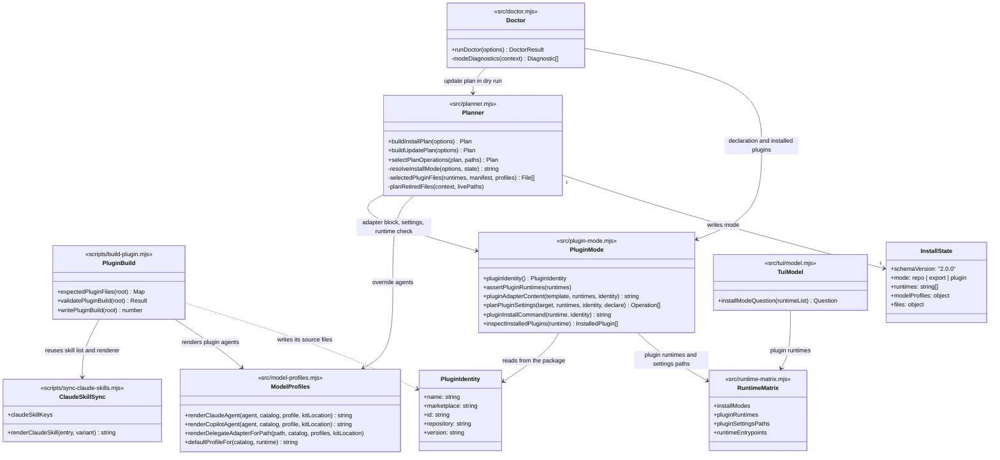
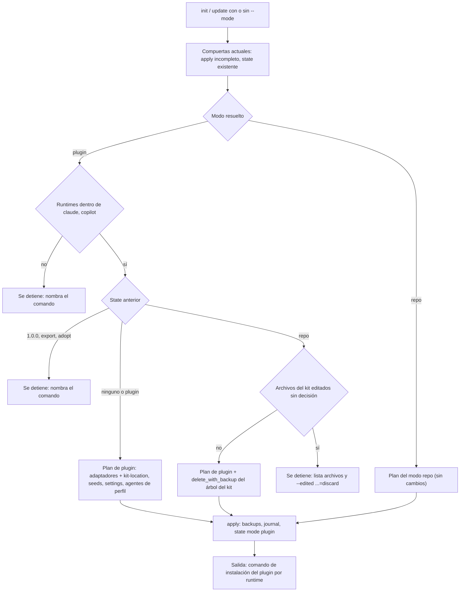

# PRD: Modo plugin piloto (PRD 4 de la épica kit-project-overlay)

**Ticket**: Épica `kit-project-overlay`, fase F4, fila 4 de la cola de PRDs
**Autor**: Agente (sesión F4)
**Fecha**: 2026-11-22
**Estado**: Aprobado (usuario, 2026-11-22, en la sesión F4: "Apruebo el PRD")

---

## 1. Contexto y Objetivo

Hoy el kit solo se instala copiando su árbol al repo: `init --runtime claude` crea 298 archivos y `--runtime copilot` 290 (medido en `558e9fb`). F1 y F2 dejaron el kit como una lista cerrada de rutas y un `install-state` 2.0.0 con el campo `mode`. Este PRD agrega la segunda forma de entrega que el sketch fijó: el mismo árbol del kit llega como plugin del runtime (Claude Code y GitHub Copilot) y el repo guarda solo el adaptador, la declaración del plugin, el state y su overlay.

> **Alcance estricto**: un build (`scripts/build-plugin.mjs`) que genera los manifiestos y los componentes del plugin `fhh` desde el árbol del kit; `init` y `update` con `--mode repo|plugin`; `install-state` con `mode: "plugin"`; las transiciones entre modos; `doctor` de modos; elección del modo en el TUI al instalar; docs. Piloto en Claude Code, VS Code Copilot y Copilot CLI. **No incluye**: plugin para Codex y Cursor (F5), agente cloud de Copilot (queda documentado como sin verificar), MCP dentro del plugin, managed settings, Antigravity y opencode (siguen en modo repo), cambios en `.agents/**`, `templates/**`, validadores, `src/migration.mjs`, `src/apply.mjs`, `src/rollback.mjs` y los follow-ups de F2 (sección 10 de su PRD). Si un slice necesita tocar algo fuera de la sección "Archivos" de 2.1, para y pregunta al orquestador.

**Sketch heredado**: `docs/design/kit-project-overlay-sketch.md` (Locked, opción B)
**UI lock**: not-applicable
**Visible UI**: No. Cambia la salida de texto del CLI y agrega una pregunta al TUI de terminal; no hay pantalla ni página.

### Contexto de Epica Padre

**parent_epic**: `docs/epics/kit-project-overlay/kit-project-overlay.md`

| Invariante heredada | AC hijo | Estado | Change request aprobado |
| --- | --- | --- | --- |
| INV-OWN-01 | AC-9 | Mapeada | No aplica |
| INV-OWN-02 | AC-5 (la lista de archivos del modo plugin sale de las clases del manifiesto y de la matriz de runtimes) | Mapeada | No aplica |
| INV-EXT-01 | AC-17 (el overlay se lee igual en modo plugin; no hay shadow del router) | Mapeada | No aplica |
| INV-EXT-02 | AC-17 (`boundary/shadow-outdated` compara contra el kit del CLI) | Mapeada | No aplica |
| INV-PATH-01 | AC-3, AC-6 (las rutas del kit se resuelven bajo la raíz del kit; las del proyecto quedan en el repo) | Mapeada | No aplica |
| INV-DIST-01 | AC-12, AC-15 (nunca los dos modos), AC-19 (modo repo intacto) | Mapeada | No aplica |
| INV-DIST-02 | AC-1, AC-3 | Mapeada | No aplica |
| INV-RUN-01, INV-RUN-02 | No aplica: F4 no cambia reglas de runbooks; el smoke de AC-20 comprueba que un runbook del overlay se lee | No aplica | No aplica |
| INV-NEUT-01 | AC-1 (`validate-stack-neutrality` en verde dentro de `check:workflow`) | Mapeada | No aplica |
| INV-MIG-01 | AC-14 (T10), AC-19 (`test/upgrade-e2e.test.mjs` sin cambios) | Mapeada | No aplica |
| INV-SEQ-01 | Cumplida: #6, #4 y #5 en `main` | Cumplida | No aplica |
| INV-CUT-01 | F4 va después de F2 (`558e9fb`) | Mapeada | No aplica |

Ajuste aprobado por el usuario (2026-11-22, D6): la métrica de la épica "archivos que el kit escribe en modo plugin (Claude) ≤ 5" se mide como **archivos que el kit posee y actualiza**. Los seeds del overlay se crean una vez, pasan a ser del proyecto y se informan aparte. No contradice ninguna invariante; `document-development` lo registra en el ledger como desvío de alcance.

**Path vivo heredado**: Debe seguir.
**Secuencia de corte heredada**: F1 → (F2 ∥ F3) → F4
**Este PRD respeta el corte**: Si

### Contrato entre Fases

**Ledger leido**: `docs/epics/kit-project-overlay/kit-project-overlay-ledger.md`
**PRD anterior en la cola**: `docs/prd/kit-project-overlay/2026-11-21-manifest-updater/manifest-updater.md`

**Precondiciones**:

| ID | Precondicion | Origen | Verificado en discovery |
| --- | --- | --- | --- |
| PRE-1 | El CLI clasifica cada ruta con el manifiesto (`kit`, `derived`, `adapter`, `seed`, `state`) | F2 POST-1 | Si (`src/kit-manifest.mjs:59-65`, `src/planner.mjs:580-585`) |
| PRE-2 | `install-state` 2.0.0 con `mode`; un state sin `mode` se lee como `repo` | F2 POST-2 | Si (`src/planner.mjs:807`, `:864`) |
| PRE-3 | `delete_with_backup`, journal 2.0.0 con acción `deleted` y rollback | F2 POST-4 | Si (`src/planner.mjs:496-536`, `src/apply.mjs`) |
| PRE-4 | `init` se detiene sobre cualquier state; `export` solo refresca un state `mode: "export"` | F2 | Si (`src/planner.mjs:145-157`) |
| PRE-5 | Los adaptadores tienen un bloque `workflow-kit:managed` y `planAdapter` reemplaza solo ese bloque | F1 POST-2, F2 | Si (`src/planner.mjs:610-634`) |
| PRE-6 | `selectPlanOperations` reenvía `mode` al reconstruir el state | F2 (lección) | Si (`src/planner.mjs:682`) |

Hallazgo de discovery que este PRD respeta: `buildUpdatePlan` no pasa `mode` a `buildNextInstallState` (`src/planner.mjs:297-306`), así que hoy un `update` siempre escribe `mode: "repo"`, también sobre un state `export`. Ese comportamiento no cambia; solo se agrega la conservación de `plugin`.

**Postcondiciones**:

| ID | Postcondicion | Como se prueba |
| --- | --- | --- |
| POST-1 | El repo del kit es un plugin instalable: `plugin.json` (Agent Plugins 1.0), `.claude-plugin/plugin.json`, `.claude-plugin/marketplace.json`, `skills/`, `agents/` y `com.github.copilot/agents/`, todos generados y verificados por `check:workflow` | AC-1, AC-2 |
| POST-2 | `install-state` 2.0.0 admite `mode: "plugin"` sin cambiar la forma | AC-5, AC-9 |
| POST-3 | `src/runtime-matrix.mjs` declara qué runtimes admiten modo plugin; F5 agrega Codex y Cursor ahí y en el build | AC-8 |
| POST-4 | `doctor` reporta los códigos `mode/*` | AC-15, AC-16 |
| POST-5 | Las transiciones de modo están definidas y probadas (tabla de 2.4) | AC-11 a AC-14 |

### Estado Actual

Verificado contra `main` `558e9fb` (0.22.0-manifest-updater). Suite: 420 tests en verde.

| Capa | Componente | Archivo |
| --- | --- | --- |
| Lista de archivos | Toda la plantilla del overlay más las carpetas de cada runtime | `src/planner.mjs:88-104`, `src/runtime-matrix.mjs:1-8` |
| Plan de instalación | `buildInstallPlan` escribe `mode: "export"` o `"repo"` | `src/planner.mjs:159-218` (`:197`) |
| Plan de update | `buildUpdatePlan`; no pasa `mode` | `src/planner.mjs:220-327` (`:297-306`) |
| Compuertas | `assertLastApplyFinished`, `assertNoInstallState` | `src/planner.mjs:132-136`, `:145-157` |
| Retirados | `planRetiredFiles`: trata como vivo todo lo que distribuye cualquier runtime | `src/planner.mjs:496-536` |
| Decisiones `--edited` | Solo sobre operaciones pendientes de la plantilla | `src/planner.mjs:356-418` |
| Archivo del usuario con merge | `.gitignore`, operación sin clase | `src/planner.mjs:971-991`, `:467-470` |
| Agentes delegados | 13 agentes, renderizados por perfil al planificar; defaults: Claude `calidad`, Copilot `costo` | `src/model-profiles.mjs:91-161`, `:171-181`, `src/planner.mjs:590` |
| Wrappers de Claude | Lista fija `claudeSkillKeys` (11) | `scripts/sync-claude-skills.mjs:18-30` |
| Doctor | Espera todos los archivos de la plantilla; valida el contrato del árbol en el repo; lee el archivo del kit de un shadow desde el repo | `src/doctor.mjs:236-260`, `:279`, `:168-175` |
| CLI | `valueFlags` sin `--mode` | `src/cli/args.mjs:7-17` |
| TUI | Pregunta runtimes, perfil y stack; `selectPlanOperations` tras la selección parcial | `src/tui.mjs:879`, `:941`, `:1027`; `src/tui/model.mjs:193`, `:212` |
| Referencias del kit | Rutas ancladas en `.agents/...`; los adaptadores apuntan a `.agents/instructions.md` | `.agents/kit-boundary.md` ("Path references"), `templates/runtime-adapters/claude/CLAUDE.md` |

---

## 2. Requerimientos Funcionales

### 2.1 Plugin `fhh`: identidad, layout y archivos

| Dato | Valor | Fuente única |
| --- | --- | --- |
| Nombre del plugin | `fhh` | `.claude-plugin/plugin.json` (generado) |
| Marketplace | `fhh-ia-ecosystem` | `.claude-plugin/marketplace.json` (generado) |
| ID | `fhh@fhh-ia-ecosystem` | Derivado de los dos anteriores |
| Repositorio del marketplace | `workflowKit.repository` | `package.json` |
| Versión | `version` | `package.json` |
| Raíz del plugin | La raíz del repo del kit (`source: "./"`) | `.claude-plugin/marketplace.json` |

La raíz del plugin es la raíz del repo del kit, así que el plugin usa el árbol `.agents/**` en su lugar: no hay copia. El build genera solo esto:

| Ruta generada | Contenido | Lo lee |
| --- | --- | --- |
| `plugin.json` | Manifiesto Agent Plugins 1.0: `$schema`, `name`, `version`, `description`, `license`, `repository`, `keywords` | Copilot |
| `.claude-plugin/plugin.json` | `name`, `version`, `description`, `license`, `repository` | Claude Code |
| `.claude-plugin/marketplace.json` | `name`, `owner.name`, `description`, `plugins: [{ name, source: "./", description }]` | Claude Code, Copilot |
| `skills/<name>/SKILL.md` (12) | 11 wrappers de `claudeSkillKeys` con `disable-model-invocation: true`, más `kit-root` | Claude Code, Copilot |
| `agents/<slug>.md` (13) | Agentes de Claude con el perfil por defecto, variante plugin | Claude Code |
| `com.github.copilot/agents/<slug>.agent.md` (13) | Agentes de Copilot con el perfil por defecto, variante plugin | Copilot |

La skill `kit-root` es la única que el modelo puede cargar por su cuenta. Su cuerpo da:
- la raíz del kit (`${CLAUDE_PLUGIN_ROOT}`; si la variable aparece sin expandir, la raíz es la carpeta dos niveles arriba de ese `SKILL.md`);
- la regla de rutas de 2.2;
- que `.agents/project/` bajo la raíz del kit se ignora: el overlay del proyecto es el del repo;
- el nombre de los delegados en modo plugin (`fhh:<slug>`, salvo que exista un agente del proyecto con ese slug);
- la instrucción de pasar `Kit root: <ruta absoluta>` en el brief de cada delegación;
- el siguiente paso: leer `<kit root>/.agents/instructions.md`.

**Archivos**. Existentes que este PRD edita: `src/runtime-matrix.mjs`, `src/model-profiles.mjs`, `src/planner.mjs`, `src/doctor.mjs`, `src/cli/args.mjs`, `src/cli/commands.mjs`, `src/tui.mjs`, `src/tui/model.mjs`, `scripts/sync-claude-skills.mjs`, `scripts/sync-delegate-runtime-adapters.mjs`, `package.json` (`files` y `check:workflow`; la versión no), `docs/README.md`, `docs/quickstart.md`, `docs/github-install.md`, `docs/workflow/cross-runtime-capability-matrix.md`, y `docs/versioning.md` (solo el paso de release que regenera el plugin; autorizado por el orquestador). Nuevos: `scripts/build-plugin.mjs`, `src/plugin-mode.mjs`, las rutas generadas de la tabla, `test/plugin-build.test.mjs`, `test/plugin-mode.test.mjs`, `test/plugin-mode-doctor.test.mjs`, `test/plugin-mode-tui.test.mjs`. Ningún archivo de test existente se modifica.

### 2.2 Regla de Negocio: resolución de rutas en modo plugin

> **Decision confirmada**: en modo plugin, una ruta que el manifiesto clasifica como `kit` o `derived` se resuelve bajo la raíz del kit (la carpeta del plugin). Todo lo demás, incluido `.agents/project/**`, se resuelve en el repo. Nadie escribe bajo la raíz del kit.

**Condicion de aplicacion**: `install-state` con `mode: "plugin"`.
**Donde vive la regla**: en la skill `kit-root` del plugin y en el bloque `workflow-kit:kit-location` del adaptador del repo. Los archivos del kit no cambian: `.agents/kit-boundary.md` ya define sus referencias como "ancladas en la raíz del kit".
**Bloque `workflow-kit:kit-location`**: va dentro del bloque `workflow-kit:managed`, justo después del marcador de inicio. Dice: el kit corre como plugin `fhh`; antes de un trabajo N2/N3 o de leer una ruta del kit hay que cargar `fhh:kit-root`; la regla de rutas; y que si esa skill no está disponible el plugin no está instalado: solo se hace trabajo N0 y se le da al usuario el comando de instalación. El resto del bloque gestionado es la plantilla del modo repo, sin cambios.
**Campos NO afectados**: el prefiltro de nivel y el bootstrap compartido del adaptador; el texto fuera de los marcadores.

### 2.3 Regla de Negocio: plan en modo plugin

> **Decision confirmada**: `--mode plugin` instala en el repo solo lo que el kit no puede entregar por el plugin.

| Qué | Regla | Clase |
| --- | --- | --- |
| Adaptadores | Los entrypoints de `runtimeEntrypoints` para los runtimes elegidos, con el bloque `kit-location` | `adapter` |
| Seeds del overlay | Los mismos que en modo repo (D6): `context.md`, `quality-gate.md`, `backend.md`, `frontend.md`, `paths.json`, y `stack.md` si hay stack pack | `seed` |
| Wrappers de instrucciones de Copilot | Como hoy, generados desde `.agents/project/*.md` y el quality gate del kit, que se lee del paquete del CLI | `derived` |
| Agentes del proyecto | Solo para un runtime cuyo perfil difiere del default del catálogo (D2): `.claude/agents/*.md` o `.github/agents/*.agent.md`, variante plugin | `derived` |
| Declaración del plugin | `.claude/settings.json` (Claude) y `.github/copilot/settings.json` (Copilot): merge de dos claves | Sin clase: archivo del usuario, como `.gitignore` |
| `.gitignore` | Como hoy | Sin clase |
| No se instala | Todo archivo `kit` o `derived` restante, `docs/workflow/**`, el bloque de `docs/README.md` y el mapa de docs legacy | — |

**Runtimes**: modo plugin exige una lista no vacía dentro de `claude`, `copilot`. Con `neutral`, `codex`, `antigravity` u `opencode` se detiene.
**Declaración**: el kit asegura `extraKnownMarketplaces["fhh-ia-ecosystem"] = { source: { source: "github", repo: <workflowKit.repository> } }` y `enabledPlugins["fhh@fhh-ia-ecosystem"] = true`.
- Sin archivo: `create`.
- JSON válido: fusiona solo esas dos claves, conserva las demás y su orden; siempre `merge_with_backup`.
- Ya declarado: `unchanged`.
- JSON inválido o que no es un objeto: `skip_unmanaged` con razón `invalid_settings_json`; el plan imprime el fragmento para agregarlo a mano.

**Conteo (métrica de la épica, D6)**: archivos que el kit posee y actualiza, con perfil por defecto:

| Runtimes | Archivos del kit | Cuáles |
| --- | --- | --- |
| `claude` | 3 (límite 5) | `CLAUDE.md`, `.claude/settings.json`, `install-state.json` |
| `copilot` | 6 | `AGENTS.md`, `.github/copilot-instructions.md`, `.github/instructions/ai-workflow.instructions.md`, `.github/instructions/quality-gate.instructions.md`, `.github/copilot/settings.json`, `install-state.json` |
| `claude,copilot` | 8 | La unión |

Aparte, del proyecto: 5 seeds (6 con stack pack) y `.gitignore`. Un perfil distinto del default suma 13 agentes por runtime, por elección explícita.

**State**: `mode: "plugin"`, `schemaVersion` 2.0.0 (D7). Los archivos de settings y `.gitignore` no entran en `files`.

### 2.4 Regla de Negocio: transiciones de modo

> **Decision confirmada**: el modo se elige con `--mode` en `init` y `update`. Sin el flag, `init` usa `repo` y `update` conserva el modo del state. Cada parada no escribe nada y nombra un comando que funciona.

| # | State encontrado | Comando | Resultado |
| --- | --- | --- | --- |
| T1 | Ninguno | `init` o `init --mode repo` | Modo repo, igual que hoy |
| T2 | Ninguno | `init --mode plugin --runtime claude` (o `copilot`, o los dos) | Plan de 2.3; state `plugin` |
| T3 | Ninguno | `init --mode plugin` con un runtime sin plugin | Se detiene: nombra `--runtime claude,copilot` y `init --mode repo` |
| T4 | 2.0.0, cualquier modo | `init --mode plugin` | Se detiene (compuerta actual); agrega `workflow-kit update --mode plugin` |
| T5 | 1.0.0 | `init --mode plugin` | Se detiene (compuerta actual); agrega "luego `workflow-kit update --mode plugin`" |
| T6 | `repo`, o 2.0.0 sin `mode` | `update` | Modo repo, igual que hoy |
| T7 | `repo` | `update --mode plugin` | Cambio a plugin, todo o nada (D5), ver abajo |
| T8 | `plugin` | `update` | Sigue en plugin; segundo `update` sin escrituras |
| T9 | `plugin` | `update --mode repo` | Cambio a repo, ver abajo |
| T10 | 1.0.0 | `update --mode plugin` | Se detiene: `workflow-kit update` primero (migración), luego `workflow-kit update --mode plugin` |
| T11 | `export` | `update --mode plugin` | Se detiene: una carpeta exportada es una copia del kit; nombra `workflow-kit init --mode plugin --target <repo>` |
| T12 | Cualquiera | `export --mode <x>` | Se detiene: export no tiene modo; nombra `workflow-kit export --output <ruta>` |
| T13 | Ninguno | `update --adopt-existing --mode plugin` | Se detiene: `workflow-kit update --adopt-existing --runtime <lista>` primero, luego `workflow-kit update --mode plugin` |
| T14 | `plugin` | `update --runtime` con un runtime sin plugin | Se detiene: nombra `workflow-kit update --mode repo --runtime <lista>` |
| T15 | Cualquiera | `--mode` con otro valor, o en `doctor`, `rollback`, `upgrade`, `tui` | Se detiene: valores `repo` y `plugin`; el flag aplica a `init` y `update` |
| T16 | `plugin` tras un cambio de modo o un `update` normal | `rollback` | Restaura los archivos y el state anterior; tras un `update` normal el state restaurado sigue `plugin` |
| T17 | `plugin` | `export --output <ese repo>` | Se detiene (compuerta actual de F2): el árbol queda idéntico y el mensaje nombra exportar a otra carpeta |

**T7, repo → plugin**:
- Todo archivo `kit` o `derived` que el state registra y el plan de plugin no escribe se trata como retirado. Para eso, en modo plugin la lista de archivos vivos de `planRetiredFiles` es solo la del plan.
- Sin editar (hash igual al registrado): `delete_with_backup`.
- Editado: el comando se detiene antes de planificar escrituras. El mensaje lista cada archivo y los dos comandos: `workflow-kit update --mode plugin --edited <ruta>=discard` y `--edited all=discard`. Indica que para conservar un cambio hay que pasarlo antes a un shadow del overlay (`.agents/kit-boundary.md`).
- Con `discard`: `delete_with_backup` del archivo editado. `keep`, `shadow` y `split` se rechazan para estos archivos.
- Adaptadores: se reemplaza el bloque gestionado; un adaptador sin marcadores válidos sigue las reglas de F2.
- Un archivo de una ruta del kit que el state no registra no se borra; `doctor` lo reporta (`mode/repo-and-plugin`).

**T9, plugin → repo**:
- Lista de archivos completa del modo repo: los archivos del kit se crean; uno que ya existe sin registro queda pendiente con las reglas de F2.
- El bloque gestionado vuelve a la plantilla sin `kit-location`.
- De los archivos de settings se quitan solo `enabledPlugins["fhh@fhh-ia-ecosystem"]` y, si es igual a lo que el kit escribe, `extraKnownMarketplaces["fhh-ia-ecosystem"]`; `merge_with_backup`. El archivo nunca se borra.
- Los agentes del proyecto se renderizan con la variante repo.

### 2.5 Regla de Negocio: doctor de modos

> **Decision confirmada**: `doctor` nunca instala ni ejecuta nada que escriba. Repo y plugin a la vez es error; plugin declarado y no instalado es aviso (D3).

En modo plugin, `doctor` espera solo los archivos del plan de plugin, valida los adaptadores con `validateAdapterContracts` (no el árbol del kit) y compara cada shadow contra el archivo del kit que trae el CLI.

| Código | Severidad | Condición | El mensaje nombra |
| --- | --- | --- | --- |
| `mode/repo-and-plugin` | error | State `plugin` y hay archivos en rutas `kit` o `derived` que el modo plugin no escribe; o state `repo` y un archivo de settings declara `fhh@fhh-ia-ecosystem` habilitado | Los archivos, y `workflow-kit update --mode plugin` o `--mode repo` |
| `mode/plugin-not-declared` | warning | State `plugin` y falta la declaración en el archivo de settings de un runtime, o el archivo no es JSON válido | `workflow-kit update --apply --yes`, o el fragmento a mano |
| `mode/plugin-not-installed` | warning | Claude: `claude plugin list --json` no lista el ID | `claude plugin install fhh@fhh-ia-ecosystem --scope project` |
| `mode/plugin-version-mismatch` | warning | Claude: la versión instalada no es la del CLI | `claude plugin update fhh@fhh-ia-ecosystem` |
| `mode/plugin-install-unverified` | warning | Claude: no se pudo comprobar (no hay `claude` en el PATH, no respondió en el tiempo máximo, salida que no es JSON o código de salida distinto de 0) | `claude plugin list` y `claude plugin install fhh@fhh-ia-ecosystem --scope project` |

Binario externo: `doctor` ejecuta `claude plugin list --json` solo cuando el state es `plugin` y el runtime `claude` está elegido; nunca en modo repo. Espera como máximo 5 segundos. Binario ausente, cuelgue, salida que no es JSON o código distinto de 0 terminan en `mode/plugin-install-unverified`; ninguno hace fallar ni colgar a `doctor`. La lectura es una función inyectable (`inspectInstalledPlugins`, con su ejecutor de comandos también inyectable); los tests siempre pasan un doble.

Copilot: no hay una forma documentada de leer sus plugins instalados, así que `doctor` no emite un diagnóstico. Imprime una línea informativa con `copilot plugin list` y `copilot plugin install fhh@fhh-ia-ecosystem`.

La salida de `doctor` agrega la línea `Install mode: plugin` solo en modo plugin, y la de los planes igual, para que la salida del modo repo no cambie.

### 2.6 Regla de Negocio: TUI

> **Decision confirmada**: el TUI pregunta el modo solo al instalar, en modo interactivo, y solo cuando todos los runtimes elegidos admiten plugin. La opción por defecto es "archivos en el repo".

En modo guionado no pregunta (igual que la pregunta de stack). `update` por TUI conserva el modo del state; el cambio de modo se hace por CLI. Tras aplicar en modo plugin, el TUI y el CLI imprimen el comando de instalación del plugin por runtime.

### 2.7 Criterios de Aceptacion

| ID | Given | When | Then | Evidence expected |
| --- | --- | --- | --- | --- |
| AC-1 | El árbol del kit en `main` | `node scripts/build-plugin.mjs --write` y luego sin flag | Genera exactamente las rutas de 2.1 (3 manifiestos, 12 skills, 13 + 13 agentes); la segunda corrida no cambia nada; sin `--write` falla ante drift, un archivo faltante o un generado huérfano; corre dentro de `check:workflow` | `test/plugin-build.test.mjs`; `npm run check:workflow` |
| AC-2 | Los manifiestos generados | Se validan | `plugin.json` tiene solo campos del esquema Agent Plugins 1.0, el `$schema` exacto y `name: "fhh"`; el marketplace tiene `name`, `owner.name` y un plugin con `source: "./"`; las tres versiones son la de `package.json` | `test/plugin-build.test.mjs`; `claude plugin validate .` en el smoke |
| AC-3 | Los componentes generados | Se inspeccionan | Ningún generado queda bajo `.agents/` ni `templates/`; cada wrapper apunta a un `SKILL.md` que `registry.json` lista y que existe; cada agente nombra una `shared_skill_path` que existe; `kit-root` contiene la regla de rutas, la exclusión de `.agents/project/` bajo la raíz del kit y el nombre `fhh:<slug>` | `test/plugin-build.test.mjs` |
| AC-4 | Los generadores existentes | `sync-claude-skills` y `sync-delegate-runtime-adapters` en modo check | Sus salidas del modo repo son byte a byte las de `558e9fb` (no se regenera ningún archivo existente) | `npm run check:workflow`; `git diff --stat` sin cambios en `.claude/`, `.github/agents/`, `.codex/`, `templates/runtime-adapters/` |
| AC-5 | Un repo vacío | `init --mode plugin --runtime claude` (dry run y apply) | El plan tiene 3 archivos del kit (≤ 5), los 5 seeds y `.gitignore`; ninguna operación en una ruta `kit` o `derived`; el state queda con `mode: "plugin"`. Con `copilot`: 6. Con los dos: 8 | `test/plugin-mode.test.mjs` (conteo por clase) |
| AC-6 | Un repo con `CLAUDE.md` propio sin marcadores, y otro vacío | `init --mode plugin` | El bloque gestionado es el de la plantilla más `workflow-kit:kit-location` (plugin, `fhh:kit-root`, regla de rutas, comando si no está instalado); el texto propio queda fuera de los marcadores; `validateAdapterContracts` no reporta nada | `test/plugin-mode.test.mjs` |
| AC-7 | Settings ausente; con otras claves; ya declarado; JSON inválido | `init` o `update` en modo plugin | `create`; `merge_with_backup` que conserva las otras claves; `unchanged`; `skip_unmanaged` sin tocar el archivo y con el fragmento en la salida | `test/plugin-mode.test.mjs` |
| AC-8 | Cualquier repo | `--mode` inválido; `--mode plugin` con runtime sin plugin; `export --mode`; `doctor --mode` | Se detiene sin escribir; el mensaje nombra el comando siguiente (T3, T12, T14, T15) | `test/plugin-mode.test.mjs` |
| AC-9 | Un install en modo plugin con overlay editado y texto propio en el adaptador | `update` dos veces; un plan filtrado con `selectPlanOperations`; y `rollback` de un `update` que escribió | El state conserva `mode: "plugin"`; la segunda corrida no escribe; nada bajo `.agents/project/**` ni fuera de los marcadores cambia; el plan filtrado conserva `mode: "plugin"`; tras el rollback el state en disco sigue `plugin` | `test/plugin-mode.test.mjs` |
| AC-10 | Un install plugin con Claude | `update --profile claude=costo`; luego `--profile claude=calidad` | Primero crea 13 `.claude/agents/*.md` variante plugin con el modelo del perfil; luego los borra con backup; `modelProfiles` queda registrado | `test/plugin-mode.test.mjs` |
| AC-11 | Un install en modo repo sin archivos editados | `update --mode plugin --apply --yes`; luego `rollback --apply --yes` | Borra con backup cada archivo `kit` o `derived` registrado, cambia el bloque, escribe la declaración y deja state `plugin`; el rollback restaura todos los archivos y el state `repo` | `test/plugin-mode.test.mjs` |
| AC-12 | Un install en modo repo con un archivo del kit editado | `update --mode plugin`; luego con `--edited <ruta>=discard`; y con `=keep` | Se detiene sin escribir y lista el archivo y los comandos; con `discard` continúa y deja backup del editado; `keep` se rechaza | `test/plugin-mode.test.mjs` |
| AC-13 | Un install en modo plugin (con otras claves en settings) | `update --mode repo --apply --yes` | Crea el árbol del kit, el bloque queda sin `kit-location`, de settings salen solo las claves del kit, state `repo`; `doctor` queda en ok | `test/plugin-mode.test.mjs` |
| AC-14 | States 2.0.0, 1.0.0, `export` y ninguno; un install con el último apply incompleto; y un install en modo plugin como destino de `export` | T4, T5, T10, T11, T13, T17; y `update --mode plugin` con el apply incompleto | Cada uno se detiene sin escribir (en T17 el árbol queda idéntico por hash); el test ejecuta el comando que el mensaje nombra y ese comando termina sin error | `test/plugin-mode.test.mjs` |
| AC-15 | State `plugin` con un archivo del kit en el repo; state `repo` con el plugin declarado | `doctor` | `mode/repo-and-plugin` (error), `Doctor: failed`, y el mensaje nombra el comando | `test/plugin-mode-doctor.test.mjs` |
| AC-16 | State `plugin`; el doble de `inspectInstalledPlugins` devuelve: sin el plugin, otra versión; y el ejecutor doble: binario ausente, cuelgue más allá del tiempo máximo, salida que no es JSON, código distinto de 0 | `doctor` | `mode/plugin-not-installed` y `mode/plugin-version-mismatch` como warnings con su comando; los cuatro fallos del binario terminan en `mode/plugin-install-unverified` y `doctor` no falla ni se cuelga; `mode/plugin-not-declared` si falta la declaración; Copilot recibe una línea informativa, no un diagnóstico; ningún doble recibe una llamada de instalación | `test/plugin-mode-doctor.test.mjs` |
| AC-17 | Un install plugin sano con un shadow cuyo `base_sha256` no coincide | `doctor` | Sin archivos faltantes del árbol del kit; `Doctor: ok`; `boundary/shadow-outdated` para ese shadow | `test/plugin-mode-doctor.test.mjs` |
| AC-18 | TUI interactivo, runtime `claude` | Elegir plugin, deseleccionar una operación y aplicar; luego `update` por TUI con selección parcial | Pregunta el modo solo si todos los runtimes admiten plugin; el `install-state.json` en disco tiene `mode: "plugin"` tras cada uno de los dos apply; la salida final trae el comando de instalación | `test/plugin-mode-tui.test.mjs` |
| AC-19 | La suite de `558e9fb` | `npm test`; y `doctor` sobre un install en modo repo con el ejecutor doble | Los 420 tests existentes pasan sin modificar ningún archivo de test existente; `test/upgrade-e2e.test.mjs` en verde; en modo repo `doctor` no ejecuta ningún binario externo (el doble registra cero llamadas) | `npm test`; `git diff --stat main -- test/` muestra solo archivos nuevos; `test/plugin-mode-doctor.test.mjs` |
| AC-20 | Docs y un repo de prueba en modo plugin | `npm run check:docs`; smoke en Claude Code y en Copilot | Los 4 docs explican el modo plugin, el comando por persona, la postura de obligatoriedad y las transiciones; la matriz marca lo no verificado; el smoke registra: skills `fhh:*` cargan, `kit-root` da la raíz, un trabajo N2 llega al router, un runbook del overlay se lee, no hay skills duplicadas. Lo que no se pueda ejecutar queda como no verificado con sus pasos | `npm run check:docs`; sección 10 |

### 2.8 Casos de Uso

| ID | Actor | Precondiciones | Flujo principal | Resultado observable (falsable) | AC vinculado |
| --- | --- | --- | --- | --- | --- |
| UC-1 | Mantenedor del kit | Cambió una skill o el catálogo de agentes | Corre el build con `--write`; `check:workflow` lo verifica | Los generados quedan al día y el check falla si no | AC-1, AC-2, AC-3, AC-4 |
| UC-2 | Equipo que quiere un repo limpio | Repo sin kit | `init --mode plugin --runtime claude --apply --yes`; cada persona instala el plugin una vez | El repo recibe 3 archivos del kit más su overlay | AC-5, AC-6, AC-7, AC-8 |
| UC-3 | Equipo en modo plugin | Install en modo plugin | `update`, con o sin `--profile` | El modo se conserva; el overlay no cambia; el perfil elegido se aplica | AC-9, AC-10 |
| UC-4 | Equipo que cambia de modo | Install en un modo | `update --mode plugin` o `--mode repo`; `rollback` si se arrepiente | Nunca quedan los dos modos; el rollback deja todo como antes | AC-11, AC-12, AC-13, AC-14 |
| UC-5 | Persona que diagnostica | Install en cualquier modo | `doctor` | Ve el error de modos mezclados o el aviso con el comando; nada se instala | AC-15, AC-16, AC-17 |
| UC-6 | Persona que instala por TUI | TUI interactivo | Elige runtime, modo y perfil | El plan y el state corresponden al modo elegido | AC-18 |
| UC-7 | Usuario del modo repo o de 0.18 | Install existente | `init`, `update`, `export`, `rollback`, `doctor` sin `--mode` | Todo se comporta como en 0.22.0 | AC-19 |
| UC-8 | Persona que trabaja con el agente | Plugin instalado y repo en modo plugin | Pide un trabajo N2; invoca `/fhh:create-prd`; dispara un runbook | El agente resuelve las rutas del kit bajo el plugin y las del proyecto en el repo | AC-6, AC-20 |

### 2.9 Estrategia de Tests

Framework: `node --test`, repos temporales como en `test/planner.test.mjs`.

| Nivel | Objetivo | Caso de uso vinculado | Cobertura esperada | Comando o mecanismo de validacion |
| --- | --- | --- | --- | --- |
| Unidad | Build: salidas, idempotencia, drift, huérfanos, esquema de los manifiestos, variantes de agentes y wrappers | UC-1 | AC-1 a AC-3 | `node --test test/plugin-build.test.mjs` |
| Contrato | Los generadores del modo repo no cambian | UC-1, UC-7 | AC-4 | `npm run check:workflow` |
| Integracion | Plan de plugin por clase, conteo, adaptador, settings, flags, update, perfil | UC-2, UC-3 | AC-5 a AC-10 | `node --test test/plugin-mode.test.mjs` |
| Integracion (apply real en repo temporal) | Transiciones T4 a T17, con apply y rollback; cada parada ejecuta el comando que nombra | UC-4 | AC-11 a AC-14 | `node --test test/plugin-mode.test.mjs` |
| Integracion | Doctor de modos con el doble de `inspectInstalledPlugins` | UC-5 | AC-15 a AC-17 | `node --test test/plugin-mode-doctor.test.mjs` |
| Integracion | TUI: pregunta de modo, selección parcial, update | UC-6 | AC-18 | `node --test test/plugin-mode-tui.test.mjs` |
| Regresion | Modo repo y migración 0.18 intactos | UC-7 | AC-19 | `npm test` |
| Smoke manual | El runtime carga el plugin y resuelve rutas | UC-8 | AC-20, supuestos S3 a S7 | Pasos de P1-S2 y P3-S2 |

Cada test nuevo falla antes del cambio que lo satisface (se registra la corrida roja en el tracker de `implement-change`).

### 2.10 Matriz de Edge Cases

| Categoria | Descripcion | Caso de uso vinculado | Capa duena | Validacion | Estado |
| --- | --- | --- | --- | --- | --- |
| Datos vacios | Repo sin `.claude/settings.json`, sin overlay y sin `.gitignore` | UC-2 | `src/plugin-mode.mjs`, planner | AC-5, AC-7 | Pending |
| Datos vacios | `--mode plugin` sin `--runtime` (queda `neutral`) | UC-2 | planner | AC-8 | Pending |
| Limites | Dos runtimes a la vez (8 archivos); settings con `enabledPlugins` en `false` o con otro marketplace | UC-2 | `src/plugin-mode.mjs` | AC-5, AC-7 | Pending |
| Limites | Perfil distinto del default: 3 + 13 archivos; volver al default los retira | UC-3 | planner | AC-10 | Pending |
| Errores | Settings con JSON inválido o que no es un objeto | UC-2 | `src/plugin-mode.mjs` | AC-7, AC-16 | Pending |
| Errores | `claude` no está en el PATH, se cuelga, sale con código distinto de 0 o su salida no es JSON | UC-5 | `src/plugin-mode.mjs` (`inspectInstalledPlugins`) | AC-16 | Pending |
| Permisos/tenancy | No aplica tenancy: es un CLI local sin usuarios. La regla equivalente, "nunca instalar sin confirmación", se prueba en la entrada de `doctor` | UC-5 | `src/doctor.mjs` | AC-16 | Pending |
| Concurrencia/orden | Cambio de modo con el último apply incompleto | UC-4 | planner (`assertLastApplyFinished`) | AC-14 | Pending |
| Concurrencia/orden | Un archivo del kit se edita entre el plan y el apply del cambio a plugin: el apply lo conserva y `doctor` lo reporta | UC-4, UC-5 | `src/apply.mjs` (existente), `src/doctor.mjs` | AC-15 | Pending |
| Concurrencia/orden | `--mode plugin` antes de migrar un state 1.0.0 | UC-4 | planner | AC-14 (T5, T10) | Pending |
| Rollout/rollback | Rollback de un cambio de modo en los dos sentidos | UC-4 | planner y journal existente | AC-11, AC-13 | Pending |
| Rollout/rollback | El orquestador sube la versión y no regenera el plugin | UC-1 | `scripts/build-plugin.mjs` | AC-1 (el check falla) | Pending |
| Rollout/rollback | Plugin instalado en una versión distinta de la del CLI | UC-5 | `src/doctor.mjs` | AC-16 | Pending |

### 2.11 Contrato Visual (UI lock)

**UI lock**: not-applicable. La única interacción nueva es una pregunta de opción única en el TUI de terminal, con el mismo componente que la pregunta de stack pack.

---

### 2.12 Supuestos e integraciones

Fuentes consultadas el 2026-11-22. Lo que corrige al evidence pack de la épica está marcado.

| # | Supuesto | Fuente | Estado | Evidencia | Que pasa si es falso |
| --- | --- | --- | --- | --- | --- |
| S1 | Agent Plugins 1.0 está publicado; exige `plugin.json` en la raíz con `$schema` y `name`, esquema cerrado, skills solo en `skills/<name>/SKILL.md` (un nivel, sin rutas configurables); solo estandariza skills y MCP | Documentación | verificado | `agentplugins/agent-plugins-spec`, `spec/1.0.0.md`: "Status: Published" (corrige "Working Draft sin verificar") | — |
| S2 | Claude Code: `.claude-plugin/plugin.json`, `skills/`, `agents/`; el plugin se copia a una caché y lo que está fuera de su raíz no se copia; `${CLAUDE_PLUGIN_ROOT}` se sustituye en cuerpos de skills y agentes; `CLAUDE.md` del plugin no se carga; agentes con `model`, nombrados `<plugin>:<name>` | Documentación | verificado | `code.claude.com/docs/en/plugins-reference`, `plugins/components`, `plugins/loading` | — |
| S3 | Un marketplace con `source: "./"` es válido y `claude plugin list --json` devuelve `id`, `version`, `scope`, `enabled`, `installPath` | Prueba exploratoria local (solo lectura) | verificado | `claude plugin validate` sobre un plugin de prueba; Claude Code 2.1.142 | — |
| S4 | Claude: `enabledPlugins` en el repo habilita pero no descarga; cada persona corre `claude plugin install <id> --scope project` una vez por clon; solo managed settings obligan | Documentación | verificado | `discover-plugins`, `plugins/loading` | — |
| S5 | Claude: una skill de plugin y una del proyecto con el mismo nombre conviven (`/x` y `/fhh:x`) | Documentación | asumido | No está documentado (corrige "cargan las dos" del evidence pack) | Solo afecta al caso de modos mezclados, que ya es error (AC-15). P1-S2 lo observa |
| S6 | Copilot CLI: un `plugin.json` de Agent Plugins gana sobre `.claude-plugin/plugin.json`; ante el mismo nombre gana la skill del proyecto o personal y la del plugin se ignora; agentes en `com.github.copilot/agents/*.agent.md`; `.github/copilot/settings.json` con las mismas dos claves no hace obligatorio el plugin | Documentación | verificado | `docs.github.com` (`cli-plugin-reference`, `about-cli-plugins`, `configuring-agent-settings`) | — |
| S7 | VS Code Copilot: qué formato elige con dos manifiestos, la precedencia ante nombres repetidos y si resuelve la raíz del plugin en el cuerpo de una skill | Documentación | asumido | No está documentado | P1-S2 lo observa. Si la skill `kit-root` no puede dar la raíz en Copilot, condición de parada de P1-S2 |
| S8 | El agente cloud de Copilot carga plugins | Documentación | asumido (fuera del piloto, D4) | Se configura con el mismo archivo, no está en la lista GA y no se documenta qué componentes carga | Sin efecto en los AC: la matriz lo marca "sin verificar" |
| S9 | `copilot plugin install fhh@fhh-ia-ecosystem` funciona con el marketplace declarado en el repo | Documentación | asumido | La forma `plugin@marketplace` está documentada; la resolución desde settings del repo no | P3-S2 lo observa; si falla, los mensajes usan `copilot plugin install <owner/repo>` |
| S10 | El modelo aplica la regla de rutas al leer archivos del kit que nombran `.agents/...` | Diseño | asumido | — | Es el riesgo central del piloto. P1-S2 es su compuerta, antes de generar agentes, con condición de parada y plan B (hook de inicio de sesión que inyecta la raíz del kit) |

### 2.13 Que queda obsoleto

Ninguno en el código: el piloto agrega un modo y el modo repo conserva todos sus archivos y generadores.

| Elemento | Tipo | Ubicacion | Reemplazado por | Accion | Consumidores | Slice | Busqueda de verificacion |
| --- | --- | --- | --- | --- | --- | --- | --- |
| Texto de la métrica "≤ 5 contando el overlay inicial" | documentacion | `docs/epics/kit-project-overlay/kit-project-overlay.md` (tabla de métricas) | La definición de 2.3 (D6) | adaptar, en `document-development` al cerrar la fase | En el repo | Cierre (ledger) | `grep -n "overlay inicial" docs/epics/kit-project-overlay/kit-project-overlay.md` |
| Filas "sin verificar" de Agent Plugins y Copilot | documentacion | `docs/epics/kit-project-overlay/kit-project-overlay-evidence.md` | Sección 2.12 de este PRD | adaptar, en `document-development` | En el repo | Cierre (ledger) | Revisión del evidence pack |

---

## 3. Modelo de Datos

### 3.1 Migracion Requerida

No hay base de datos. `install-state` conserva `schemaVersion: "2.0.0"`; `mode` admite un valor más:

```text
mode: "repo" | "export" | "plugin"     # ausente se lee como "repo"
```

Formas nuevas, todas generadas o escritas por el kit:

```jsonc
// plugin.json (raíz del repo del kit)
{ "$schema": "https://agent-plugins.org/schemas/1.0.0/plugin.schema.json", "name": "fhh", "version": "<package.json>", "description": "...", "license": "MIT", "repository": "...", "keywords": [] }

// .claude/settings.json y .github/copilot/settings.json (repo destino): solo estas dos claves son del kit
{ "extraKnownMarketplaces": { "fhh-ia-ecosystem": { "source": { "source": "github", "repo": "<workflowKit.repository>" } } },
  "enabledPlugins": { "fhh@fhh-ia-ecosystem": true } }
```

### 3.2 Diagrama de Clases

Módulos y funciones como clases (el repo es ESM sin clases).



### 3.3 Diagrama de Flujo



---

## 4. Plan de Implementacion por Fases

### Fase 1 - Build del plugin

**Objetivo**: el repo del kit es un plugin `fhh` válido, generado y verificado. Su supuesto central (la regla de rutas) se comprueba apenas existen los manifiestos y las skills, antes de generar agentes y de tocar el instalador.

**Slices ejecutables**:

| ID | Outcome | Depends on | Scope / likely files | Acceptance criteria | Use cases | Tests | Edge cases | Validation | Evidence |
| --- | --- | --- | --- | --- | --- | --- | --- | --- | --- |
| P1-S1 | El build genera y verifica los 3 manifiestos y las 12 skills | none | `scripts/build-plugin.mjs`, `scripts/sync-claude-skills.mjs` (exporta el renderer con variante), `package.json` (`files`, `check:workflow`), `docs/versioning.md` (paso de release), generados `plugin.json`, `.claude-plugin/*`, `skills/**` | AC-1, AC-2, AC-3 (skills), AC-4 | UC-1 | `test/plugin-build.test.mjs` | Versión sin regenerar | `node --test test/plugin-build.test.mjs && npm run check:workflow` | Test rojo antes, verde después; salida del check |
| P1-S2 | Smoke temprano de la regla de rutas: el runtime carga el plugin desde la carpeta local, `kit-root` da la raíz y el agente lee un archivo del kit a partir de ella | P1-S1 | Sin código de producto. `claude plugin validate .`; una sesión con `claude --plugin-dir <checkout>` en un repo de prueba con el bloque `kit-location` escrito a mano (no cambia la configuración del usuario); en Copilot, instalación local solo con aprobación del usuario | AC-2, AC-20 (parcial) | UC-8 | Smoke manual | S5, S7, S10 | Pasos registrados en el tracker | Resultado por supuesto: verificado o no verificado |
| P1-S3 | El build genera los 13 + 13 agentes en variante plugin | P1-S2 | `src/model-profiles.mjs` (parámetro `kitLocation`), `scripts/sync-delegate-runtime-adapters.mjs` (solo si hace falta exportar algo), `scripts/build-plugin.mjs`, generados `agents/**`, `com.github.copilot/agents/**` | AC-1, AC-3 (agentes), AC-4 | UC-1 | `test/plugin-build.test.mjs` | — | `node --test test/plugin-build.test.mjs test/model-profiles.test.mjs && npm run check:workflow` | Diff vacío en los agentes del modo repo |

**Out of scope de la fase**: `--mode`, planner, doctor.

**Slice stop conditions**:

- `claude plugin validate .` rechaza los manifiestos, o un validador fuera de la lista de archivos de 2.1 falla por las carpetas nuevas de la raíz: parar y avisar al orquestador.
- P1-S2: si el agente no logra leer un archivo del kit a partir de `kit-root` en Claude Code, parar antes de P1-S3 y proponer al usuario el plan B como enmienda del PRD: un hook de inicio de sesión del plugin que inyecta la raíz del kit y la regla de rutas en cada sesión (solo Claude Code). Si falla solo en Copilot, parar y preguntar al usuario si Copilot sigue en el piloto.
- P1-S2 necesita que el usuario autorice la sesión de prueba; sin esa autorización queda como no verificado y el usuario decide si el trabajo sigue.

**Definition of Done**:

- Cada slice está `VERIFIED`.
- `npm test` y `npm run check:workflow` en verde.
- AC-1 a AC-4 con evidencia; S5, S7 y S10 con resultado registrado.

---

### Fase 2 - Modo plugin en el CLI

**Objetivo**: `init`, `update`, `doctor` y el TUI manejan el modo plugin y sus transiciones sin cambiar el modo repo.

**Slices ejecutables**:

| ID | Outcome | Depends on | Scope / likely files | Acceptance criteria | Use cases | Tests | Edge cases | Validation | Evidence |
| --- | --- | --- | --- | --- | --- | --- | --- | --- | --- |
| P2-S1 | `init --mode plugin` planifica y aplica el plan de 2.3 | P1-S3 | `src/cli/args.mjs` (`--mode`), `src/runtime-matrix.mjs`, `src/plugin-mode.mjs` (identidad, adaptador, settings), `src/planner.mjs` (`buildInstallPlan`, selección de archivos, operaciones sin clase), `src/cli/commands.mjs` (línea de modo y comando siguiente) | AC-5, AC-6, AC-7, AC-8 | UC-2 | `test/plugin-mode.test.mjs` | Datos vacíos; límites de settings; JSON inválido | `node --test test/plugin-mode.test.mjs && npm test` | Conteo del plan en el test |
| P2-S2 | `update` conserva el modo plugin, es idempotente, aplica el perfil y su rollback deja el state `plugin` | P2-S1 | `src/planner.mjs` (`buildUpdatePlan`, modo resuelto, agentes de perfil, retirados con lista de vivos por modo) | AC-9, AC-10 | UC-3 | `test/plugin-mode.test.mjs` | Perfil distinto del default | `node --test test/plugin-mode.test.mjs && npm test` | Segundo update sin escrituras; state en disco tras el rollback |
| P2-S3 | Cambio repo → plugin (T7), todo o nada, y su rollback (T16) | P2-S2 | `src/planner.mjs` (retirados del árbol del kit, parada con archivos editados, `discard` de retirados editados) | AC-11, AC-12 | UC-4 | `test/plugin-mode.test.mjs` | Rollback del cambio; archivo editado | `node --test test/plugin-mode.test.mjs test/upgrade-e2e.test.mjs && npm test` | Apply y rollback reales en repo temporal |
| P2-S4 | Cambio plugin → repo (T9) y paradas T4, T5, T10, T11, T13 y T17 | P2-S3 | `src/planner.mjs` (plugin → repo, paradas de transición), `src/plugin-mode.mjs` (quitar la declaración) | AC-13, AC-14 | UC-4 | `test/plugin-mode.test.mjs` | Concurrencia/orden; rollback | `node --test test/plugin-mode.test.mjs test/upgrade-e2e.test.mjs && npm test` | Cada parada ejecuta el comando que nombra |
| P2-S5 | `doctor` de modos, con el binario externo acotado | P2-S4 | `src/doctor.mjs`, `src/plugin-mode.mjs` (`inspectInstalledPlugins` y su ejecutor con tiempo máximo) | AC-15, AC-16, AC-17, AC-19 (sin binario en modo repo) | UC-5, UC-7 | `test/plugin-mode-doctor.test.mjs` | `claude` ausente, cuelgue, salida inválida; versión distinta; archivo editado entre plan y apply | `node --test test/plugin-mode-doctor.test.mjs test/doctor.test.mjs && npm test` | Códigos `mode/*` en el test |
| P2-S6 | El TUI pregunta el modo al instalar | P2-S1 | `src/tui/model.mjs` (`installModeQuestion`), `src/tui.mjs` | AC-18 | UC-6 | `test/plugin-mode-tui.test.mjs` | Selección parcial | `node --test test/plugin-mode-tui.test.mjs test/tui.test.mjs && npm test` | State `plugin` en disco tras selección parcial, en install y en update |

**Out of scope de la fase**: `src/apply.mjs`, `src/rollback.mjs`, `src/migration.mjs`, `src/workflow-contract/*`, `src/cli/summaries.mjs` y cualquier archivo de test existente.

**Slice stop conditions**:

- Un test existente falla y la única forma de pasarlo es cambiar su expectativa: parar; es un cambio de comportamiento del modo repo.
- Un slice necesita editar un archivo fuera de 2.1: parar y preguntar al orquestador.
- El rollback de un cambio de modo no restaura un archivo o el state: parar; no se entrega la transición sin rollback.

**Definition of Done**:

- Cada slice está `VERIFIED`; cada test nuevo tuvo su corrida roja.
- `npm test` en verde con los 420 tests anteriores sin modificar; `check:workflow` en verde.
- AC-5 a AC-19 con evidencia.

---

### Fase 3 - Docs y smoke final

**Objetivo**: el modo plugin está documentado y probado en los runtimes del piloto.

**Slices ejecutables**:

| ID | Outcome | Depends on | Scope / likely files | Acceptance criteria | Use cases | Tests | Edge cases | Validation | Evidence |
| --- | --- | --- | --- | --- | --- | --- | --- | --- | --- |
| P3-S1 | Los 4 docs explican el modo plugin | P2-S6 | `docs/README.md`, `docs/quickstart.md`, `docs/github-install.md`, `docs/workflow/cross-runtime-capability-matrix.md` | AC-20 (docs) | UC-2, UC-4, UC-5 | — | — | `npm run check:docs && npm run check:legal` | Salida de los checks |
| P3-S2 | Smoke final en Claude Code y Copilot, y evidencia en la sección 10 | P3-S1 | Sin código de producto. Repo de prueba con `init --mode plugin`; Claude Code con `--plugin-dir`, incluida una delegación a un agente `fhh:<slug>`; Copilot CLI y VS Code con instalación local, que ejecuta o autoriza el usuario | AC-20 (smoke) | UC-8 | Smoke manual | S7, S9 | Lista de comprobación de AC-20 | Resultado por punto, o "no verificado" con los pasos |

**Slice stop conditions**:

- El smoke muestra skills duplicadas o que el overlay no se lee en un runtime del piloto: parar y decidir con el usuario si se corrige o se documenta como límite.

**Definition of Done**:

- `npm test`, `check:workflow`, `check:docs` y `check:legal` en verde (`check:release` falla solo por la versión, que asigna el orquestador).
- AC-20 con evidencia; sección 10 completa.

---

### Fase Futura _(fuera de alcance de este PRD)_

> Sera abordada en PRD separado.

- Plugin para Codex y Cursor (F5).
- Agente cloud de Copilot, cuando GitHub documente qué componentes carga.
- Cambio de modo desde el TUI.
- Decisión `shadow` durante el cambio repo → plugin (hoy vive en la migración de F2).
- Fijar el marketplace a un tag cuando el repo tenga tags de versión.

---

## 5. Decisiones Tomadas

| # | Pregunta | Respuesta | Impacto en diseno |
| --- | --- | --- | --- |
| D1 | P8: nombre del plugin | `fhh`, marketplace `fhh-ia-ecosystem` (usuario) | Skills `/fhh:<skill>`, delegados `fhh:<slug>` |
| D2 | P2: agentes por perfil | Default en el plugin; `--profile` escribe los agentes en el repo (usuario: "configurable y extensible en cualquier modo") | Variante plugin de los renderers; el límite de archivos vale con el perfil por defecto |
| D3 | P6: obligatoriedad | Opcional; `doctor` avisa con warning; obligar es modo repo o managed settings (usuario) | Códigos `mode/plugin-*` como warning; docs |
| D4 | P7: alcance de Copilot | VS Code y Copilot CLI; agente cloud sin verificar (usuario) | Matriz de runtimes; supuestos S7 a S9 |
| D5 | Cambio repo → plugin con archivos editados | Todo o nada (usuario) | Parada con lista y `--edited ...=discard` |
| D6 | Métrica ≤ 5 | Mismos seeds que modo repo; se mide lo que el kit posee (usuario) | AC-5; ajuste del texto de la épica |
| D7 | Versión del schema del state | Sigue 2.0.0 (agente). Descartado: 2.1.0 para que un CLI 0.22.0 se detenga | Riesgo R3 |
| D8 | Raíz del plugin | La raíz del repo del kit (agente). Descartado: carpeta generada con skills aplanadas | Sin copia del árbol; wrappers por skill |
| D9 | Adaptador en modo plugin | Plantilla del modo repo más bloque `kit-location` (agente). Descartado: plantillas nuevas | Sin cambios en `templates/**` |
| D10 | Dividir el PRD (dos señales de tamaño: 11 slices, más de 600 líneas) | No: un solo PRD, ejecutado fase por fase con pausa de revisión y cierre parcial de la sección 10 (usuario) | Respeta "un PRD por fase" de la épica |
| D11 | Cuándo se prueba la regla de rutas | Apenas existen manifiestos y skills (P1-S2), antes de los agentes; plan B: hook de inicio de sesión (usuario, a propuesta del agente) | Orden de la Fase 1 |
| D12 | Aviso de instalación en Copilot | Línea informativa, no un diagnóstico (usuario, a propuesta del agente) | Sin ruido en cada corrida de `doctor` |

---

## 6. Preguntas Abiertas

- [x] No hay UI visible: `UI lock: not-applicable` con su razón (2.11)

| # | Pregunta | Bloquea | Area |
| --- | --- | --- | --- |

_(Vacio = PRD listo para implementar)_

---

## 7. Riesgos y Mitigaciones

| # | Riesgo | Probabilidad | Impacto | Mitigacion |
| --- | --- | --- | --- | --- |
| R1 | El modelo no aplica la regla de rutas y busca `.agents/instructions.md` en el repo | Media | Alto | P1-S2 es compuerta antes de generar agentes y de la Fase 2; el bloque `kit-location` y `kit-root` repiten la regla; plan B: hook de inicio de sesión que inyecta la raíz del kit |
| R2 | Copilot en VS Code se comporta distinto de lo documentado para Copilot CLI | Media | Medio | S7 se observa en P1-S2 y P3-S2; lo no verificado queda escrito en la matriz |
| R3 | Un CLI 0.22.0 corre `update` sobre un state `plugin` y reinstala el árbol | Baja | Medio | `doctor` reporta `mode/repo-and-plugin`; `update --mode plugin` lo repara; docs: actualizar el CLI primero |
| R4 | El cambio de modo borra un archivo que el usuario quería | Baja | Alto | Solo se borra lo que coincide con el hash registrado; lo editado exige `discard`; backup y rollback en todos los casos |
| R5 | La versión del plugin queda vieja tras subir la versión del paquete | Media | Bajo | El check del build falla; el orquestador corre `node scripts/build-plugin.mjs --write` después de asignar la versión |
| R6 | Las carpetas nuevas en la raíz (`skills/`, `agents/`, `com.github.copilot/`) chocan con un validador | Baja | Medio | Condición de parada de P1-S1 |
| R7 | El cambio repo → plugin deja un backup junto a cada archivo borrado | Alta | Bajo | Es el mecanismo de F2 y lo que permite el rollback; los docs dicen cómo borrarlos después de verificar |

---

## 8. Definition of Done Global

- [ ] Todas las fases completadas
- [ ] `npm test` en verde, con los 420 tests anteriores sin modificar
- [ ] `npm run check:workflow`, `npm run check:docs` y `npm run check:legal` en verde
- [ ] Retrocompatibilidad: `init`, `update`, `export`, `rollback` y `doctor` en modo repo no cambian; la migración desde 0.18 sigue funcionando
- [ ] Identificadores de código en inglés
- [ ] Ningún archivo del repo público nombra proyectos privados, rutas locales ni correos
- [ ] Todo AC tiene al menos un caso de uso vinculado y todo caso de uso tiene al menos un AC vinculado
- [ ] Todo caso de uso tiene al menos un test en la Estrategia de Tests
- [ ] La Matriz de Edge Cases cubre las seis categorias obligatorias (o declara `No aplica` con justificacion)
- [ ] Smoke en Claude Code y Copilot registrado en la sección 10, o marcado como no verificado con sus pasos

---

## 9. Matriz de Trazabilidad

| Acceptance criterion | Caso de uso | Phase / slice | Test evidence | Edge case(s) | Validation evidence | Status |
| --- | --- | --- | --- | --- | --- | --- |
| AC-1 | UC-1 | P1-S1, P1-S3 | `test/plugin-build.test.mjs` | Versión sin regenerar | `npm run check:workflow` | Pending |
| AC-2 | UC-1 | P1-S1, P1-S2 | `test/plugin-build.test.mjs` | — | `claude plugin validate .` | Pending |
| AC-3 | UC-1 | P1-S1, P1-S3 | `test/plugin-build.test.mjs` | — | `node --test test/plugin-build.test.mjs` | Pending |
| AC-4 | UC-1 | P1-S1, P1-S3 | Checks existentes | — | `npm run check:workflow` | Pending |
| AC-5 | UC-2 | P2-S1 | `test/plugin-mode.test.mjs` | Datos vacíos; dos runtimes | `node --test test/plugin-mode.test.mjs` | Pending |
| AC-6 | UC-2, UC-8 | P2-S1 | `test/plugin-mode.test.mjs` | — | Igual | Pending |
| AC-7 | UC-2 | P2-S1 | `test/plugin-mode.test.mjs` | Settings inválido o con otras claves | Igual | Pending |
| AC-8 | UC-2 | P2-S1 | `test/plugin-mode.test.mjs` | `--mode plugin` sin runtime | Igual | Pending |
| AC-9 | UC-3 | P2-S2 | `test/plugin-mode.test.mjs` | — | Igual | Pending |
| AC-10 | UC-3 | P2-S2 | `test/plugin-mode.test.mjs` | Perfil distinto del default | Igual | Pending |
| AC-11 | UC-4 | P2-S3 | `test/plugin-mode.test.mjs` | Rollback del cambio | Igual | Pending |
| AC-12 | UC-4 | P2-S3 | `test/plugin-mode.test.mjs` | — | Igual | Pending |
| AC-13 | UC-4 | P2-S4 | `test/plugin-mode.test.mjs` | Rollback del cambio | Igual | Pending |
| AC-14 | UC-4 | P2-S4 | `test/plugin-mode.test.mjs` | Apply incompleto; state 1.0.0; export sobre un install plugin | Igual | Pending |
| AC-15 | UC-5 | P2-S5 | `test/plugin-mode-doctor.test.mjs` | Archivo editado entre plan y apply | `node --test test/plugin-mode-doctor.test.mjs` | Pending |
| AC-16 | UC-5 | P2-S5 | `test/plugin-mode-doctor.test.mjs` | `claude` ausente; versión distinta; no instalar | Igual | Pending |
| AC-17 | UC-5 | P2-S5 | `test/plugin-mode-doctor.test.mjs` | — | Igual | Pending |
| AC-18 | UC-6 | P2-S6 | `test/plugin-mode-tui.test.mjs` | Selección parcial | `node --test test/plugin-mode-tui.test.mjs` | Pending |
| AC-19 | UC-7 | P2-S1 a P2-S6 | Suite existente | — | `npm test` | Pending |
| AC-20 | UC-8 | P1-S2, P3-S1, P3-S2 | Smoke manual | S5, S7, S9, S10 | `npm run check:docs`; sección 10 | Pending |

---

## 10. Evidencia de Implementacion

Esta seccion es el registro durable de cierre: un resumen, no una bitacora. `implement-change` la completa antes de eliminar los artefactos temporales de `.ai-work/<prd-slug>/`.

**Estado**: No iniciada

| Campo | Evidencia durable |
| --- | --- |
| Cambios entregados | |
| Criterios de aceptacion | |
| Validaciones ejecutadas | |
| Calidad y QA | |
| Referencia de cambio | |
| Riesgos o waivers | |
| Checks reutilizados | |
| Iteraciones y causa | |
| Modo de ejecucion | |
| Fecha de cierre | |
