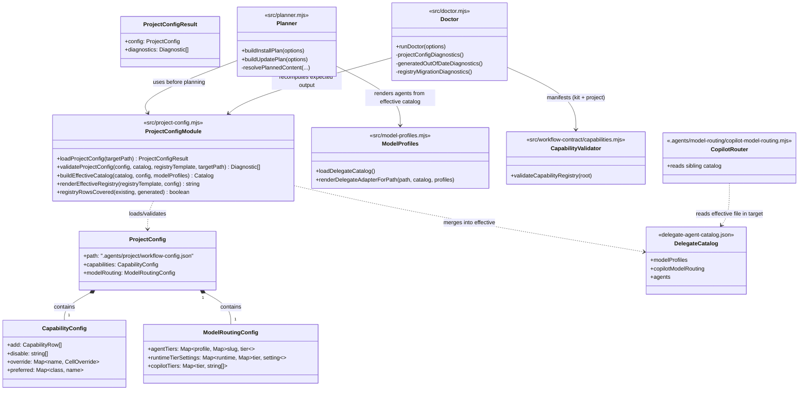
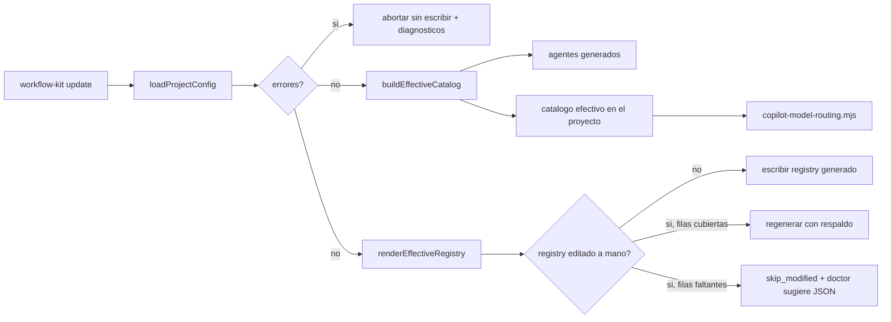

# PRD: Configuración del workflow por proyecto (capabilities y modelos)

**Ticket**: Análisis del 2026-11-14 — una actualización del workflow eliminó una capability que el usuario había agregado a `.agents/capabilities/registry.md`
**Autor**: xampo848 + Claude (create-prd)
**Fecha**: 2026-11-14
**Estado**: En revision

---

## 1. Contexto y Objetivo

Hoy un proyecto no tiene un lugar propio donde personalizar el workflow. Para agregar una herramienta, el contrato de integraciones le pide al agente editar `.agents/capabilities/registry.md`, pero el instalador trata ese archivo como del kit y puede reemplazarlo al actualizar. Así se pierden configuraciones locales. Los tiers de los agentes (`agentTiers`) ni siquiera se pueden configurar: los agentes se generan desde el catálogo del paquete del kit, no desde el del proyecto. Este PRD crea un archivo de configuración propiedad del proyecto (`.agents/project/workflow-config.json`), hace que el kit genere el registry de capabilities y el catálogo de modelos juntando su base con esa configuración, y deja escrita la regla "nunca personalizar editando archivos del kit".

> **Alcance estricto**: entra el archivo de configuración (capabilities y modelos), la generación del registry de capabilities y del catálogo efectivo, la validación, los diagnósticos de `doctor`, la migración mínima de registries editados a mano y la regla de propiedad escrita en contratos y encabezados. **No entra**: los tres caminos del instalador que pisan ediciones locales en otros archivos (instalar sobre un repo instalado, sobrescritura todo-o-nada, baseline de `adopt-existing`), un comando nuevo, la configuración de skills o del router, ni soporte para volver a una versión anterior del kit.

**Sketch heredado**: `sketch: skipped` (no ofrecido: los anclajes locales cubren todas las clases)
**UI lock**: not-applicable
**Visible UI**: No

### Estado Actual

| Capa | Componente | Archivo |
| --- | --- | --- |
| Instalador | `skillCatalogPreservePaths`, `resolvePlannedContent`, `buildInstallPlan`, `buildUpdatePlan` | `src/planner.mjs` (L16, L126, L229, L602) |
| Generación de agentes | `loadDelegateCatalog` (lee **solo** el paquete del kit), `agentTierFor`, `render{Claude,Codex,Copilot}Agent`, `renderDelegateAdapterForPath` | `src/model-profiles.mjs` (L31–181) |
| Diagnóstico | `runDoctor`, `modelProfileDiagnostics`, `managedDriftDiagnostics`, `localCatalogDiagnostics` | `src/doctor.mjs` |
| Validación de manifests | `validateCapabilityRegistry` (solo `.agents/capabilities/manifests/`) | `src/workflow-contract/capabilities.mjs` |
| Espejo canónico ↔ overlay | `mirroredFiles` incluye `.agents/capabilities/registry.md`; `mirroredDirectories` incluye `.agents/project` | `src/workflow-contract/drift.mjs` |
| Router de Copilot en el proyecto | Lee el `delegate-agent-catalog.json` **del proyecto** en tiempo de ejecución | `.agents/model-routing/copilot-model-routing.mjs` (L6–23) |
| Catálogo de modelos | `modelProfiles.profiles.{calidad,costo}.agentTiers`, `runtimeTierSettings`, `copilotModelRouting.{tiers,agentTiers}` | `.agents/model-routing/delegate-agent-catalog.json` |
| Registry de capabilities | Dos tablas: "Capability inventory" (preferida por tipo) e "Implementation capability inventory" | `.agents/capabilities/registry.md` |
| Contratos | Contrato de integraciones: "updating neutral taxonomy or integration registry docs under `.agents/`" | `.agents/integrations/README.md` (L106) |
| Archivos del proyecto | `paths.json`, `project-context.md`, `quality-gate.md`, `backend.md`, `frontend.md`; el kit los escribe solo si faltan | `.agents/project/**` |

### Estado actual del contrato

- La elección de perfil (`calidad`/`costo`) es lo único configurable por proyecto, y se guarda en `.agents/workflow-kit/install-state.json`.
- Copilot ya tiene dos fuentes de verdad: el frontmatter de los agentes sale del catálogo del kit, y `copilot-model-routing.mjs` lee el catálogo del proyecto. Además, `copilotModelRouting.agentTiers` siempre trae los tiers de `costo`, aunque el proyecto use `calidad`.
- Cuando un archivo administrado se edita a mano, el instalador lo protege (`skip_modified`) pero deja de actualizarlo. `doctor` solo avisa `managed/content-drift`.

---

## 2. Requerimientos Funcionales

### 2.1 Archivo de configuración del proyecto

Archivo: `.agents/project/workflow-config.json`. Es propiedad del proyecto: el kit lo crea solo si falta (se agrega a `skillCatalogPreservePaths`) y queda registrado en `.agents/project/paths.json` con el nombre lógico `workflow-config`.

Contenido inicial (plantilla del kit, idéntica en el repo canónico y en el overlay):

```json
{
  "description": "Project-owned workflow configuration. workflow-kit never rewrites this file. Edit it and run `workflow-kit update` to regenerate .agents/capabilities/registry.md, .agents/model-routing/delegate-agent-catalog.json and the delegate agents.",
  "capabilities": { "add": [], "disable": [], "override": {}, "preferred": {} },
  "modelRouting": { "agentTiers": {}, "runtimeTierSettings": {}, "copilotTiers": {} }
}
```

| Clave | Tipo | Significado | Validación |
| --- | --- | --- | --- |
| `capabilities.add[]` | objeto `{name, class, manifest, status, posture, fallback}` | Capability propia; agrega una fila a "Implementation capability inventory" | `name` sin espacios ni backticks; `manifest` debe existir bajo `.agents/project/capabilities/` y cumplir el contrato de manifests → si no, **error** |
| `capabilities.disable[]` | string | Saca la fila de una capability del kit en ambas tablas | Un nombre que el kit no trae → **advertencia**, se ignora |
| `capabilities.override.<name>` | objeto `{posture?, fallback?, status?}` | Reemplaza esas celdas en la fila de una capability (del kit o propia) | Un nombre inexistente → **advertencia**; una clave fuera de esas tres → **error** |
| `capabilities.preferred.<class>` | string | Cambia la capability preferida para esa clase en "Capability inventory" | Una capability desactivada o inexistente → **error**; una clase que no está en la tabla de la plantilla → **error** |
| `modelRouting.agentTiers.<profile>.<slug>` | `Liviano`\|`Mediano`\|`Grande` | Cambia el tier de un agente en ese perfil | Perfil inexistente → **error**; tier inexistente o fuera de `allowedTiers` del perfil → **error**; agente que el kit no trae → **advertencia**, se ignora; `Grande` en `costo` → **advertencia** |
| `modelRouting.runtimeTierSettings.claude.<tier>` | string no vacío | Modelo de Claude Code para ese tier (alias o ID) | Vacío o tier inexistente → **error** |
| `modelRouting.runtimeTierSettings.codex.<tier>` | objeto `{model_reasoning_effort?, model?}` | Ajuste de Codex para ese tier | `model_reasoning_effort` fuera de `low\|medium\|high\|xhigh` → **error** |
| `modelRouting.copilotTiers.<tier>` | string[] | Reemplaza la lista de candidatos de Copilot de ese tier | Lista vacía o tier inexistente → **error** |
| Cualquier otra clave | — | — | Clave estructural desconocida → **error** (atrapa errores de tipeo como `agentTier`) |

### 2.2 Regla de negocio: catálogo efectivo y archivos generados

> **Decisión confirmada**: el kit calcula un catálogo efectivo = catálogo del paquete + `modelRouting` del proyecto, y un registry efectivo = registry de la plantilla + `capabilities` del proyecto. `init` y `update` escriben en el proyecto tres tipos de archivos generados a partir de ellos: `.agents/model-routing/delegate-agent-catalog.json`, `.agents/capabilities/registry.md` y los agentes delegados (`.claude/agents/*.md`, `.codex/agents/*.toml`, `.github/agents/*.agent.md`). En el catálogo efectivo, `copilotModelRouting.agentTiers` es igual a los `agentTiers` efectivos del perfil de Copilot del proyecto.

**Condición de aplicación**: cada `init`/`update`, y cada vez que `doctor` recalcula lo esperado.
**Orden de aplicación en el registry**: `disable` → `override` → `add` → `preferred`. Las filas se identifican por el nombre entre backticks de la primera celda (tabla de implementación) o de la celda "Preferred capability" (tabla de preferidas).
**Interacción `disable` / `preferred`**: si se desactiva la capability preferida de una clase, la fila de esa clase sale de "Capability inventory", salvo que `preferred` nombre un reemplazo para esa clase. En ese caso la fila se conserva con el reemplazo, y `Manifest`, `Status`, `Runtime posture` y `Fallback` se copian de la fila del reemplazo en la tabla de implementación.
**Afectados**: las celdas `Status`, `Runtime posture` y `Fallback` de las filas existentes; las filas nuevas; la fila preferida de cada clase.
**No afectados**: el texto fuera de las tablas, salvo el encabezado generado, y las filas que la configuración no nombra.
**Sin configuración**: la salida es idéntica en bytes a la plantilla del kit. La única excepción es `copilotModelRouting.agentTiers` cuando el perfil de Copilot es `calidad`.
**Fallo**: un **error** de validación detiene `init`/`update` antes de escribir cualquier archivo, con salida distinta de cero y los diagnósticos (`project-config/*`, archivo y clave). Las **advertencias** se muestran y no detienen el proceso.

### 2.3 Regla de negocio: migración de un registry editado a mano

> **Decisión confirmada**: si `.agents/capabilities/registry.md` tiene ediciones locales (su checksum difiere del de `install-state`), `update` lo protege (`skip_modified`) como hoy, **excepto** cuando todas las filas de las tablas del archivo existente aparecen idénticas en el registry efectivo. En ese caso nada de las tablas se pierde y `update` lo regenera con respaldo, sin la opción global de sobrescribir.

`doctor` emite la advertencia `capabilities/local-rows-not-in-config` con cada fila que no está en el registry efectivo y el bloque JSON (`add`, `override` o `disable`) que la representa. Las ediciones de prosa fuera de las tablas no se migran; quedan en el respaldo y el mensaje de `doctor` lo dice.

### 2.4 Regla de negocio: manifests propios

Los manifests del proyecto viven en `.agents/project/capabilities/<name>.md` y cumplen el mismo contrato que los del kit (campos de identidad, attach points válidos, `## Activation rules`). `validateCapabilityRegistry` los revisa. Si un manifest del proyecto tiene el mismo `name` que uno del kit, gana el del proyecto y `doctor` advierte `capabilities/manifest-shadowed`, sin error de nombre duplicado.

### 2.5 Regla de negocio: la regla de propiedad queda escrita

- `.agents/instructions.md` suma la sección "Kit-owned vs project-owned files": una tabla que dice qué archivos se reemplazan al actualizar y cuáles son del proyecto, y la regla "nunca personalizar editando un archivo del kit; usar `.agents/project/workflow-config.json`".
- `.agents/integrations/README.md`: en el contrato de conexión, "conectar" significa escribir en `workflow-config.json` (y agregar el manifest en `.agents/project/capabilities/`), no editar el registry.
- `.agents/capabilities/registry.md` lleva el encabezado `<!-- Generated by workflow-kit from the kit base and .agents/project/workflow-config.json. Do not edit; customize in that file and run workflow-kit update. -->`, y su sección "Add or replace a capability" apunta a la configuración.
- `.agents/capabilities/README.md`: la fila "Repo overlay" dice dónde se declara la adopción local.
- `.agents/model-routing/README.md`: la sección de perfiles documenta los cambios de tier y de modelo en la configuración.
- `renderProfileLine` (agentes generados) menciona `workflow-config.json` además de `--profile`.
- El catálogo efectivo lleva la clave `"generatedNote"` con el mismo aviso, porque un JSON no admite comentarios.
- No se crea una skill nueva.

### 2.6 Criterios de Aceptacion

| ID | Given | When | Then | Evidence expected |
| --- | --- | --- | --- | --- |
| AC-1 | Proyecto sin `workflow-config.json` | `init` o `update` | Se crea con la plantilla de §2.1; en un segundo `update` con el archivo editado, queda intacto (`skip_unmanaged`, fuera de install-state) | test planner |
| AC-2 | Sin configuración (perfiles por defecto) | `init`/`update` | `registry.md`, el catálogo efectivo y los agentes son idénticos en bytes a la plantilla de hoy | test planner + `npm run check:workflow` |
| AC-3 | `agentTiers.calidad.qa-relampago = "Mediano"`, Claude en `calidad` | `update` | `.claude/agents/qa-relampago.md` queda con `model: sonnet` y la línea de perfil dice `tier: Mediano` | test planner/model-profiles |
| AC-4 | `runtimeTierSettings.claude.Grande = "claude-opus-5-5"` y `codex.Grande.model_reasoning_effort = "high"` | `update` | Los agentes Grande de Claude tienen `model: claude-opus-5-5` y los de Codex `model_reasoning_effort = "high"` | test model-profiles |
| AC-5 | `copilotTiers.Mediano` reemplazado y Copilot en `calidad` | `update` | El frontmatter Copilot de los agentes Mediano lista los nuevos candidatos; el catálogo efectivo tiene esos `tiers.Mediano` y `copilotModelRouting.agentTiers` = tiers efectivos de `calidad`; `copilot-model-routing.mjs` resuelve el tier desde ese archivo | test project-config + router |
| AC-6 | JSON inválido, tier fuera de `allowedTiers`, tier inexistente, candidatos vacíos, clave desconocida, manifest faltante o preferida desactivada | `update`/`init` | Salida distinta de cero, ningún archivo escrito, diagnóstico `project-config/<code>` con archivo y clave | test planner + cli |
| AC-7 | Tier para un agente que el kit no trae, o `Grande` en `costo` | `update`/`doctor` | Advertencia visible; el cambio para el agente desconocido se ignora; `update` aplica el resto | test project-config + doctor |
| AC-8 | `capabilities.add` con `playwright` y su manifest válido en `.agents/project/capabilities/` | `update` | `registry.md` tiene la fila `playwright`; `validateCapabilityRegistry` acepta el manifest; sin manifest → error AC-6 | test planner + workflow-contract |
| AC-9 | `disable: ["impeccable"]`, `override.caveman.fallback`, `preferred` de una clase | `update` | La fila `impeccable` no aparece en ninguna tabla; la celda de respaldo de `caveman` cambia; la fila preferida de la clase nombra la nueva capability; desactivar una inexistente → advertencia | test project-config |
| AC-10 | Proyecto con configuración y una versión nueva del kit que agrega una capability | `update` | El registry generado tiene la fila nueva del kit **y** todas las de la configuración | test planner (plantilla simulada) |
| AC-11 | Configuración editada sin correr `update` (archivos generados sin ediciones a mano) | `doctor` | Error `project-config/generated-out-of-date` por cada archivo generado distinto de lo esperado, con "run workflow-kit update" | test doctor |
| AC-12 | `registry.md` editado a mano con una fila local | `doctor`, y luego `update` | `doctor` advierte `capabilities/local-rows-not-in-config` con la fila y el JSON; `update` lo deja (`skip_modified`); al agregar la fila a la configuración, `update` lo regenera con respaldo sin `--overwrite-modified` | test planner + doctor |
| AC-13 | Manifest del proyecto con el mismo `name` que uno del kit | `doctor`/validación | Se usa el del proyecto, advertencia `capabilities/manifest-shadowed` y ningún error de duplicado | test workflow-contract |
| AC-14 | Contratos y encabezados actualizados (§2.5) | `npm test`, búsquedas de obsolescencia | `instructions.md` tiene la sección de propiedad; el contrato de integraciones y el registry apuntan a la configuración; las búsquedas de §2.9 dan cero | test docs + grep |

### 2.7 Casos de Uso

| ID | Actor | Precondiciones | Flujo principal | Resultado observable (falsable) | AC vinculado |
| --- | --- | --- | --- | --- | --- |
| UC-1 | Mantenedor del proyecto | Workflow instalado, Claude en `calidad` | Edita `agentTiers.calidad`, corre `workflow-kit update` | El agente cambia de modelo; el mismo `update` repetido no cambia nada | AC-3, AC-1 |
| UC-2 | Mantenedor del proyecto | Workflow instalado con Claude, Codex y Copilot | Cambia modelos por tier y candidatos de Copilot, corre `update` | Agentes y catálogo efectivo reflejan los cambios; el router de Copilot y el frontmatter usan la misma lista | AC-4, AC-5 |
| UC-3 | Mantenedor o agente IA | Capability externa instalada en su entorno | Crea el manifest en `.agents/project/capabilities/`, la agrega en `capabilities.add`, corre `update` | La fila aparece en el registry y el manifest pasa la validación | AC-8 |
| UC-4 | Mantenedor del proyecto | Workflow instalado | Desactiva, ajusta o cambia la preferida de una capability del kit, corre `update` | El registry generado refleja cada operación | AC-9 |
| UC-5 | Mantenedor del proyecto | Proyecto con configuración, versión nueva del kit | Corre `update` | Llegan las novedades del kit y no se pierde nada de la configuración | AC-10, AC-2 |
| UC-6 | Agente IA en el proyecto | Usuario pide "conecta X" | Sigue el contrato de integraciones | El diff toca `workflow-config.json` (y un manifest del proyecto), nunca `capabilities/registry.md` a mano | AC-14 |
| UC-7 | Mantenedor de un proyecto existente | `registry.md` editado a mano antes de este cambio | Corre `doctor`, copia el JSON sugerido, corre `update` | El registry pasa a ser generado y contiene sus filas; queda un respaldo | AC-12 |
| UC-8 | Mantenedor del proyecto | Configuración con un error o sin aplicar | Corre `update` o `doctor` | `update` se detiene sin escribir; `doctor` nombra el problema | AC-6, AC-7, AC-11 |
| UC-9 | Usuario nuevo o proyecto sin configuración | — | `init` / `update` | Resultado idéntico al actual más el archivo de configuración vacío | AC-1, AC-2 |
| UC-10 | Mantenedor con manifest propio homónimo de uno del kit | Kit publica un manifest con ese nombre | `update` y `doctor` | Gana el manifest del proyecto, con advertencia | AC-13 |

### 2.8 Estrategia de Tests

| Nivel | Objetivo | Caso de uso vinculado | Cobertura esperada | Comando o mecanismo de validacion |
| --- | --- | --- | --- | --- |
| Unidad | Carga, validación (errores y advertencias) y merge del catálogo efectivo | UC-1, UC-2, UC-8 | Cada código `project-config/*`; merge de los tres bloques de `modelRouting`; `copilotModelRouting.agentTiers` según perfil | `node --test test/project-config.test.mjs` |
| Unidad | Render del registry efectivo (`disable`, `override`, `add`, `preferred`, orden, sin config = plantilla) | UC-3, UC-4, UC-5, UC-9 | Ambas tablas; fila del kit nueva con config existente | `node --test test/project-config.test.mjs` |
| Integración | Planner: creación y preservación del config, archivos generados, aborto sin escritura, regla de migración | UC-1, UC-5, UC-7, UC-8, UC-9 | install y update en repo temporal | `node --test test/planner.test.mjs` |
| Integración | Agentes generados desde el catálogo efectivo | UC-1, UC-2 | Claude, Codex, Copilot | `node --test test/model-profiles.test.mjs` |
| Integración | Router de Copilot instalado lee el catálogo efectivo | UC-2 | Tier resuelto para un agente con override | `node --test test/project-config.test.mjs` (ejecuta el script del overlay contra un repo temporal) |
| Integración | Doctor: desfase, migración, advertencias y manifest sombreado | UC-7, UC-8, UC-10 | Cada código nuevo de diagnóstico | `node --test test/doctor.test.mjs` |
| Contrato | Manifests del proyecto con el mismo contrato | UC-3, UC-10 | Válido, malformado, sombreado | `node --test test/workflow-contract.test.mjs` |
| Contrato | Texto de la regla de propiedad y espejo canónico ↔ overlay | UC-6 | Secciones y encabezados presentes; sin drift | `node --test test/docs.test.mjs` y `npm run check:workflow` |
| Smoke | Instalación real en un repo temporal con configuración | UC-5 | `init` → editar config → `update` → `doctor` en verde | `node --test test/upgrade-e2e.test.mjs` (caso nuevo) |

### 2.9 Matriz de Edge Cases

| Categoria | Descripcion | Caso de uso vinculado | Validacion | Estado |
| --- | --- | --- | --- | --- |
| Datos vacios | No existe `workflow-config.json` → se usa la base del kit y se crea el archivo vacío | UC-9 | test planner (AC-1, AC-2) | Pending |
| Datos vacios | Configuración con secciones vacías → salida idéntica a la plantilla | UC-9 | test project-config | Pending |
| Limites | Tier inexistente, fuera de `allowedTiers`, candidatos vacíos, clave desconocida → error | UC-8 | test project-config (AC-6) | Pending |
| Limites | `add` sin manifest; `preferred` desactivada → error. `disable` de una capability inexistente → advertencia | UC-3, UC-4 | test project-config (AC-8, AC-9) | Pending |
| Errores | JSON inválido → `update`/`init` se detienen sin escribir, con salida distinta de cero | UC-8 | test planner + cli (AC-6) | Pending |
| Permisos/tenancy | No aplica: es un archivo local del repo que se comparte por git; no hay usuarios ni tenants | — | — | No aplica |
| Concurrencia/orden | Configuración editada sin `update` → error de desfase en `doctor` | UC-8 | test doctor (AC-11) | Pending |
| Concurrencia/orden | El kit elimina un agente con override → advertencia, se ignora | UC-8 | test project-config (AC-7) | Pending |
| Concurrencia/orden | El kit agrega una capability → aparece sin tocar la configuración | UC-5 | test planner (AC-10) | Pending |
| Concurrencia/orden | Cambio de perfil con `--profile` → aplica los overrides de ese perfil | UC-1 | test planner | Pending |
| Concurrencia/orden | Registry generado editado a mano → `skip_modified` + advertencia de migración | UC-7 | test planner + doctor (AC-12) | Pending |
| Rollout/rollback | Proyecto existente con registry editado → migración guiada; regeneración con respaldo cuando las filas están cubiertas | UC-7 | test planner (AC-12) | Pending |
| Rollout/rollback | Borrar la configuración → el siguiente `update` regenera la base del kit | UC-9 | test planner | Pending |
| Rollout/rollback | Volver a una versión anterior del kit → ignora la configuración (limitación documentada, sin código) | UC-5 | nota en `.agents/model-routing/README.md` y README | Pending |

### 2.10 Contrato Visual (UI lock)

**UI lock**: not-applicable — no cambia ninguna pantalla. La salida de terminal de `update` y `doctor` solo suma líneas de diagnóstico.

### 2.11 Supuestos e integraciones

| Supuesto | Fuente | Estado | Evidencia | Que pasa si es falso |
| --- | --- | --- | --- | --- |
| `copilot-model-routing.mjs` lee el catálogo vecino del proyecto | Código | verificado | `.agents/model-routing/copilot-model-routing.mjs` L6–23 | — |
| Claude Code acepta alias e IDs completos en el `model` de los agentes | Documentación Claude Code; catálogo actual usa alias | verificado | `delegate-agent-catalog.json` `runtimeTierSettings.claude` | AC-4 cambiaría a "solo alias" |
| Codex acepta `model` y `model_reasoning_effort` en el TOML de agentes | `codexNote` del catálogo (verificado 2026-11-10) | verificado | `delegate-agent-catalog.json` | AC-4 Codex se limita a `model_reasoning_effort` |
| El formato de las dos tablas del registry lo controla el kit y es estable | Código y plantilla | verificado | `.agents/capabilities/registry.md` | Los tests de render fallan al cambiar el formato; se reevalúa pasar a una base JSON |
| Cuántos proyectos tienen el registry editado a mano | Usuario | asumido (desconocido, al menos uno) | Conversación 2026-11-14 | Solo cambia cuántas veces se ejecuta la migración guiada; no cambia el diseño |

### 2.12 Que queda obsoleto

| Elemento | Tipo | Ubicacion | Reemplazado por | Accion | Consumidores | Slice | Busqueda de verificacion |
| --- | --- | --- | --- | --- | --- | --- | --- |
| "updating neutral taxonomy or integration registry docs under `.agents/`" | documentacion | `.agents/integrations/README.md` (+ overlay) | Escribir `workflow-config.json` + manifest del proyecto | adaptar | Agentes en proyectos | P3-S1 | `grep -rn "registry docs under" .agents templates` → 0 |
| Pasos 1–2 de "Add or replace a capability" (editar filas del registry) | documentacion | `.agents/capabilities/registry.md` (+ overlay) | Pasos con `workflow-config.json` | adaptar | Agentes y personas | P2-S2 | `grep -rn "Update the preferred capability row" .agents templates` → 0 |
| Agentes generados desde `loadDelegateCatalog()` sin la configuración del proyecto | codigo | `src/planner.mjs`, `src/doctor.mjs` | Catálogo efectivo (`loadEffectiveCatalog`) | adaptar | En el repo | P1-S2, P1-S3 | `grep -n "loadDelegateCatalog()" src/planner.mjs src/doctor.mjs` → 0 |
| `copilotModelRouting.agentTiers` fijo en los tiers de `costo` dentro del proyecto | configuracion | catálogo instalado en el proyecto | Tiers efectivos del perfil de Copilot | adaptar | Router de Copilot | P1-S2 | test AC-5 |
| "do not edit this file" sin indicar dónde personalizar | documentacion | `renderProfileLine` en `src/model-profiles.mjs` | Texto que nombra `workflow-config.json` | adaptar | Agentes generados | P3-S1 | `npm run check:workflow` (adapters regenerados) |

---

## 3. Modelo de Datos

### 3.1 Migracion Requerida

No hay base de datos. El estado persistido cambia así:

- Nuevo archivo del proyecto `.agents/project/workflow-config.json`, fuera de `install-state.files` (igual que el resto de `.agents/project/**`).
- `install-state.files` sigue registrando el checksum de lo **generado** para `registry.md`, el catálogo y los agentes. Al cambiar la configuración cambia lo generado, y el mecanismo actual de checksums decide si sobrescribir o proteger.
- No cambia `installStateSchemaVersion`.

### 3.2 Diagrama de Clases



### 3.3 Diagrama de Flujo



---

## 4. Plan de Implementacion por Fases

### Fase 1 - Configuración del proyecto y catálogo efectivo de modelos

**Objetivo**: un proyecto puede cambiar tiers, modelos por tier y candidatos de Copilot en un archivo propio, y `update` y `doctor` lo respetan.

**Slices ejecutables**:

| ID | Outcome | Depends on | Scope / likely files | Out of scope | Acceptance criteria | Use cases | Tests | Edge cases | Validation | Evidence | Stop conditions | Activation |
| --- | --- | --- | --- | --- | --- | --- | --- | --- | --- | --- | --- | --- |
| P1-S1 | Existe el archivo de configuración y se carga y valida `modelRouting` | none | `src/project-config.mjs` (load + validate de `modelRouting` y claves), plantilla `.agents/project/workflow-config.json` (canónica + overlay), `paths.json` (canónico + overlay), `skillCatalogPreservePaths` | Merge, generación, capabilities | AC-1, AC-6 (parte modelRouting), AC-7 | UC-8, UC-9 | `test/project-config.test.mjs` validación; `test/planner.test.mjs` creación/preservación | Datos vacíos, Límites, Errores | `node --test test/project-config.test.mjs test/planner.test.mjs` | Tests en verde | La plantilla rompe el drift de `.agents/project` → corregir el espejo antes de seguir | Ninguna |
| P1-S2 | Agentes y catálogo del proyecto salen del catálogo efectivo; un error de configuración detiene `init`/`update` sin escribir | P1-S1 | `buildEffectiveCatalog` en `src/project-config.mjs`; `src/planner.mjs` (cargar config, abortar, resolver `.agents/model-routing/delegate-agent-catalog.json` como generado, pasar catálogo efectivo a `renderDelegateAdapterForPath`); `"generatedNote"` en el catálogo (canónico + overlay) | Doctor, registry | AC-2, AC-3, AC-4, AC-5, AC-6 | UC-1, UC-2, UC-5 | `test/project-config.test.mjs` merge + router; `test/model-profiles.test.mjs`; `test/planner.test.mjs` aborto | Errores, Concurrencia/orden (cambio de perfil, agente eliminado) | `node --test test/project-config.test.mjs test/model-profiles.test.mjs test/planner.test.mjs && npm run check:workflow` | Tests + check en verde; sin configuración, salida idéntica | `check:workflow` cambia adapters del repo canónico sin configuración → detener: viola AC-2 | `update` en proyectos regenera el catálogo; sin configuración no hay cambio |
| P1-S3 | `doctor` usa el catálogo efectivo e informa errores, advertencias y desfase | P1-S2 | `src/doctor.mjs` (`modelProfileDiagnostics` con catálogo efectivo, `projectConfigDiagnostics`, `generatedOutOfDateDiagnostics` para catálogo y agentes) | Registry, migración | AC-7, AC-11 (catálogo y agentes) | UC-8 | `test/doctor.test.mjs` | Concurrencia/orden (config sin update) | `node --test test/doctor.test.mjs` | Tests en verde | Desfase y edición a mano indistinguibles → usar checksum de install-state como en §2.3 | Ninguna |

**Definition of Done**:

- Los tres slices están `VERIFIED`.
- `npm test` y `npm run check:workflow` en verde.
- Sin configuración, el repo canónico y una instalación nueva producen los mismos archivos que hoy.

---

### Fase 2 - Capabilities configurables

**Objetivo**: un proyecto agrega, desactiva, ajusta y elige capabilities desde la configuración, y los registries editados a mano tienen un camino de migración.

| ID | Outcome | Depends on | Scope / likely files | Out of scope | Acceptance criteria | Use cases | Tests | Edge cases | Validation | Evidence | Stop conditions | Activation |
| --- | --- | --- | --- | --- | --- | --- | --- | --- | --- | --- | --- | --- |
| P2-S1 | Los manifests en `.agents/project/capabilities/` se validan con el mismo contrato y el homónimo gana con advertencia | P1-S3 | `src/workflow-contract/capabilities.mjs`, `src/doctor.mjs` (advertencia `manifest-shadowed`) | Registry | AC-8 (manifest), AC-13 | UC-3, UC-10 | `test/workflow-contract.test.mjs`, `test/doctor.test.mjs` | Límites | `node --test test/workflow-contract.test.mjs test/doctor.test.mjs` | Tests en verde | — | Ninguna |
| P2-S2 | `registry.md` se genera desde la plantilla + `capabilities`; el desfase se reporta | P2-S1 | `renderEffectiveRegistry` y validación de `capabilities` en `src/project-config.mjs`; `src/planner.mjs` (resolver `registry.md` como generado); `src/doctor.mjs` (desfase del registry); encabezado y sección "Add or replace" en `.agents/capabilities/registry.md` (canónico + overlay) | Migración | AC-2 (registry), AC-6 (parte capabilities), AC-8, AC-9, AC-10, AC-11 (registry) | UC-3, UC-4, UC-5 | `test/project-config.test.mjs` render; `test/planner.test.mjs` | Datos vacíos, Límites, Concurrencia/orden (capability nueva del kit) | `node --test test/project-config.test.mjs test/planner.test.mjs test/doctor.test.mjs && npm run check:workflow` | Tests + check en verde | El render no logra salida idéntica sin configuración → detener y revisar el parseo de tablas | Proyectos sin ediciones reciben el registry generado en el siguiente `update` |
| P2-S3 | Un registry editado a mano tiene migración guiada y se regenera con respaldo cuando está cubierto | P2-S2 | `registryRowsCovered` en `src/project-config.mjs`; regla en `buildUpdatePlan` (`src/planner.mjs`); `registryMigrationDiagnostics` en `src/doctor.mjs` | Otros archivos administrados (punto 1, fuera de alcance) | AC-12 | UC-7 | `test/planner.test.mjs`, `test/doctor.test.mjs`, caso en `test/upgrade-e2e.test.mjs` | Concurrencia/orden (edición a mano), Rollout/rollback | `node --test test/planner.test.mjs test/doctor.test.mjs test/upgrade-e2e.test.mjs` | Tests en verde; respaldo creado | La regla regenera con filas faltantes → detener: pérdida de datos | Los proyectos existentes migran al correr `doctor` + `update` |

**Definition of Done**: los tres slices están `VERIFIED`; `npm test` y `npm run check:workflow` en verde.

---

### Fase 3 - Regla de propiedad escrita

**Objetivo**: agentes y personas encuentran la regla donde editan.

| ID | Outcome | Depends on | Scope / likely files | Out of scope | Acceptance criteria | Use cases | Tests | Edge cases | Validation | Evidence | Stop conditions | Activation |
| --- | --- | --- | --- | --- | --- | --- | --- | --- | --- | --- | --- | --- |
| P3-S1 | La regla y los nuevos caminos de personalización están en contratos, encabezados y docs | P2-S3 | `.agents/instructions.md`, `.agents/integrations/README.md`, `.agents/capabilities/README.md`, `.agents/model-routing/README.md` (incluye la limitación de downgrade), `renderProfileLine` en `src/model-profiles.mjs` + adapters regenerados, `README.md` (sección corta), espejos del overlay | Skill nueva | AC-14 | UC-6 | `test/docs.test.mjs` (aserciones de las secciones) | Rollout/rollback (nota de downgrade) | `node --test test/docs.test.mjs && npm run check:workflow && npm run check:docs` + búsquedas de §2.12 | Tests + checks en verde; búsquedas en cero | Una frase cambia el contrato de otra skill → detener y revisar con el usuario | Ninguna |

Atomicidad de la Fase 3: un solo slice, porque todo es texto de contratos sin lógica y se valida con el mismo comando.

**Definition of Done**: el slice está `VERIFIED`; `npm test`, `npm run check:workflow` y `npm run check:docs` en verde.

---

### Fase Futura - _(fuera de alcance de este PRD)_

> Será abordada en un PRD separado.

- Cerrar los tres caminos del instalador que pisan ediciones locales en otros archivos administrados: instalar sobre un repo instalado, sobrescritura todo-o-nada en el TUI y baseline de `adopt-existing`.
- Configuración de skills o del router desde `workflow-config.json`.
- Pasar la base del registry de capabilities a JSON, si el formato de las tablas empieza a cambiar seguido.

---

## 5. Decisiones Tomadas

| # | Pregunta | Respuesta | Impacto en diseno |
| --- | --- | --- | --- |
| 1 | ¿Migración mínima de registries editados a mano? | Sí | P2-S3; regla §2.3 |
| 2 | ¿Dónde y en qué formato vive la configuración? | Un solo `.agents/project/workflow-config.json` | §2.1 |
| 3 | ¿Registry generado o preservado con aviso? | Generado (se descartó preservar + aviso porque obliga a copiar filas a mano y no permite desactivar) | §2.2; P2-S2 |
| 4 | ¿Qué operaciones sobre capabilities? | add, disable, override (posture/fallback/status) y preferred (derivada: la exige el caso borde "preferida desactivada") | §2.1 |
| 5 | ¿Dónde van los manifests propios? | `.agents/project/capabilities/`; ante choque de nombre gana el del proyecto, con advertencia | §2.4 |
| 6 | ¿Qué se puede cambiar de modelos? | agentTiers por perfil, modelo por tier por runtime, candidatos de Copilot | §2.1 |
| 7 | ¿Reglas de perfil? | Fuera de `allowedTiers` → error; Grande en `costo` → advertencia | §2.1 |
| 8 | ¿Cómo se aplica un cambio? | `workflow-kit update`; `doctor` detecta el desfase; sin comando nuevo | §2.2; P1-S3 |
| 9 | ¿Dónde queda escrita la regla? | instructions + integrations + encabezados + docs; sin skill nueva | §2.5; P3-S1 |
| 10 | ¿Archivo de configuración en instalaciones nuevas? | Sí, con secciones vacías | AC-1 |
| 11 | ¿JSON inválido? | `update`/`init` se detienen sin escribir | AC-6 |
| 12 | ¿Override de un agente que el kit eliminó? | Advertencia, se ignora (trade-off aceptado: un error de tipeo en un agente solo advierte) | AC-7 |
| 13 | ¿Regeneración automática al migrar? | Sí, cuando todas las filas están cubiertas, con respaldo | §2.3 |
| 14 | ¿`copilotModelRouting.agentTiers` en el catálogo efectivo? | Igual a los tiers efectivos del perfil de Copilot (derivada de 8: una sola fuente) | §2.2; AC-5 |
| 15 | ¿Clave estructural desconocida? | Error (derivada: el kit define el esquema y así se atrapan errores de tipeo) | §2.1 |

---

## 6. Preguntas Abiertas

- [x] Sin UI visible: `UI lock: not-applicable` con razón.

| # | Pregunta | Bloquea | Area |
| --- | --- | --- | --- |

_(Vacío = PRD listo para implementar)_

---

## 7. Riesgos y Mitigaciones

| Riesgo | Probabilidad | Impacto | Mitigacion |
| --- | --- | --- | --- |
| Cambiar el formato de las tablas del registry rompe el render por filas | Media | Medio | Tests de render sobre la plantilla real; si se vuelve frecuente, base JSON (Fase Futura) |
| Proyectos Copilot en `calidad` cambian de tiers en el router al actualizar | Baja | Medio | Es la corrección de la doble fuente; se anuncia en el resumen del release |
| Un `update` se detiene por un error de configuración en CI o en un script | Media | Bajo | Mensaje con archivo, clave y corrección; mismo comportamiento en `doctor` para detectarlo antes |
| La regla de migración regenera y pierde prosa local fuera de las tablas | Baja | Bajo | Respaldo obligatorio y aviso explícito en el mensaje de `doctor` |
| Los agentes siguen editando el registry a mano | Media | Medio | Encabezado generado + contrato de integraciones + advertencia de migración en `doctor` |
| Volver a una versión anterior del kit ignora la configuración | Baja | Bajo | Limitación documentada en `.agents/model-routing/README.md` y README |

---

## 8. Definition of Done Global

- [ ] Todas las fases completadas
- [ ] `npm test` en verde
- [ ] `npm run check:workflow`, `npm run check:docs` y `npm run check:templates` en verde
- [ ] Retrocompatibilidad: sin configuración, una instalación nueva y una actualización producen los mismos archivos que hoy (salvo el archivo de configuración vacío)
- [ ] Identificadores de código en inglés
- [ ] Espejo canónico ↔ overlay sin drift
- [ ] Todo AC tiene al menos un caso de uso vinculado y todo caso de uso tiene al menos un AC vinculado
- [ ] Todo caso de uso tiene al menos un test en la Estrategia de Tests
- [ ] La Matriz de Edge Cases cubre las seis categorías (o declara `No aplica` con justificación)
- [ ] Búsquedas de §2.12 en cero

---

## 9. Matriz de Trazabilidad

| Acceptance criterion | Caso de uso | Phase / slice | Test evidence | Edge case(s) | Validation evidence | Status |
| --- | --- | --- | --- | --- | --- | --- |
| AC-1 | UC-1, UC-9 | P1-S1 | test/planner.test.mjs | Datos vacíos | `node --test` | Pending |
| AC-2 | UC-5, UC-9 | P1-S2, P2-S2 | test/planner.test.mjs | Datos vacíos | `npm run check:workflow` | Pending |
| AC-3 | UC-1 | P1-S2 | test/model-profiles.test.mjs | Cambio de perfil | `node --test` | Pending |
| AC-4 | UC-2 | P1-S2 | test/model-profiles.test.mjs | — | `node --test` | Pending |
| AC-5 | UC-2 | P1-S2 | test/project-config.test.mjs | — | `node --test` | Pending |
| AC-6 | UC-8 | P1-S1, P1-S2, P2-S2 | test/project-config.test.mjs, test/planner.test.mjs | Límites, Errores | `node --test` | Pending |
| AC-7 | UC-8 | P1-S1, P1-S3 | test/project-config.test.mjs, test/doctor.test.mjs | Agente eliminado | `node --test` | Pending |
| AC-8 | UC-3 | P2-S1, P2-S2 | test/workflow-contract.test.mjs, test/planner.test.mjs | Límites | `node --test` | Pending |
| AC-9 | UC-4 | P2-S2 | test/project-config.test.mjs | Límites | `node --test` | Pending |
| AC-10 | UC-5 | P2-S2 | test/planner.test.mjs | Capability nueva del kit | `node --test` | Pending |
| AC-11 | UC-8 | P1-S3, P2-S2 | test/doctor.test.mjs | Config sin update | `node --test` | Pending |
| AC-12 | UC-7 | P2-S3 | test/planner.test.mjs, test/doctor.test.mjs, test/upgrade-e2e.test.mjs | Edición a mano, Rollout | `node --test` | Pending |
| AC-13 | UC-10 | P2-S1 | test/workflow-contract.test.mjs | Límites | `node --test` | Pending |
| AC-14 | UC-6 | P3-S1 | test/docs.test.mjs | Rollback (nota de downgrade) | `npm run check:docs` + grep | Pending |

---

## 10. Evidencia de Implementacion

**Estado**: No iniciada

| Campo | Evidencia durable |
| --- | --- |
| Cambios entregados | |
| Criterios de aceptacion | |
| Validaciones ejecutadas | |
| Calidad y QA | |
| Referencia de cambio | |
| Riesgos o waivers | |
| Checks reutilizados | |
| Iteraciones y causa | |
| Modo de ejecucion | |
| Fecha de cierre | |
