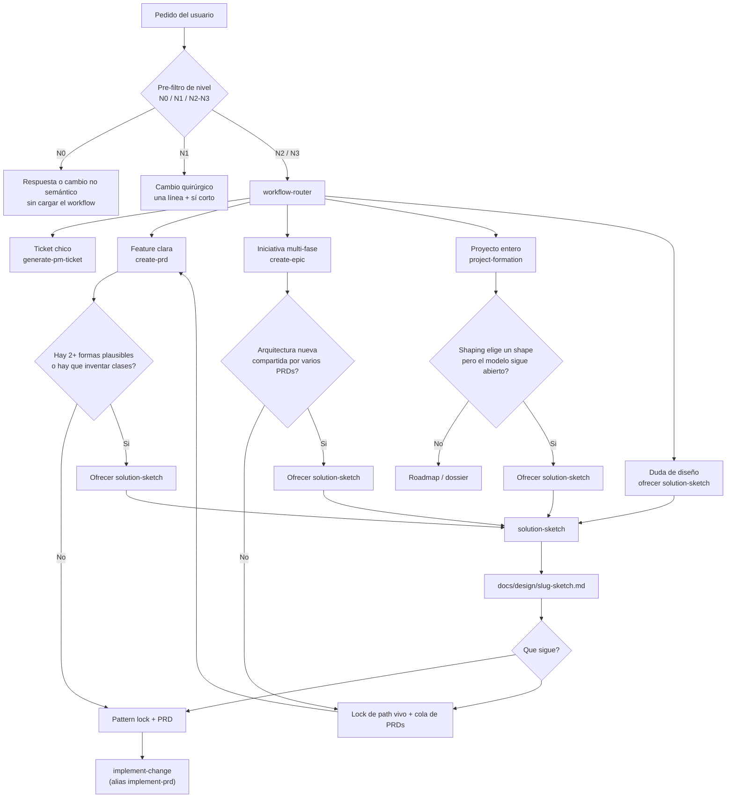

# Workflow Docs Map

This folder is reserved for documents that support the installed AI workflow.

## Structure

- `decisions/`: durable decisions about workflow rules, routing, and architecture.
- `runbooks/`: procedural documents for recurring operations.
- `handoffs/`: implementation summaries and ownership transfers.
- `standards/`: backend/frontend standards and setup-migration guidance.
- `migration/`: one-time adoption artifacts for recovering and reordering legacy docs.

## Ordering rules

1. Keep one concern per document.
2. Prefer append-only history for decisions; supersede by adding a newer file.
3. Link each runbook to the commands/files it touches.
4. For handoffs, include scope, validation evidence, and next steps.

## Product skill flow

Optional `solution-sketch` sits beside ticket / PRD / epic / formation. It is offer-only. See [decisions/2026-08-24-solution-sketch-flow.md](decisions/2026-08-24-solution-sketch-flow.md).

Visible UI also needs a **Contrato Visual (UI lock)** inside `create-prd` / `generate-pm-ticket` before `implement-change` (alias `implement-prd`) starts. See [decisions/2026-08-24-ui-visual-contract.md](decisions/2026-08-24-ui-visual-contract.md).

## Implementation route

`implement-change` is the single implementation route. Two independent axes
decide the work:

| Axis | Values | Decides |
| --- | --- | --- |
| Level | N1 surgical, N2 standard, N3 high risk | ceremony: tracker, delegates, Discovery, QA, closure |
| Input type | PRD, bug, ticket, iteration | evidence: AC coverage, failing-first test, ticket AC, delta plus regression |

An **iteration** over an implemented PRD uses its `## 10. Evidencia de
Implementacion` as the map, checks freshness with `git diff <ref>..HEAD` on the
delivered files, runs the original feature's regression tests, and closes with
an "Iteración N" subsection. **Autonomous** execution is offered for N2/N3 and
chosen per run; supervised is the default. Former mode names map to levels:
`small/local` → N1, `controlled-*` → N2, `standard` → N3.

Execution brakes apply at every level and survive autonomous mode: at most 2
repair rounds per slice, one recovery attempt for an environment failure, one
rerun for a flaky test, and the full expensive suite once at closure. Temporary
AI state lives in `.ai-work/<prd-slug>/` (Git-ignored) and is removed at
closure; the PRD keeps only a compact section 10.

Expensive deterministic checks (typecheck, unit suites, build) may reuse a
previous result when a script-computed fingerprint proves nothing changed. It
starts in shadow mode, never applies to integration, E2E, critical slices, or
the closure suite, and QA re-entries are focused on the repair.

## Recommended first documents

- `decisions/2026-01-01-workflow-adoption-baseline.md`
- `decisions/2026-08-24-solution-sketch-flow.md`
- `runbooks/update-skill-registry.md`
- `runbooks/router-skill-enforcement-manual-checklist.md`
- `runbooks/runtime-native-readiness-checklist.md`
- `handoffs/template-installation.md`
- `standards/setup-and-migration.md`
- `standards/project-instructions-template.md`
